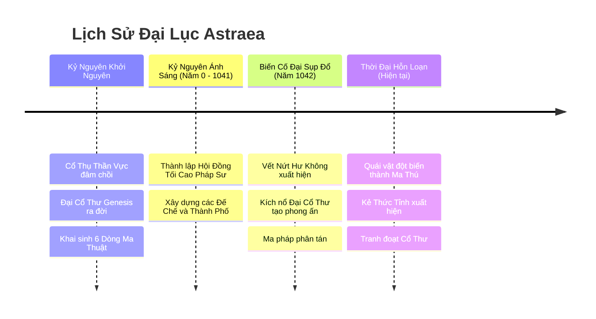
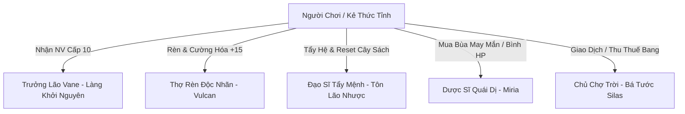

# TÀI LIỆU CỐT TRUYỆN & THẾ GIỚI QUAN (WORLD LORE)
**Dự án:** Astraea Online - Cổ Thư Hỗn Mang (The Shattered Grimoire)  
**Thể loại:** 2.5D Isometric MMORPG Web H5  
**Phong cách:** Thần thoại huyền huyễn phương Tây pha trộn chất Kiếm hiệp cày cuốc kinh điển (Vibe Võ Lâm / Diablo)  
**Phiên bản:** 1.0 - Chính thức  

---

## 1. BIÊN NIÊN SỬ ĐẠI LỤC ASTRAEA



### 1.1. Kỷ Nguyên Khởi Nguyên (The Genesis Era)
Thuở hồng hoang, đại lục **Astraea** chỉ là một cõi hư vô tĩnh mịch. Nguồn sống đầu tiên xuất hiện khi hạt giống thần thoại đâm chồi nảy lộc, tạo nên **Cổ Thụ Thần Vực (The Yggdrasil of Astraea)** khổng lồ cắm rễ sâu vào lòng địa mạch. 

Từ lõi của Cổ Thụ, kết tinh năng lượng thuần khiết nhất đã ngưng tụ thành một cuốn kinh thư duy nhất: **Đại Cổ Thư Khởi Nguyên (The Genesis Grimoire)**. Cuốn sách ghi chép trật tự vận hành của vạn vật thông qua 6 nguyên tố cội nguồn:
- **Hỏa (Ignis):** Sự nhiệt huyết, hủy diệt và tái sinh.
- **Băng (Glacies):** Sự tĩnh lặng, bảo tồn và vĩnh cửu.
- **Lôi (Fulgur):** Sự phán quyết, xung kích và biến đổi tức thời.
- **Độc (Venom):** Sự ăn mòn, mục rữa và chuyển hóa tuần hoàn.
- **Quang (Lux):** Sự che chở, thanh tẩy và chữa lành.
- **Ám (Umbra):** Chiều sâu tâm thức, ảo vọng và hư không kiềm hãm.

### 1.2. Biến Cố Đại Sụp Đổ (The Great Shattering - Năm 1042)
Năm 1042 Kỷ Nguyên Ánh Sáng, một dị tượng chưa từng có xảy ra: bầu trời phía Bắc đại lục rách toạc ra một vết rách đen ngòm sâu thẳm mang tên **Vết Nứt Hư Không (The Void Rift)**. Khí Hỗn Mang tràn ngập, những thực thể tà ác từ ngoài chiều không gian túa ra tàn sát cư dân.

Trước nguy cơ toàn bộ sự sống bị diệt vong, 7 Đại Trưởng Lão thuộc **Hội Đồng Pháp Sư Astraea** đã đưa ra quyết định liều mạng nhất lịch sử: **Hiến tế sinh mệnh để kích nổ Đại Cổ Thư Khởi Nguyên**, mượn vụ nổ năng lượng tối thượng tạo thành Đại Phong Ấn vĩnh cửu nhốt chặt Vết Nứt Hư Không.

Vụ nổ thành công ngăn chặn quân đoàn Hư Không, nhưng cái giá phải trả vô cùng đắt:
- Cổ Thụ Thần Vực nứt toác, nguồn mana thiên nhiên bị biến tính dữ dội.
- Đại Cổ Thư vỡ vụn thành **hàng triệu Tàn Trang Thần Bí (Grimoire Pages)** và các cuốn **Cổ Thư Biến Dị** bắn tung tóe khắp cùng trời cuối đất.

---

## 2. SINH VẬT MA HÓA & MA THÚ BẠO CHÚA (FIELD BOSSES)

Sau vụ nổ, dòng chảy mana rơi vào hỗn loạn cực độ:

### 2.1. Quái Thường & Thú Dữ Biến Dị
Những sinh vật hiền lành nhất như Ốc sên, Heo rừng, Nấm rừng... khi ăn phải hoặc hít phải bụi mana từ các Tàn Trang rải rác đã bị đột biến thể xác:
- Cơ bắp nở lớn, mọc gai xương sừng nhọn hoắt.
- Trở nên cực kỳ khát máu, tấn công bất cứ con người nào xuất hiện trong tầm mắt.
- Trong cơ thể chúng kết tụ lại thành các mảnh Tàn Trang rách vụn và Đá Cường Hóa sơ cấp.

### 2.2. Ma Thú Bạo Chúa (Field Bosses & World Bosses)
Những thủ lĩnh quái vật hoặc hung thú ngàn năm may mắn nuốt trọn được **cả một cuốn Cổ Thư hoàn chỉnh** đã hấp thụ toàn bộ tri thức ma thuật cổ xưa, tiến hóa trí tuệ và sức mạnh lên tầm Bạo Chúa:
- **Thủ Lĩnh Nấm Tử Thần - Spore King (Cấp 15 - Rừng Sơ Khai):** Nuốt phải Tàn Trang Độc, có khả năng phun bào tử làm mù mắt và thối rữa da thịt.
- **Ma Lợn Gai Bạo Bệnh - Gorefang (Cấp 25 - Thung Lũng Cỏ Gió):** To lớn như cỗ xe bọc thép, mang sừng Lôi Điện có thể húc văng cả một nhóm hiệp sĩ.
- **Xà Thần Đầm Lầy - Venom Hydra (Cấp 35 - Đầm Lầy Tử Khí):** Rắn 3 đầu khổng lồ, mỗi đầu bắn ra axit ăn mòn mọi trang bị giáp trụ.
- **Hỏa Viêm Ma Thần - Ignis Golem (Cấp 48 - Miệng Núi Lửa Tro Tàn):** Sinh vật nham thạch cổ đại thức tỉnh khi nuốt trọn Sách Lửa Thần Thoại.
- **Bóng Ma Hư Không - Void Herald (Cấp 60 - Cửa Vết Nứt Hư Không):** Kẻ canh gác ranh giới, sở hữu sức mạnh bóp méo không gian và thời gian.

---

## 3. NGƯỜI THỨC TỈNH (THE AWAKENED ONES) & HỆ THỐNG NPC

### 3.1. Thân Thế Của Người Chơi
Người chơi đóng vai những đứa trẻ sinh ra đúng vào thời khắc Đại Sụp Đổ diễn ra. Dòng mana hỗn loạn thẩm thấu vào huyết quản từ lúc lọt lòng, khiến mỗi người đều mang trong linh hồn một **Ấn Ký Nguyên Tố Tiềm Ẩn**.

Khi đạt Cấp 10, người chơi bước chân vào Đền Thần Vực thực hiện nghi thức Thức Tỉnh để khơi thông nguồn năng lượng bẩm sinh này. Từ một thợ săn quái vô danh của Làng Khởi Nguyên, người chơi dấn thân vào hành trình tranh đoạt, săn lùng Cổ Thư, trở thành Đấng Cứu Thế hoặc Kẻ Thống Trị Hỗn Mang.

### 3.2. Dàn NPC Trọng Yếu Tại Thành Phố & Dã Ngoại



1. **Trưởng Lão Vane (Làng Khởi Nguyên):**
   * Người sống sót từ thảm họa Đại Sụp Đổ, nắm giữ chìa khóa mở Đền Thần Vực và dẫn dắt tân thủ những bước đi đầu tiên.
2. **Thợ Rèn Độc Nhãn Vulcan (Khu Lò Rèn Thành Phố):**
   * Bậc thầy rèn vũ khí với bàn tay ma thuật, nơi người chơi tìm đến để nung nấu trang bị từ +1 đến +15 với hy vọng kích hoạt hào quang thần binh.
3. **Đạo Sĩ Tẩy Mệnh Tôn Lão Nhược (Ẩn cư góc Tây Thành Phố):**
   * Nhân vật bí ẩn mang phong thái dị nhân tiên hiệp, chuyên sử dụng Vàng và Bột Tẩy Hồn để đảo ngược thiên mệnh, giúp người chơi đổi hệ nguyên tố.
4. **Dược Sĩ Quái Dị Miria (Chợ Dược Liệu):**
   * Cung cấp các loại thuốc hồi sinh lực, linh dược tăng tốc độ, bùa may mắn và thu mua mảnh tàn trang để đổi hòm quà.
5. **Bá Tước Silas - Quản Lý Chợ Trời (Quảng Trường Trung Tâm):**
   * Người giám sát các sạp hàng tự do của người chơi và là đại diện thu thuế 5% cho Bang Hội chiếm được Vực Đá Quý.

---

## 4. CHI TIẾT 4 CHƯƠNG NHIỆM VỤ CHÍNH TUYẾN (CẤP 1 - 60)

### 📖 CHƯƠNG 1: KẺ THỨC TỈNH (CẤP 1 - 15)
* **Khu vực hoạt động:** Làng Khởi Nguyên, Cánh Đồng Hoa Nắng, Rừng Sơ Khai.
* **Mạch truyện:** 
  * Người chơi bắt đầu với tư cách dân quân tự vệ của làng, nhận nhiệm vụ quét sạch lũ Nấm Ma Hóa và Heo Rừng đang phá hoại hoa màu.
  * Trong lúc làm nhiệm vụ, người chơi nhặt được một trang sách rách phát ra ánh sáng kỳ bí. Trưởng Lão Vane nhận ra đây là Tàn Trang của Cổ Thư Khởi Nguyên.
  * Đạt cấp 10, người chơi bước vào Đền Thần Vực cổ xưa, đặt tay lên Bệ Đá Thần để kích hoạt nghi thức Thức Tỉnh, roll ngẫu nhiên 1 trong 6 Ấn Ký Nguyên Tố bẩm sinh.
  * Nhiệm vụ kết thúc: Hạ gục Boss sơ cấp **Spore King (Cấp 15)** để lấy giấy phép tiến vào Đại Đô Thành.

### 📖 CHƯƠNG 2: DẤU CHÂN BẠO CHÚA (CẤP 16 - 35)
* **Khu vực hoạt động:** Thành Phố Ánh Sáng Astraea, Thung Lũng Cỏ Gió, Đầm Lầy Tử Khí.
* **Mạch truyện:**
  * Đến thành phố, người chơi được gia nhập Hiệp Hội Thợ Săn, mở khóa Ô Sách Phép thứ hai (Sub Slot).
  * Điều tra những vụ mất tích bí ẩn tại Thung Lũng Cỏ Gió, phát hiện dấu vết của Ma Lợn Gai Gorefang và Xà Thần 3 Đầu Hydra.
  * Người chơi bắt đầu học cách tổ đội (Party) để cùng nhau săn lùng những con Boss đầu tiên, trải nghiệm cơ chế tranh chấp rương báu 30 giây đầy kịch tính.
  * Đoạt được cuốn **Sách Phép Lam (Rare)** đầu tiên trong đời.

### 📖 CHƯƠNG 3: CỔ THƯ HỖN MANG (CẤP 36 - 50)
* **Khu vực hoạt động:** Hẻm Núi Gió Hú, Vùng Đất Chết, Miệng Núi Lửa Tro Tàn.
* **Mạch truyện:**
  * Rời xa các vùng đất an toàn, người chơi tiến vào khu vực dã ngoại không luật lệ - nơi cho phép bật **Cờ Đỏ Đồ Sát (PK Tự Do)**.
  * Các bang hội bắt đầu tranh giành bãi quái cày cấp và phục kích lẫn nhau tại các điểm hồi sinh Boss Thế Giới.
  * Cuộc chiến đẫm máu với **Hỏa Viêm Ma Thần - Ignis Golem** để tranh đoạt **Sách Phép Tím (Epic)** mang những dòng Affix bạo kích chí tử.
  * Mở rộng mạng lưới kinh tế: Dựng sạp bán đồ, giao dịch P2P giữa các thợ săn cày cuốc.

### 📖 CHƯƠNG 4: TÁI THIẾT PHONG ẤN (CẤP 51 - 60)
* **Khu vực hoạt động:** Phế Tích Cổ Thụ, Vực Đá Quý, Cửa Vết Nứt Hư Không.
* **Mạch truyện:**
  * Phong ấn ngàn năm trước đang rạn nứt nghiêm trọng. Binh đoàn Hư Không do **Void Herald** chỉ huy chuẩn bị tràn qua.
  * Chiến sự nổ ra giữa các Bang Hội hùng mạnh nhất trong sự kiện **Công Thành Chiếm Mỏ Vực Đá Quý (20:00 Thứ Bảy)** nhằm thâu tóm tài nguyên tinh thể phong ấn và hưởng thuế chợ trời.
  * Đỉnh cao danh vọng: Sở hữu vũ khí Thần Khí +15 phát sáng cầu vồng tím rực rỡ, trang bị song **Sách Phép Vàng (Mythic)** cùng bang hội nghênh chiến Ma Thú Thần Thoại.

---

## 5. THIẾT KẾ CÁC KHU VỰC BẢN ĐỒ (WORLD MAP)

```
[Bản Đồ 1: Làng Khởi Nguyên] (Khu An Toàn)
       ↓
[Bản Đồ 2: Thung Lũng Cỏ Gió] (Quái Lv 16 - 25 | Boss Gorefang)
       ↓
[Bản Đồ 3: Thành Phố Ánh Sáng] (Trung Tâm Giao Dịch, Chợ Trời, Thợ Rèn)
       ↓
[Bản Đồ 4: Đầm Lầy Tử Khí] (Quái Lv 26 - 35 | Boss Hydra | Bắt đầu cho phép PK)
       ↓
[Bản Đồ 5: Miệng Núi Lửa Tro Tàn] (Quái Lv 36 - 50 | Boss Golem | Chiến trường PK tự do)
       ↓
[Bản Đồ 6: Vực Đá Quý & Vết Nứt Hư Không] (Khu Cấp Cao Lv 51 - 60 | Công Thành Bang Hội)
```

Mỗi bản đồ đều được máy chủ phân chia thành **Khu 1 đến Khu 20** giúp game luôn vận hành trơn tru trên trình duyệt web, đảm bảo người chơi có thể tự do chuyển khu tìm bãi quái vắng hoặc cùng bang hội gom quân săn Boss.
