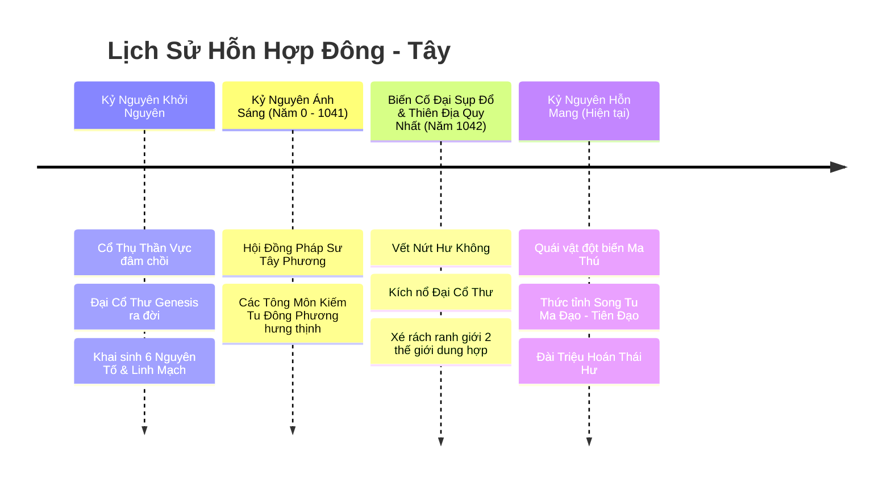
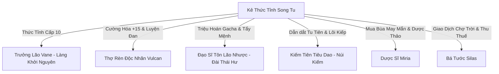

# TÀI LIỆU CỐT TRUYỆN & THẾ GIỚI QUAN (WORLD LORE)
**Dự án:** Echoes of Genesis (Astraea Online - Cổ Thư Hỗn Mang)  
**Thể loại:** 2.5D Isometric MMORPG Web H5 kết hợp Squad Battler Gacha Spine 2D  
**Phong cách:** Siêu hỗn hợp Đông - Tây (Tu Tiên Cảnh Giới, Kiếm Hiệp Ngự Kiếm x Ma Pháp Grimoire, Hiệp Sĩ Giáo Đình)  
**Phiên bản:** 2.0 - Tích hợp Đột Phá Tu Tiên & Anh Linh Gacha  

---

## 1. BIÊN NIÊN SỬ ĐẠI LỤC ASTRAEA & THƯƠNG KHUNG VỰC



### 1.1. Kỷ Nguyên Khởi Nguyên (The Genesis Era)
Thuở hồng hoang, đại lục **Astraea** chỉ là một cõi hư vô tĩnh mịch. Nguồn sống đầu tiên xuất hiện khi hạt giống thần thoại đâm chồi nảy lộc, tạo nên **Cổ Thụ Thần Vực (The Yggdrasil of Astraea)** khổng lồ cắm rễ sâu vào lòng địa mạch. 

Từ lõi của Cổ Thụ, kết tinh năng lượng thuần khiết nhất đã ngưng tụ thành một cuốn kinh thư duy nhất: **Đại Cổ Thư Khởi Nguyên (The Genesis Grimoire)**. Cuốn sách ghi chép trật tự vận hành của vạn vật thông qua 6 nguyên tố cội nguồn (đồng thời tương ứng với 6 loại Linh Căn Tu Tiên):
- **Hỏa (Ignis / Hỏa Linh Căn):** Sự nhiệt huyết, hủy diệt và tái sinh.
- **Băng (Glacies / Băng Linh Căn):** Sự tĩnh lặng, bảo tồn và vĩnh cửu.
- **Lôi (Fulgur / Lôi Linh Căn):** Sự phán quyết, lôi kiếp và xung kích biến đổi tức thời.
- **Độc (Venom / Hủ Độc Linh Căn):** Sự ăn mòn, mục rữa và chuyển hóa tuần hoàn.
- **Quang (Lux / Thánh Quang Linh Căn):** Sự che chở, thanh tẩy và chữa lành.
- **Ám (Umbra / Ma Linh Căn):** Chiều sâu tâm thức, ảo vọng và hư không kiềm hãm.

### 1.2. Biến Cố Đại Sụp Đổ & "Thiên Địa Quy Nhất" (The Convergence - Năm 1042)
Năm 1042 Kỷ Nguyên Ánh Sáng, một dị tượng chưa từng có xảy ra: bầu trời phía Bắc đại lục rách toạc ra một vết rách đen ngòm sâu thẳm mang tên **Vết Nứt Hư Không (The Void Rift)**. Khí Hỗn Mang tràn ngập, những thực thể tà ác từ ngoài chiều không gian túa ra tàn sát cư dân.

Trước nguy cơ toàn bộ sự sống bị diệt vong, 7 Đại Trưởng Lão thuộc **Hội Đồng Pháp Sư Astraea** đã đưa ra quyết định liều mạng nhất lịch sử: **Hiến tế sinh mệnh để kích nổ Đại Cổ Thư Khởi Nguyên**, mượn vụ nổ năng lượng tối thượng tạo thành Đại Phong Ấn vĩnh cửu nhốt chặt Vết Nứt Hư Không.

Vụ nổ năng lượng vượt tầm kiểm soát đã tạo nên một chấn động không thời gian kinh hoàng mang tên **Thiên Địa Quy Nhất (The Great Convergence)**:
- Không chỉ xé rách Đại Cổ Thư thành **hàng triệu Tàn Trang Thần Bí (Grimoire Pages)**, vụ nổ còn làm sụp đổ ranh giới không gian, hút xoáy và sáp nhập **Đại lục Astraea (Tây Huyễn)** với **Thương Khung Vực (Đông Phương Tiên Giới)**.
- **Mana ma pháp** hòa quyện với **Linh khí trời đất** tạo thành nguồn năng lượng mới: **Hỗn Nguyên Khí**. Các môn phái Kiếm Tu, Đạo Môn, Ma Đạo Tu Chân bỗng chốc cùng tồn tại bên cạnh các Hiệp Sĩ Giáo Đình, Pháp Sư Viện và Yêu Tộc Cổ Đại.
- Tàn trang rơi rụng phong ấn cả hồn phách của các Kiếm Tiên, Ma Tôn, Thánh Nữ và Cổ Thần từ thời viễn cổ, trôi dạt khắp nhân gian chờ ngày được thức tỉnh qua **Đài Triệu Hoán Thái Hư**.

---

## 2. BỐN ĐẠI TRẬN DOANH THẾ GIỚI (FACTIONS)

1. **Tiên Môn Kiếm Tông (Đông Phương Chính Đạo):**
   * Tụ họp các kiếm tu tu luyện ngự kiếm thuật, rèn luyện đan điền, lấy kiếm đạo nhập tiên đạo.
   * Lãnh tụ tinh thần: Kiếm Tiên Lý Tiêu Dao.
2. **Ma Đạo Cổ Tộc (Hắc Ám / Tà Tu):**
   * Tận dụng khí Hỗn Mang và huyết ma đại pháp để cưỡng cầu đột phá cảnh giới, bất chấp thủ đoạn.
   * Thủ lĩnh: Cửu U Ma Tôn Diệp Hắc.
3. **Thần Thánh Giáo Đình (Tây Phương Thánh Điện):**
   * Tôn thờ Ánh Sáng Khởi Nguyên, đề cao danh dự hiệp sĩ, sử dụng thần chú thánh quang bảo hộ đồng minh.
   * Người đứng đầu: Thánh Nữ Kỵ Sĩ Jeanne d'Arc.
4. **Hư Không & Yêu Tộc (Hỗn Mang Thần Tộc):**
   * Các loài ma thú, tinh linh viễn cổ và rồng thần hấp thụ tàn trang biến hóa thành hình người ma mị.
   * Biểu tượng: Long Vương Tiamat và Hồ Tiên Cửu Vĩ Bạch Thiển.

---

## 3. NGƯỜI THỨC TỈNH SONG TU (THE AWAKENED ONES) & HỆ THỐNG NPC

### 3.1. Thân Thế Người Chơi: Thiên Mệnh Hỗn Nguyên
Người chơi sinh ra đúng vào thời khắc hai thế giới sáp nhập. Sở hữu huyết mạch kỳ dị vừa có đan điền tu chân tụ khí, vừa có khả năng cảm ứng Ma Thư Grimoire. Người chơi là **"Kẻ Song Tu Hỗn Nguyên"** duy nhất có thể vừa vung bảo kiếm thi triển kiếm khí, vừa niệm ma pháp hủy diệt, đồng thời câu thông linh hồn qua Đài Triệu Hoán Thái Hư để hiệu triệu vạn tướng.

### 3.2. Dàn NPC Trọng Yếu Tại Thành Phố & Dã Ngoại



1. **Trưởng Lão Vane (Làng Khởi Nguyên):** Người sống sót từ thảm họa Đại Sụp Đổ, hướng dẫn tân thủ nhập môn.
2. **Thợ Rèn Độc Nhãn Vulcan (Khu Lò Rèn):** Bậc thầy dung hợp kỹ nghệ rèn Tây Phương với Lò Bát Quái Đông Phương, hỗ trợ cường hóa vũ khí +15 và luyện chế Đan Dược Đột Phá.
3. **Đạo Sĩ Tôn Lão Nhược (Đài Triệu Hoán Thái Hư):** Trấn giữ tế đàn bát quái, người hướng dẫn cách dùng Lệnh Bài Tầm Tiên để Gacha triệu hồi tướng Spine 2D.
4. **Kiếm Tiên Tiêu Dao (Kiếm Các Thần Vực):** Dẫn dắt người chơi qua từng tầng Cảnh Giới: Trúc Cơ, Kim Đan, Nguyên Anh và hướng dẫn cách chịu đựng Lôi Kiếp Thiên Phạt.
5. **Dược Sĩ Quái Dị Miria:** Thu mua mảnh tàn trang, bán đan dược hồi phục và nguyên liệu luyện đan.
6. **Bá Tước Silas - Quản Lý Chợ Trời:** Quản lý sàn giao dịch tự do, thu thuế 5% cho Bang Hội chiếm giữ Vực Đá Quý.

---

## 4. CHI TIẾT TUYẾN NHIỆM VỤ CHÍNH TUYẾN KẾT HỢP CẢNH GIỚI (CẤP 1 - 65)

### 📖 CHƯƠNG 1: KHỞI TÂM LUYỆN KHÍ (CẤP 1 - 15)
* **Cảnh giới:** Luyện Khí Tầng 1 ➔ Tầng 9.
* **Khu vực:** Làng Khởi Nguyên, Đền Thần Vực.
* **Mạch truyện:** 
  * Diệt quái sơ cấp, nhặt trang tàn kinh đầu tiên.
  * Đạt Cấp 10: Vào Đền Thần Vực kích hoạt Ấn Ký Linh Căn Bẩm Sinh.
  * Hạ gục Boss **Spore King (Cấp 15)**, hoàn thành tầng Luyện Khí thứ 9, chuẩn bị Trúc Cơ Đan.

### 📖 CHƯƠNG 2: TRÚC CƠ & NGỰ KIẾM PHI HÀNH (CẤP 16 - 30)
* **Cảnh giới:** Trúc Cơ Sơ Kỳ ➔ Viên Mãn.
* **Khu vực:** Thành Phố Ánh Sáng, Thung Lũng Cỏ Gió, Đài Triệu Hoán Thái Hư.
* **Mạch truyện:**
  * Đến Đài Thái Hư gặp Đạo Sĩ Tôn Lão Nhược, thực hiện lần **Gacha Triệu Hồi Tướng Spine 2D đầu tiên**.
  * Cắn Trúc Cơ Đan, thức tỉnh khả năng **Ngự Kiếm / Phi Hành**, tốc độ chạy tăng vọt.
  * Săn lùng Boss dã ngoại Gorefang và Hydra, mở khóa Tháp Hư Không tầng 1-20.

### 📖 CHƯƠNG 3: KIM ĐAN TAM TRỌNG LÔI KIẾP (CẤP 31 - 45)
* **Cảnh giới:** Kim Đan Kỳ (Vượt Tam Trọng Lôi Kiếp).
* **Khu vực:** Đầm Lầy Tử Khí, Miệng Núi Lửa Tro Tàn, Vực Đồ Sát PK.
* **Mạch truyện:**
  * Đạt đỉnh phong Trúc Cơ, kích hoạt sự kiện **Độ Kiếp Lôi Đình**: Sấm sét giáng xuống màn hình, toàn server chứng kiến màn đột phá Kim Đan.
  * Mở khóa Ô Kỹ Năng / Bí Tịch thứ 3.
  * Bắt đầu tham gia Đấu Trường Xếp Hạng Spine Arena và săn Boss Thế Giới Ignis Golem đoạt Sách Phép Tím.

### 📖 CHƯƠNG 4: NGUYÊN ANH XUẤT KHIẾU & THẦN MA ĐẠI CHIẾN (CẤP 46 - 55)
* **Cảnh giới:** Nguyên Anh Kỳ (Vượt Lục Trọng Lôi Kiếp).
* **Khu vực:** Vực Đá Quý, Phế Tích Cổ Thần.
* **Mạch truyện:**
  * Vượt qua Lục Trọng Thiên Kiếp, ngưng tụ Nguyên Anh Chân Thân: Nhận nội tại tự động hồi sinh 1 lần khi chết.
  * Mở khóa slot Tướng Trợ Chiến Striker Call ngoài map dã ngoại.
  * Bang hội đại chiến tranh đoạt mỏ tài nguyên Vực Đá Quý (20:00 Thứ Bảy).

### 📖 CHƯƠNG 5: HÓA THẦN & PHI THĂNG PHONG ẤN (CẤP 56 - 65+)
* **Cảnh giới:** Hóa Thần ➔ Độ Kiếp Phi Thăng.
* **Khu vực:** Vết Nứt Hư Không, Tế Đàn Khởi Nguyên.
* **Mạch truyện:**
  * Nghênh chiến Binh Đoàn Hư Không do Void Herald và Thái Cổ Tà Thần dẫn đầu.
  * Thần Thông Đại Thành, kích hoạt Thần Binh +15 hào quang rực rỡ, thống lĩnh đội hình 5 Đại Tướng UR/SSR lập lại trật tự càn khôn.

---

## 5. THIẾT KẾ CÁC KHU VỰC BẢN ĐỒ (WORLD MAP)

```
[Bản Đồ 1: Làng Khởi Nguyên] (Khu An Toàn | Luyện Khí)
       ↓
[Bản Đồ 2: Thung Lũng Cỏ Gió & Đài Thái Hư] (Quái Lv 16 - 25 | Trúc Cơ & Gacha Tướng)
       ↓
[Bản Đồ 3: Thành Phố Ánh Sáng Astraea] (Trung Tâm Giao Dịch, Chợ Trời, Lò Luyện Đan)
       ↓
[Bản Đồ 4: Đầm Lầy Tử Khí] (Quái Lv 26 - 35 | PK Tự Do | Tam Trọng Lôi Kiếp)
       ↓
[Bản Đồ 5: Miệng Núi Lửa Tro Tàn] (Quái Lv 36 - 50 | Kim Đan & Đấu Trường Spine)
       ↓
[Bản Đồ 6: Vực Đá Quý & Vết Nứt Hư Không] (Khu Lv 51 - 65 | Nguyên Anh / Hóa Thần | Công Thành)
```

Toàn bộ thế giới được vận hành với hệ thống **20 Channels (Khu 1 - Khu 20)** đảm bảo trải nghiệm siêu mượt trên Web H5, tạo sân chơi cày cuốc, săn boss, độ kiếp và giao thương tự do không giới hạn.
