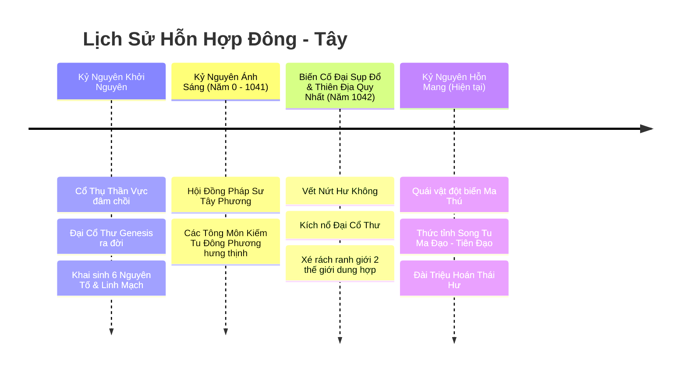

# TÀI LIỆU CỐT TRUYỆN & THẾ GIỚI QUAN (WORLD LORE)
**Dự án:** Echoes of Genesis (Astraea Online - Cổ Thư Hỗn Mang)  
**Thể loại:** 2.5D Isometric MMORPG Web H5 kết hợp Squad Battler Gacha Spine 2D  
**Phong cách:** Siêu hỗn hợp Đông - Tây (9 Đại Cảnh Giới Tu Tiên, Kiếm Hiệp Ngự Kiếm x Ma Pháp Grimoire, Hiệp Sĩ Giáo Đình)  
**Phiên bản:** 2.1 - Nâng Cấp 9 Đại Cảnh Giới (Cap Level 150)  

---

## 1. BIÊN NIÊN SỬ ĐẠI LỤC ASTRAEA & THƯƠNG KHUNG VỰC



### 1.1. Kỷ Nguyên Khởi Nguyên (The Genesis Era)
Thuở hồng hoang, đại lục **Astraea** chỉ là một cõi hư vô tĩnh mịch. Nguồn sống đầu tiên xuất hiện khi hạt giống thần thoại đâm chồi nảy lộc, tạo nên **Cổ Thụ Thần Vực (The Yggdrasil of Astraea)** khổng lồ cắm rễ sâu vào lòng địa mạch. 

Từ lõi của Cổ Thụ, kết tinh năng lượng thuần khiết nhất đã ngưng tụ thành một cuốn kinh thư duy nhất: **Đại Cổ Thư Khởi Nguyên (The Genesis Grimoire)**. Cuốn sách ghi chép trật tự vận hành của vạn vật thông qua 6 nguyên tố cội nguồn (đồng thời tương ứng với 6 loại Linh Căn Tu Tiên):
- **Hỏa (Ignis / Hỏa Linh Căn):** Sự nhiệt huyết, hủy diệt và tái sinh.
- **Băng (Glacies / Băng Linh Căn):** Sự tĩnh lặng, bảo tồn và vĩnh cửu.
- **Lôi (Fulgur / Lôi Linh Căn):** Sự phán quyết, lôi kiếp và xung kích biến đổi tức thời.
- **Độc (Venom / Hủ Độc Linh Căn):** Sự ăn mòn, mục rữa và chuyển hóa tuần hoàn.
- **Quang (Lux / Thánh Quang Linh Căn):** Sự che chở, thanh tẩy và chữa lành.
- **Ám (Umbra / Ma Linh Căn):** Chiều sâu tâm thức, ảo vọng và hư không kiềm hãm.

### 1.2. Biến Cố Đại Sụp Đổ & "Thiên Địa Quy Nhất" (The Convergence - Năm 1042)
Năm 1042 Kỷ Nguyên Ánh Sáng, bầu trời phía Bắc rách toạc ra **Vết Nứt Hư Không (The Void Rift)**. Khí Hỗn Mang tràn ngập, binh đoàn bóng tối túa ra tàn sát cư dân.

Để cứu vãn thế giới, 7 Đại Trưởng Lão đã **kích nổ Đại Cổ Thư Khởi Nguyên**, tạo Đại Phong Ấn phong tỏa Vết Nứt Hư Không. Xung lực vụ nổ chấn động không thời gian tạo nên biến cố **"Thiên Địa Quy Nhất" (The Convergence)**:
- Sáp nhập **Đại lục Astraea (Tây Huyễn)** với **Thương Khung Vực (Đông Phương Tiên Giới)**.
- **Mana ma pháp** và **Linh khí trời đất** hòa quyện thành **Hỗn Nguyên Khí**.
- Phân chia thế giới thành **4 Đại Trận Doanh Độc Lập**: Kiếm Tông Tiên Môn, Vạn Huyết Ma Điện, Thánh Quang Giáo Đình và Hư Không Ma Viện.

---

## 2. BỐN ĐẠI TRẬN DOANH THẾ GIỚI (FACTIONS)

1. **Kiếm Tông Tiên Môn (Đông Phương Chính Đạo):** Kiếm đạo nhập tiên, phi kiếm lơ lửng, tốc độ và bạo kích. Lãnh tụ: Thanh Huyền Kiếm Tiên Lý Tiêu Dao.
2. **Vạn Huyết Ma Điện (Đông Phương Ma Đạo):** Nghịch thiên đoạt mệnh, hút máu, ma trận huyết sắc. Lãnh tụ: Cửu U Ma Tôn Diệp Hắc.
3. **Thánh Quang Giáo Đình (Tây Phương Thánh Điện):** Khiên thánh giá, cờ lệnh ánh sáng, bảo hộ và hồi máu toàn diện. Lãnh tụ: Thánh Nữ Jeanne d'Arc.
4. **Hư Không Ma Viện (Tây Phương Ma Pháp & Yêu Tộc):** Phép thuật diện rộng AOE, ma thú rồng cổ đại, khống chế mê hoặc. Lãnh tụ: Tinh Linh Long Vương Tiamat & Merlin.

---

## 3. NGƯỜI THỨC TỈNH SONG TU (THE AWAKENED ONES) & HỆ THỐNG NPC

### 3.1. Thân Thế Người Chơi: Thiên Mệnh Hỗn Nguyên
Người chơi sinh ra đúng vào thời khắc hai thế giới sáp nhập, mang **Huyết Mạch Hỗn Nguyên**. Người chơi có thể vừa tu luyện 9 Đại Cảnh Giới, vừa điều khiển Ma Thư Grimoire, và thông qua Đài Triệu Hoán Thái Hư để hiệu triệu 16+ vị Anh Linh Spine 2D.

### 3.2. Dàn NPC Trọng Yếu Tại Thành Phố & Dã Ngoại
1. **Trưởng Lão Vane (Làng Khởi Nguyên):** Dẫn dắt tân thủ nhập môn Luyện Khí.
2. **Thợ Rèn Độc Nhãn Vulcan:** Cường hóa vũ khí +15 và nung nấu Đan Dược Đột Phá.
3. **Đạo Sĩ Tôn Lão Nhược (Đài Triệu Hoán Thái Hư):** Hướng dẫn Gacha tướng Spine 2D và nghi thức Tẩy Mệnh đổi phe.
4. **Kiếm Tiên Tiêu Dao (Kiếm Các Thần Vực):** Hướng dẫn ngự kiếm phi hành và cách chịu đựng Lôi Kiếp Thiên Phạt.
5. **Dược Sĩ Miria:** Cung cấp linh thảo ngưng đan và bùa hộ mệnh chống sét.
6. **Bá Tước Silas:** Quản lý Chợ Trời, thu thuế 5% cho Bang Chủ thắng Công Thành.

---

## 4. CHI TIẾT TUYẾN CỐT TRUYỆN 9 CHƯƠNG QUA 9 ĐẠI CẢNH GIỚI (CẤP 1 - 150)

```mermaid
graph LR
    C1[Chương 1: Luyện Khí<br>Lv 1 - 20] --> C2[Chương 2: Trúc Cơ<br>Lv 21 - 40]
    C2 --> C3[Chương 3: Kim Đan<br>Lv 41 - 60]
    C3 --> C4[Chương 4: Nguyên Anh<br>Lv 61 - 80]
    C4 --> C5[Chương 5: Hóa Thần<br>Lv 81 - 100]
    C5 --> C6[Chương 6: Luyện Hư<br>Lv 101 - 115]
    C6 --> C7[Chương 7: Hợp Thể<br>Lv 116 - 130]
    C7 --> C8[Chương 8: Đại Thừa<br>Lv 131 - 145]
    C8 --> C9[Chương 9: Độ Kiếp<br>Lv 146 - 150 Max]
```



### 📖 Chương 1: Khởi Tâm Luyện Khí (Lv 1 - 20)
* **Khu vực:** Làng Khởi Nguyên, Rừng Sơ Khai.
* **Mạch truyện:** Khơi thông 10 tầng kinh mạch, chạm Bệ Đá kích hoạt Linh Căn bẩm sinh. Hạ gục Boss Spore King (Cấp 20) đoạt viên Trúc Cơ Đan đầu tiên.

### 📖 Chương 2: Trúc Cơ Ngự Kiếm & Chọn Phe (Lv 21 - 40)
* **Khu vực:** Thành Phố Ánh Sáng, Thung Lũng Cỏ Gió, Đài Triệu Hoán Thái Hư.
* **Mạch truyện:** Gặp Đạo Sĩ Tôn Lão Nhược, thực hiện lần Gacha triệu hồi tướng Spine 2D đầu tiên. Tiếp nhận Tín Vật của 1 trong 4 Đại Trận Doanh. Thức tỉnh kỹ năng Ngự Kiếm Phi Hành lướt gió.

### 📖 Chương 3: Kim Đan Tam Trọng Lôi Kiếp (Lv 41 - 60)
* **Khu vực:** Đầm Lầy Tử Khí, Miệng Núi Lửa Tro Tàn.
* **Mạch truyện:** Trải nghiệm cảm giác nghẹt thở của Tam Trọng Lôi Kiếp: 3 đạo sét tím giáng xuống, cắn Ngưng Đan Lộ ngưng tụ Kim Đan Chân Hỏa. Bắt đầu tham gia Đấu Trường Xếp Hạng Spine Arena.

### 📖 Chương 4: Nguyên Anh Bất Tử & Trợ Chiến Xuất Kích (Lv 61 - 80)
* **Khu vực:** Vực Đá Quý, Hẻm Núi Gió Hú.
* **Mạch truyện:** Vượt qua Lục Trọng Lôi Kiếp, Nguyên Anh ngưng tụ thành công, nhận nội tại tự động hồi sinh khi chết. Mở khóa ô Tướng Trợ Chiến Striker Call ngoài bản đồ dã ngoại.

### 📖 Chương 5: Hóa Thần Ngàn Dặm & Thế Lực Chiến (Lv 81 - 100)
* **Khu vực:** Núi Lửa Tro Tàn, Phế Tích Cổ Tộc.
* **Mạch truyện:** Vượt Cửu Trọng Lôi Kiếp ngưng Thần Niệm, tầm đánh mở rộng 50%. Chiến trường Thế Lực 4 Trận Doanh bùng nổ, tranh giành quyền khai thác mỏ quặng thần cấp.

### 📖 Chương 6: Luyện Hư Vô Ảnh & Tâm Ma Huyễn Cảnh (Lv 101 - 115)
* **Khu vực:** Vực Thẳm Vô Tận.
* **Mạch truyện:** Đối mặt với ảo ảnh Tâm Ma của chính bản thân. Đột phá Luyện Hư, tấn công bỏ qua 20% giáp/kháng phép của đối phương.

### 📖 Chương 7: Hợp Thể Pháp Tướng & Cổ Thần Đại Chiến (Lv 116 - 130)
* **Khu vực:** Cửa Vết Nứt Hư Không.
* **Mạch truyện:** Chịu đựng Bát Cực Lôi Ma Kiếp, dung hợp chân thân hóa Pháp Tướng Thiên Địa khổng lồ (+40% HP, +30% Công trong 15s combat).

### 📖 Chương 8: Đại Thừa Viên Mãn & Song Hộ Vệ Xuất Chiến (Lv 131 - 145)
* **Khu vực:** Phế Tích Cổ Thụ Thần Vực.
* **Mạch truyện:** Trảm diệt Tâm Ma Phân Thân, mở khóa mang cùng lúc **2 Tướng Spine Trợ Chiến** dã ngoại.

### 📖 Chương 9: Cửu Cửu Thiên Kiếp & Độ Kiếp Phi Thăng (Lv 146 - 150 Max)
* **Khu vực:** Tế Đàn Khởi Nguyên & Cõi Tiên Giới Hỗn Mang.
* **Mạch truyện:** Đỉnh cao tối thượng: Chịu đựng **Cửu Cửu 81 Đạo Lôi Đình Liên Hoàn**, đồng đội bang hội đứng hộ pháp. Phi thăng phong thần, khắc tên lên Bảng Vàng vĩnh cửu của máy chủ!

---

## 5. THIẾT KẾ CÁC KHU VỰC BẢN ĐỒ (WORLD MAP 9 TẦNG)

```
[Bản Đồ 1: Làng Khởi Nguyên & Rừng Sơ Khai] (Lv 1 - 20 | Luyện Khí)
       ↓
[Bản Đồ 2: Thung Lũng Cỏ Gió & Đài Thái Hư] (Lv 21 - 40 | Trúc Cơ & Gacha)
       ↓
[Bản Đồ 3: Thành Phố Ánh Sáng & Chợ Trời] (Trung Tâm Giao Dịch, Lò Rèn Vulcan)
       ↓
[Bản Đồ 4: Đầm Lầy Tử Khí] (Lv 41 - 60 | Kim Đan & Tam Trọng Lôi Kiếp | PK Tự Do)
       ↓
[Bản Đồ 5: Hẻm Núi Gió Hú & Núi Lửa Tro Tàn] (Lv 61 - 80 | Nguyên Anh & Lục Trọng Kiếp)
       ↓
[Bản Đồ 6: Vực Đá Quý & Chiến Trường Thế Lực] (Lv 81 - 100 | Hóa Thần & Cửu Trọng Kiếp)
       ↓
[Bản Đồ 7: Vực Thẳm Vô Tận] (Lv 101 - 115 | Luyện Hư & Tâm Ma)
       ↓
[Bản Đồ 8: Cửa Vết Nứt Hư Không] (Lv 116 - 130 | Hợp Thể & Bát Cực Kiếp)
       ↓
[Bản Đồ 9: Tế Đàn Khởi Nguyên & Tiên Giới Hỗn Mang] (Lv 131 - 150 | Đại Thừa & Phi Thăng)
```

Mỗi bản đồ phân bổ **20 Channels (Khu 1 - Khu 20)** đảm bảo trải nghiệm siêu mượt trên Web H5, tạo sân chơi cày cuốc, săn boss, độ kiếp và giao thương tự do không giới hạn.
