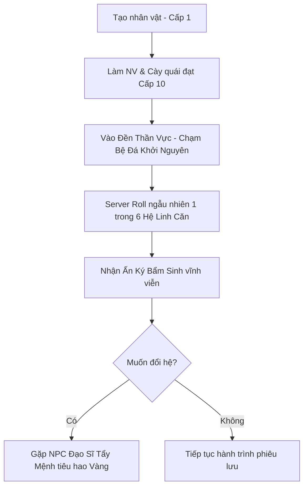

# TÀI LIỆU THIẾT KẾ TÍNH NĂNG & CƠ CHẾ GAMEPLAY (CORE SYSTEMS)
**Dự án:** Echoes of Genesis (Astraea Online - Cổ Thư Hỗn Mang)  
**Tài liệu:** Game Mechanics & Features Specification (GDD Feature Details)  
**Phiên bản:** 2.2 - Tích hợp 9 Đại Cảnh Giới (Cap Lv 150) & Rủi Ro Lôi Kiếp  

---

## MỤC LỤC TÍNH NĂNG
1. [HỆ THỐNG ẤN KÝ NGUYÊN TỐ (INNATE ELEMENT)](#1-hệ-thống-ấn-ký-nguyên-tố-innate-element)
2. [HỆ THỐNG SÁCH PHÉP & CÂY KỸ NĂNG (GRIMOIRE SYSTEM)](#2-hệ-thống-sách-phép--cây-kỹ-năng-grimoire-system)
3. [HỆ THỐNG FARM QUÁI & AUTO-GRIND (GRINDING LOOP)](#3-hệ-thống-farm-quái--auto-grind-grinding-loop)
4. [HỆ THỐNG SĂN BOSS DÃ NGOẠI & PHÂN KHU 20 CHANNELS](#4-hệ-thống-săn-boss-dã-ngoại--phân-khu-20-channels)
5. [HỆ THỐNG LÒ RÈN & CƯỜNG HÓA +15 (FORGING & WEAPON GLOW)](#5-hệ-thống-lò-rèn--cường-hóa-15-forging--weapon-glow)
6. [HỆ THỐNG KINH TẾ: CHỢ TRỜI & GIAO DỊCH TỰ DO (FREE ECONOMY)](#6-hệ-thống-kinh-tế-chợ-trời--giao-dịch-tự-do-free-economy)
7. [HỆ THỐNG CHIẾN ĐẤU, ĐỒ SÁT & PK THẾ GIỚI (WORLD PVP & KARMA)](#7-hệ-thống-chiến-đấu-đồ-sát--pk-thế-giới-world-pvp--karma)
8. [HỆ THỐNG TỔ ĐỘI & CÔNG THÀNH BANG HỘI (SOCIAL & GUILD WAR)](#8-hệ-thống-tổ-đội--công-thành-bang-hội-social--guild-war)
9. [HỆ THỐNG 9 ĐẠI CẢNH GIỚI TU TIÊN, 4 TRẬN DOANH & RỦI RO ĐỘ KIẾP (CAP 150)](#9-hệ-thống-9-đại-cảnh-giới-tu-tiên-4-trận-doanh--rủi-ro-độ-kiếp-cap-150)
10. [GAMEPLAY B: AUTO-BATTLER SPINE 2D & VÒNG SÁNG TRẬN DOANH](#10-gameplay-b-auto-battler-spine-2d--vòng-sáng-trận-doanh)
11. [CƠ CHẾ LIÊN THÔNG DUAL-GAMEPLAY (DUYÊN PHẬN & TRỢ CHIẾN STRIKER)](#11-cơ-chế-liên-thông-dual-gameplay-duyên-phận--trợ-chiến-striker)
12. [CÁC CHẾ ĐỘ PHỤ BẢN ĐỘI HÌNH TƯỚNG SPINE 2D (PVE / PVP)](#12-các-chế-độ-phụ-bản-đội-hình-tướng-spine-2d-pve--pvp)

---

## 1. HỆ THỐNG ẤN KÝ NGUYÊN TỐ (INNATE ELEMENT)

### 1.1. Luồng Trải Nghiệm (User Flow)


### 1.2. Chi Tiết 6 Hệ Nguyên Tố & Hiệu Ứng Bổ Trợ (Utility Perks)
*Nguyên tắc thiết kế:* Giữ nguyên 100% sát thương gốc của đòn đánh, không tạo cơ chế tương khắc khắc hệ trừ máu phi lý (gây mất cân bằng trong PK). Ấn ký cung cấp hiệu ứng tiện ích phụ:

| Hệ Nguyên Tố | Màu VFX Đặc Trưng | Xác Suất Kích Hoạt | Hiệu Ứng Bổ Trợ Chi Tiết |
| :--- | :--- | :---: | :--- |
| **Hỏa (Ignis)** | Đỏ Cam rực lửa | 15% khi đánh trúng | Gây trạng thái **Bỏng**: Rút 1% HP tối đa của mục tiêu mỗi giây trong 3 giây (Tối đa 1 tầng, không cộng dồn). |
| **Băng (Glacies)** | Xanh Băng tinh thể | 15% khi đánh trúng | Gây trạng thái **Đóng Băng Nhẹ**: Giảm 10% tốc độ di chuyển trong 1.5 giây. |
| **Lôi (Fulgur)** | Vàng Chanh sấm sét | 20% khi tung chiêu | Kích hoạt **Hưng Phấn Điện Lực**: Tăng 5% tốc độ xuất chiêu cơ bản trong 2 giây. |
| **Độc (Venom)** | Xanh Dạ Quang / Tím | 20% khi đánh trúng | Gây trạng thái **Nhiễm Độc Sâu**: Giảm 15% lượng hồi máu/hút máu nhận vào trong 3 giây. |
| **Quang (Lux)** | Vàng Kim thánh khiết | 15% khi tung chiêu | Tạo **Khiên Quang Học**: Giảm 5% mọi sát thương nhận vào trong 2 giây. |
| **Ám (Umbra)** | Đen / Tím hư không | 15% khi tung chiêu | Kích hoạt **Hấp Huyết Tâm Trí**: Hồi phục ngay lập tức 2% Mana tiêu hao của kỹ năng vừa đánh. |

### 1.3. Thưởng Đồng Hệ (Element Resonance)
- Khi nhân vật trang bị cuốn Sách Phép có hệ **trùng với Ấn Ký Bẩm Sinh**:
  - Giảm **5%** lượng Mana tiêu hao của mọi kỹ năng trong sách.
  - Tăng **30%** uy lực (sát thương/hồi phục) của các chiêu thức trong cuốn sách đó.
  - Toàn bộ hiệu ứng hạt đạn phép (VFX) tự động chuyển sang dải màu sắc của hệ tương ứng.

### 1.4. Cơ Chế Đổi Hệ (Tẩy Mệnh)
- Đến gặp NPC **Đạo Sĩ Tẩy Mệnh** tại Thành Phố.
- Tiêu tốn: `100.000 Vàng cày cuốc` (hoặc vật phẩm hiếm `Bình Tẩy Hồn` rơi từ Boss Thế Giới).
- Hệ thống roll ngẫu nhiên 1 trong 5 hệ còn lại (đảm bảo không bị trùng lại hệ cũ).

---

## 2. HỆ THỐNG SÁCH PHÉP & CÂY KỸ NĂNG (GRIMOIRE SYSTEM)

Thay vì cố định kỹ năng theo môn phái truyền thống, người chơi định hình phong cách chiến đấu thông qua các cuốn **Cổ Thư (Grimoire)** săn được từ Boss dã ngoại.

### 2.1. Cấu Trúc Trang Bị Sách (2 Ô Kỹ Năng)
- Nhân vật sở hữu **2 Ô Sách:**
  - **Sách Chính (Main Slot):** Kích hoạt bộ 3 phím kỹ năng chính (Q, W, E hoặc Nút 1, 2, 3 trên Mobile).
  - **Sách Phụ (Sub Slot):** Kích hoạt kỹ năng hỗ trợ hoặc chiêu Tuyệt Kỹ Tối Thượng (Phím R hoặc Nút 4 trên Mobile).

### 2.2. Đẳng Cấp Sách (Tome Mastery Cấp 1 - 10)
- Đeo sách vào người khi đánh quái: **Sách tự động hấp thụ 50% lượng EXP của quái** để thăng cấp (không trừ vào EXP của nhân vật).
- Mỗi cấp sách mang lại **1 Điểm Bí Thuật (TP - Tome Point)**. Tối đa 10 TP ở cấp 10.

### 2.3. Cây Kỹ Năng 4 Tầng & Phân Nhánh A/B
```
[Tầng 1: Active Core] (Tốn 1 TP) -> Mở khóa chiêu cơ bản
           │
           ├─────────────────────────┐
           ▼                         ▼
   [Tầng 2 - Nhánh A]       [Tầng 2 - Nhánh B]  (Tốn 3 TP - Chỉ được chọn 1)
   (Tăng tốc / Xuyên thấu)   (Diện rộng / Bộc phá)
           │                         │
           └────────────┬────────────┘
                        ▼
             [Tầng 3: Passive Perk]  (Tốn 2 TP) -> Nội tại bổ trợ chỉ số
                        │
           ┌────────────┴────────────┐
           ▼                         ▼
  [Tầng 4 - Tuyệt Kỹ A]     [Tầng 4 - Tuyệt Kỹ B] (Tốn 4 TP - Chọn 1 chiêu Thức Tỉnh)
```

- **Tính năng Tẩy Điểm Sách:** Sử dụng **Bụi Ma Pháp** (nhặt từ quái thường) để hoàn trả 100% điểm TP, cho phép người chơi tự do thử nghiệm lại giữa Nhánh A và Nhánh B.

### 2.4. Hệ Thống Dòng Ngẫu Nhiên (Affix RNG)
Sách rơi từ Boss dã ngoại sẽ có các dòng thuộc tính ngẫu nhiên:
- **Phẩm chất Trắng (Common):** 0 dòng thuộc tính phụ.
- **Phẩm chất Lam (Rare):** 1 - 2 dòng thuộc tính phụ ngẫu nhiên.
- **Phẩm chất Tím (Epic):** 3 dòng thuộc tính phụ ngẫu nhiên.
- **Phẩm chất Vàng (Mythic):** 4 dòng thuộc tính phụ tối thượng.
- *Bể dòng ngẫu nhiên (Affix Pool):* Giảm hồi chiêu (3%~10%), mở rộng bán kính AOE (5%~15%), tăng tốc đạn ma pháp (10%~25%), hút mana (1%~3%), sát thương chí mạng (5%~18%).

---

## 3. HỆ THỐNG FARM QUÁI & AUTO-GRIND (GRINDING LOOP)

### 3.1. Phân Bổ Điểm Tiềm Năng (Manual Stat Allocation)
Mỗi khi thăng 1 Cấp độ, nhân vật nhận được **5 Điểm Tiềm Năng (TN)** để tự do cộng tay:
- **STR (Sức Mạnh):** 1 điểm = +3 Sát thương vật lý, +2 Sức chứa tối đa túi đồ, +0.2% Sát thương chí mạng.
- **INT (Trí Tuệ):** 1 điểm = +3.5 Sát thương phép, +15 Điểm Mana tối đa, +0.5 Tốc độ hồi mana/5s.
- **DEX (Khéo Léo):** 1 điểm = +0.15% Tỷ lệ chí mạng, +0.1% Tốc đánh, +0.2% Tỷ lệ né đòn.
- **VIT (Thể Lực):** 1 điểm = +25 Máu (HP) tối đa, +1.5 Điểm Giáp, +0.8 Tốc độ hồi máu/5s.

### 3.2. Cơ Chế Auto-Grind Trên Web H5
- **Bật/Tắt 1 chạm:** Nút bấm Auto trên góc phải màn hình hoặc nhấn phím tắt `Space`.
- **Phạm vi tự động:** Tự động dò tìm quái vật gần nhất trong bán kính `5m - 10m` quanh điểm đứng ban đầu.
- **Tự động dùng bình hồi phục:** Uống bình Máu khi HP < 50% và uống bình Mana khi MP < 30%.
- **Quy tắc an toàn chống chết:** Tự động ngắt Auto ngay lập tức khi phát hiện bị người chơi khác bật Cờ Đỏ đồ sát tấn công.

---

## 4. HỆ THỐNG SĂN BOSS DÃ NGOẠI & PHÂN KHU 20 CHANNELS

### 4.1. Cấu Trúc 20 Phân Khu (Zone / Channel System)
- Mỗi bản đồ dã ngoại được server chia thành **Khu 1 đến Khu 20** giúp phân tán tải và nhân bội cơ hội săn Boss cho người chơi.
- Đổi khu nhanh tại Trụ Dịch Chuyển (Thời gian hồi: 10 giây).

### 4.2. Cơ Chế Báo Động Toàn Server (World Broadcast)
Khi Boss xuất hiện, toàn server xuất hiện thông báo chữ đỏ chạy ngang màn hình:
> *"Cảnh Báo: Ma Thú Bạo Chúa [Tên Boss] đã giáng lâm tại [Tên Bản Đồ] - [Khu X]!"*

### 4.3. Luật Phân Định Quyền Nhặt Đồ & Tranh Đoạt 30 Giây
- **Top Damage:** Người hoặc tổ đội gây tổng sát thương lớn nhất được bảo vệ quyền nhặt Rương Boss Chính trong 30 giây đầu.
- **Last-Hit:** Người tung đòn kết liễu nhận riêng 1 Hòm Thưởng May Mắn.
- **Hết 30 giây:** Mọi vật phẩm chưa kịp nhặt sẽ mở khóa cho toàn bộ người chơi xung quanh lao vào tranh cướp tự do!

---

## 5. HỆ THỐNG LÒ RÈN & CƯỜNG HÓA +15 (FORGING & WEAPON GLOW)

### 5.1. Bảng Tỷ Lệ & Rủi Ro Chi Tiết Từng Cấp
* **+1 đến +3:** Tỷ lệ 100%, không rủi ro.
* **+4 đến +6:** Tỷ lệ 60% -> 45%, thất bại giảm 1 cấp.
* **+7 đến +9:** Tỷ lệ 35% -> 20%, thất bại rớt về mốc an toàn (+4). Dùng Bùa Hộ Mệnh giữ cấp.
* **+10 đến +12:** Tỷ lệ 15% -> 8%, thất bại rớt về +4 (Không bùa rớt về +0). Cần Bùa Cao Cấp.
* **+13 đến +14:** Tỷ lệ 5% -> 3%, thất bại rớt về +0, có 10% nguy cơ VỠ VỤN trang bị.
* **+15 (Thần Khí):** Tỷ lệ 1.5%, thất bại VỠ NÁT thành Bụi Ma Pháp. Bắt buộc dùng Bùa Thần Thánh.

### 5.2. Hiệu Ứng Hào Quang Vũ Khí (Weapon Glow) 5 Bậc
* +4 đến +6: Hào quang trắng mờ dịu.
* +7 đến +9: Hào quang xanh lơ nhấp nháy liên tục.
* +10 đến +12: Hào quang vàng kim rực rỡ tỏa rộng.
* +13 đến +14: Hào quang đỏ rực như máu kèm tia chớp điện giật lách tách.
* +15 (Thần Khí Tối Thượng): Hào quang cầu vồng chuyển sắc huyền ảo (Tím - Hồng - Vàng - Xanh Ngọc).

---

## 6. HỆ THỐNG KINH TẾ: CHỢ TRỜI & GIAO DỊCH TỰ DO (FREE ECONOMY)

* **Quy tắc Unbound 100%:** Toàn bộ Sách Phép, Đá Cường Hóa và Trang Bị săn từ Boss đều không khóa.
* **Mở Sạp Chợ Trời:** Bày bán tối đa 10 món tại Quảng Trường Thành Phố, định giá bằng Vàng hoặc Ngọc.
* **Giao Dịch P2P 2 Bước:** Bước 1 Khóa Đồ -> Bước 2 Xác Nhận Giao Dịch chống tráo đồ.

---

## 7. HỆ THỐNG CHIẾN ĐẤU, ĐỒ SÁT & PK THẾ GIỚI (WORLD PVP & KARMA)

* **3 Chế Độ Cờ:** Cờ Trắng (Hòa bình), Cờ Đỏ (Đồ sát ngoài vùng an toàn), Cờ Bang (Guild PK).
* **Trừng Phạt Tên Đỏ (Hắc Danh):** Giết người vô tội bị tích điểm PK. Khi chết, rơi 10% Vàng và tăng 50% nguy cơ rớt trang bị đang mặc ra đất!
* **Khu An Toàn Tuyệt Đối:** Làng, Thành Phố và Trụ Hồi Sinh tuyệt đối cấm PK.

---

## 8. HỆ THỐNG TỔ ĐỘI & CÔNG THÀNH BANG HỘI (SOCIAL & GUILD WAR)

* **Tổ Đội (Party):** Tối đa 4 người. Mỗi thành viên đứng cùng màn hình buff thêm +10% EXP (Đủ đội buff +40% EXP).
* **Công Thành Vực Đá Quý (20:00 Thứ Bảy):** Bang giữ Trụ Trung Tâm nhận đặc quyền hưởng **5% tổng doanh thu thuế chợ trời toàn server trong tuần!**

---

## 9. HỆ THỐNG 9 ĐẠI CẢNH GIỚI TU TIÊN, 4 TRẬN DOANH & RỦI RO ĐỘ KIẾP (CAP 150)

### 9.1. Chuỗi 9 Đại Cảnh Giới Cốt Lõi (Cap Level 150)
1. **Luyện Khí Kỳ (Lv 1 - 20):** Khai thông 10 tầng kinh mạch.
2. **Trúc Cơ Kỳ (Lv 21 - 40):** Ngự Kiếm Phi Hành (+30% tốc chạy). Chọn 1 trong 4 Đại Trận Doanh.
3. **Kim Đan Kỳ (Lv 41 - 60):** Tam Trọng Lôi Kiếp. Mở Ô Sách thứ 3, đòn đánh kèm chân hỏa.
4. **Nguyên Anh Kỳ (Lv 61 - 80):** Lục Trọng Lôi Kiếp. Nguyên Anh Bất Tử tự hồi sinh 1 lần. Mở slot Tướng Trợ Chiến ngoài map dã ngoại.
5. **Hóa Thần Kỳ (Lv 81 - 100):** Cửu Trọng Lôi Kiếp. Thần Niệm Ngàn Dặm (+50% tầm đánh, -15% hồi chiêu).
6. **Luyện Hư Kỳ (Lv 101 - 115):** Tâm Ma Huyễn Cảnh. Thấu thị hư không, bỏ qua 20% giáp/kháng.
7. **Hợp Thể Kỳ (Lv 116 - 130):** Bát Cực Lôi Ma Kiếp. Pháp Tướng Thiên Địa hóa khổng lồ (+40% HP, +30% Công).
8. **Đại Thừa Kỳ (Lv 131 - 145):** Trảm Tâm Ma Phân Thân. Mở khóa mang cùng lúc **2 Tướng Spine Trợ Chiến**.
9. **Độ Kiếp Phi Thăng (Lv 146 - 150 Max):** Cửu Cửu Thiên Kiếp (81 Đạo Lôi Đình). Thân xác Thần Thoại Bất Tử, khắc tên Bảng Phong Thần.

### 9.2. Bốn Nấc Thang Tiểu Cảnh Giới & Nghẽn Cảnh Giới
* Mỗi cảnh giới chia làm 4 giai đoạn: **Sơ Kỳ (25%) ➔ Trung Kỳ (50%) ➔ Hậu Kỳ (75%) ➔ Đại Viên Mãn (100%)**.
* Tại mốc Đại Viên Mãn, thanh EXP bị **KHÓA 100% (Bottleneck)** cho đến khi độ kiếp thành công.

### 9.3. Rủi Ro Thất Bại Khi Độ Kiếp & Biện Pháp Hộ Kiếp
* Sấm sét giáng xuống rút từ **30% đến 50% Max HP** mỗi đạo sét.
* Biện pháp: Cắn Đan Dược Hộ Kiếp, trang bị Bùa Chống Sét, nhờ đồng đội Bang Hội đứng "Hộ Pháp" chia sẻ sát thương (tối đa 4 người chia sẻ 20%).
* ⚠️ **Hậu quả khi thất bại:** Bị thiên lôi đánh chết ➔ **Tụt 20% EXP của mốc Đại Viên Mãn hiện tại**, dính debuff Trọng Thương Khí Huyết (-15% chỉ số trong 10 phút), phải cày lại và gom đan dược độ kiếp lại từ đầu!

### 9.4. Bảng Danh Xưng 9 Cảnh Giới Theo 4 Trận Doanh
* **Kiếm Tông:** Luyện Khí ➔ Trúc Cơ Kiếm Thai ➔ Kim Đan Kiếm Tâm ➔ Kiếm Hồn Nguyên Anh ➔ Kiếm Thần Hóa Thần ➔ Luyện Hư Kiếm Cực ➔ Hợp Thể Vạn Kiếm ➔ Đại Thừa Kiếm Tiên ➔ Độ Kiếp Phi Thăng.
* **Ma Điện:** Luyện Thể Hóa Huyết ➔ Huyết Tủy Trúc Cơ ➔ Diệt Thế Huyết Đan ➔ Ma Anh Xuất Huyết ➔ Chân Ma Hóa Thần ➔ Hư Vô Ma Thể ➔ Cửu U Ma Tôn Hợp Thể ➔ Vô Thượng Ma Hoàng ➔ Cửu U Thiên Kiếp.
* **Giáo Đình:** Tập Sự Kỵ Sĩ ➔ Thánh Kỵ Sĩ Trúc Cơ ➔ Quang Huy Kim Đan ➔ Thánh Linh Nguyên Anh ➔ Thiên Sứ Hóa Thần ➔ Thánh Vực Phán Quan ➔ Đại Thần Quan Hợp Thể ➔ Tổng Lãnh Thiên Thần ➔ Thánh Thần Sáng Thế.
* **Ma Viện:** Ma Pháp Đồ Đệ ➔ Ma Đạo Trúc Cơ ➔ Tinh Hạch Ma Đan ➔ Hư Không Nguyên Thần ➔ Thái Cổ Hiền Triết ➔ Tinh Tú Luyện Hư ➔ Hỗn Mang Thần Long Hợp Thể ➔ Chân Lý Pháp Hoàng ➔ Hư Không Chúa Tể.

### 9.5. Giao Diện (UI) Tu Luyện Đan Điền Biến Thể Động
* Nhận diện Phe người chơi chọn để đổi Visual: Thái Cực Bát Quái (Kiếm Tông), Trái Tim Ma Thần (Ma Điện), Vương Miện Thánh Giá (Giáo Đình), Vòng Tròn 7 Lớp & Hố Đen (Ma Viện).
* Lõi Hỗn Nguyên Khởi Nguyên Tâm nằm tại trung tâm đan điền, bảo lưu 100% tu vi khi đổi phe.

---

## 10. GAMEPLAY B: AUTO-BATTLER SPINE 2D & VÒNG SÁNG TRẬN DOANH

### 10.1. Chiến Trường Spine 2D Side-View
* Đội hình 5 Tướng: 2 Hàng Trước (Tanker, Đấu Sĩ) + 3 Hàng Sau (Pháp Sư, Cung Thủ, Trị Liệu).
* Đồ họa Spine 2D sống động 60 FPS mượt mà, chuyển động xương mềm mại, tích đủ 1000 Nộ Khí chạm Avatar xả Ultimate Cut-In mãn nhãn.

### 10.2. Cơ Chế Vòng Sáng Trận Doanh (Faction Aura Synergy)
* **3 Tướng cùng Phe:** +10% HP Tối Đa, +10% Lực Tấn Công.
* **4 Tướng cùng Phe:** +15% HP Tối Đa, +15% Lực Tấn Công, +5% Kháng Khống Chế.
* **5 Tướng cùng Phe (Thuần Chủng):** **+25% HP Tối Đa, +25% Lực Tấn Công, +10% Tỉ Lệ Bạo Kích** + Vòng Sáng Hào Quang rực rỡ dưới chân toàn đội!
* **Bách Gia Tranh Minh (Đủ 4 Phe):** Tăng 15% Tốc độ tích Nộ Khí cho toàn đội.

### 10.3. Hệ Thống Gacha: Đài Triệu Hoán Thái Hư
* Bể Tầm Tiên Thường (dùng Lệnh Bài rơi từ quái) & Bể Thần Ma Giới Hạn (dùng Hồn Ngọc cao cấp).
* Cơ chế bảo hiểm: 10 lần quay chắc chắn có SR, 60 lần quay chắc chắn ra SSR/UR.
* Quay trùng nhận Mảnh Hồn để Thăng Tinh từ 1 Sao đến 5 Sao Thần Cảnh.

---

## 11. CƠ CHẾ LIÊN THÔNG DUAL-GAMEPLAY (DUYÊN PHẬN & TRỢ CHIẾN STRIKER)

1. **Duyên Phận Bộ Sưu Tập (Passive Bond):** Sở hữu tướng tự động buff % chỉ số vĩnh viễn cho Nhân vật chính dã ngoại.
2. **Kỹ Năng Trợ Chiến Xuất Kích (Striker Call):** Cài đặt tướng Spine làm Hộ Vệ dã ngoại. Bấm phím Space/G: Tướng Spine từ không gian đáp xuống, tung Tuyệt Kỹ quét sạch quái trong bán kính 10m rồi lướt đi trong 2.5s.
3. **Tuần Hoàn Kinh Tế:** Cày quái dã ngoại nhặt vé gacha & đan dược nuôi tướng; Đánh phụ bản tướng nhặt Sách Phép Mythic & Đá Cường Hóa cho nhân vật chính.

---

## 12. CÁC CHẾ ĐỘ PHỤ BẢN ĐỘI HÌNH TƯỚNG SPINE 2D (PVE / PVP)

* **Tháp Hư Không (100 Tầng):** Thử thách từng tầng với quái vật biến dị, nhận quà mốc rương chọn tướng SSR và sách phép cổ đại.
* **Đấu Trường Xếp Hạng Spine Arena:** Đặt đội hình thủ, khiêu chiến đội hình người chơi khác để leo bậc Rank (Đồng ➔ Chí Tôn).
* **Viễn Chinh Roguelike:** Đưa đội hình vượt 15 ải bàn cờ, máu không tự hồi, bốc bài may mắn dọc đường.
* **Săn Cổ Thần Khổng Lồ (Raid 5v1):** Đội hình 5 tướng xả sát thương vào Boss thần thoại chiếm trọn 1/2 màn hình.

---
*Tài liệu Master GDD được cập nhật và lưu trữ chính thức trong thư mục `Documents` của dự án.*
