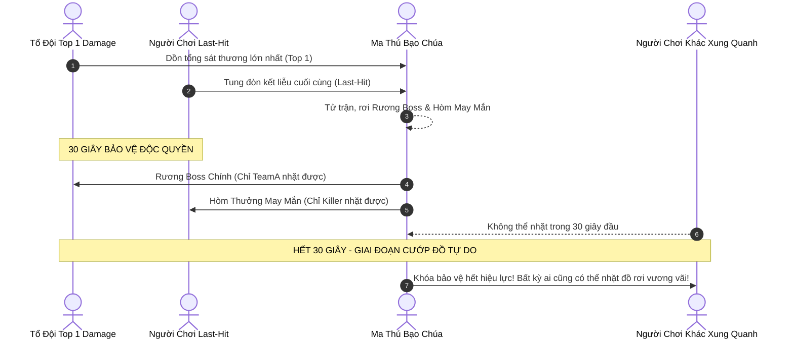

# TÀI LIỆU THIẾT KẾ TÍNH NĂNG & CƠ CHẾ GAMEPLAY (CORE SYSTEMS)
**Dự án:** Astraea Online - Cổ Thư Hỗn Mang (The Shattered Grimoire)  
**Tài liệu:** Game Mechanics & Features Specification (GDD Feature Details)  
**Phiên bản:** 1.0 - Chính thức  

---

## MỤC LỤC TÍNH NĂNG
1. [HỆ THỐNG ẤN KÝ NGUYÊN TỐ (INNATE ELEMENT)](#1-hệ-thống-ấn-ký-nguyên-tố-innate-element)
2. [HỆ THỐNG SÁCH PHÉP & CÂY KỸ NĂNG (GRIMOIRE SYSTEM)](#2-hệ-thống-sách-phép--cây-kỹ-năng-grimoire-system)
3. [HỆ THỐNG FARM QUÁI & AUTO-GRIND (GRINDING LOOP)](#3-hệ-thống-farm-quái--auto-grind-grinding-loop)
4. [HỆ THỐNG SĂN BOSS DÃ NGOẠI & PHÂN KHU 20 CHANNELS](#4-hệ-thống-săn-boss-dã-ngoại--phân-khu-20-channels)
5. [HỆ THỐNG LÒ RÈN & CƯỜNG HÓA +15 (FORGING & WEAPON GLOW)](#5-hệ-thống-lò-rèn--cường-hóa-15-forging--weapon-glow)
6. [HỆ THỐNG KINH TẾ: CHỢ TRỜI & GIAO DỊCH TỰ DO (FREE ECONOMY)](#6-hệ-thống-kinh-tế-chợ-trời--giao-dịch-tự-do-free-economy)
7. [HỆ THỐNG CHIẾN ĐẤU, ĐỒ SÁT & PK THẾ GIỚI (WORLD PVP & KARMA)](#7-hệ-thống-chiến-đấu-đồ-sát--pk-thế-giới-world-pvp--karma)
8. [HỆ THỐNG TỔ ĐỘI & CÔNG THÀNH BANG HỘI (SOCIAL & GUILD WAR)](#8-hệ-thống-tổ-đội--công-thành-bang-hội-social--guild-war)

---

## 1. HỆ THỐNG ẤN KÝ NGUYÊN TỐ (INNATE ELEMENT)

### 1.1. Luồng Trải Nghiệm (User Flow)


### 1.2. Chi Tiết 6 Hệ Nguyên Tố & Hiệu Ứng Bổ Trợ (Utility Perks)
*Nguyên tắc thiết kế:* Giữ nguyên 100% sát thương gốc của đòn đánh, không tạo cơ chế tương khắc khắc hệ trừ máu phi lý (gây mất cân bằng trong PK). Ấn ký cung cấp hiệu ứng tiện ích phụ:

| Hệ Nguyên Tố | Màu VFX Đặc Trưng | Xác Suất Kích Hoạt | Hiệu Ứng Bổ Trợ Chi Tiết |
| :--- | :--- | :---: | :--- |
| **Hỏa (Ignis)** | Đỏ Cam rực lửa | 15% khi đánh trúng | Gây trạng thái **Bỏng**: Rút 1% HP tối đa của mục tiêu mỗi giây trong 3 giây (Tối đa 1 tầng, không cộng dồn). |
| **Băng (Glacies)** | Xanh Băng tinh thể | 15% khi đánh trúng | Gây trạng thái **Đóng Băng Nhẹ**: Giảm 10% tốc độ di chuyển trong 1.5 giây. |
| **Lôi (Fulgur)** | Vàng Chanh sấm sét | 20% khi tung chiêu | Kích hoạt **Hưng Phấn Điện Lực**: Tăng 5% tốc độ xuất chiêu cơ bản trong 2 giây. |
| **Độc (Venom)** | Xanh Dạ Quang / Tím | 20% khi đánh trúng | Gây trạng thái **Nhiễm Độc Sâu**: Giảm 15% lượng hồi máu/hút máu nhận vào trong 3 giây. |
| **Quang (Lux)** | Vàng Kim thánh khiết | 15% khi tung chiêu | Tạo **Khiên Quang Học**: Giảm 5% mọi sát thương nhận vào trong 2 giây. |
| **Ám (Umbra)** | Đen / Tím hư không | 15% khi tung chiêu | Kích hoạt **Hấp Huyết Tâm Trí**: Hồi phục ngay lập tức 2% Mana tiêu hao của kỹ năng vừa đánh. |

### 1.3. Thưởng Đồng Hệ (Element Resonance)
- Khi nhân vật trang bị cuốn Sách Phép có hệ **trùng với Ấn Ký Bẩm Sinh**:
  - Giảm **5%** lượng Mana tiêu hao của mọi kỹ năng trong sách.
  - Tăng **30%** uy lực (sát thương/hồi phục) của các chiêu thức trong cuốn sách đó.
  - Toàn bộ hiệu ứng hạt đạn phép (VFX) tự động chuyển sang dải màu sắc của hệ tương ứng.

### 1.4. Cơ Chế Đổi Hệ (Tẩy Mệnh)
- Đến gặp NPC **Đạo Sĩ Tẩy Mệnh** tại Thành Phố.
- Tiêu tốn: `100.000 Vàng cày cuốc` (hoặc vật phẩm hiếm `Bình Tẩy Hồn` rơi từ Boss Thế Giới).
- Hệ thống roll ngẫu nhiên 1 trong 5 hệ còn lại (đảm bảo không bị trùng lại hệ cũ).

---

## 2. HỆ THỐNG SÁCH PHÉP & CÂY KỸ NĂNG (GRIMOIRE SYSTEM)

Thay vì cố định kỹ năng theo môn phái truyền thống, người chơi định hình phong cách chiến đấu thông qua các cuốn **Cổ Thư (Grimoire)** săn được từ Boss dã ngoại.

### 2.1. Cấu Trúc Trang Bị Sách (2 Ô Kỹ Năng)
- Nhân vật sở hữu **2 Ô Sách:**
  - **Sách Chính (Main Slot):** Kích hoạt bộ 3 phím kỹ năng chính (Q, W, E hoặc Nút 1, 2, 3 trên Mobile).
  - **Sách Phụ (Sub Slot):** Kích hoạt kỹ năng hỗ trợ hoặc chiêu Tuyệt Kỹ Tối Thượng (Phím R hoặc Nút 4 trên Mobile).

### 2.2. Đẳng Cấp Sách (Tome Mastery Cấp 1 - 10)
- Đeo sách vào người khi đánh quái: **Sách tự động hấp thụ 50% lượng EXP của quái** để thăng cấp (không trừ vào EXP của nhân vật).
- Mỗi cấp sách mang lại **1 Điểm Bí Thuật (TP - Tome Point)**. Tối đa 10 TP ở cấp 10.

### 2.3. Cây Kỹ Năng 4 Tầng & Phân Nhánh A/B

```
[Tầng 1: Active Core] (Tốn 1 TP) -> Mở khóa chiêu cơ bản
           │
           ├─────────────────────────┐
           ▼                         ▼
   [Tầng 2 - Nhánh A]       [Tầng 2 - Nhánh B]  (Tốn 3 TP - Chỉ được chọn 1)
   (Tăng tốc / Xuyên thấu)   (Diện rộng / Bộc phá)
           │                         │
           └────────────┬────────────┘
                        ▼
             [Tầng 3: Passive Perk]  (Tốn 2 TP) -> Nội tại bổ trợ chỉ số
                        │
           ┌────────────┴────────────┐
           ▼                         ▼
  [Tầng 4 - Tuyệt Kỹ A]     [Tầng 4 - Tuyệt Kỹ B] (Tốn 4 TP - Chọn 1 chiêu Thức Tỉnh)
```

- **Tính năng Tẩy Điểm Sách:** Sử dụng **Bụi Ma Pháp** (nhặt từ quái thường) để hoàn trả 100% điểm TP, cho phép người chơi tự do thử nghiệm lại giữa Nhánh A và Nhánh B.

### 2.4. Hệ Thống Dòng Ngẫu Nhiên (Affix RNG)
Sách rơi từ Boss dã ngoại sẽ có các dòng thuộc tính ngẫu nhiên:
- **Phẩm chất Trắng (Common):** 0 dòng thuộc tính phụ.
- **Phẩm chất Lam (Rare):** 1 - 2 dòng thuộc tính phụ ngẫu nhiên.
- **Phẩm chất Tím (Epic):** 3 dòng thuộc tính phụ ngẫu nhiên.
- **Phẩm chất Vàng (Mythic):** 4 dòng thuộc tính phụ tối thượng.
- *Bể dòng ngẫu nhiên (Affix Pool):*
  - Giảm thời gian hồi chiêu: `3% ~ 10%`.
  - Mở rộng bán kính kỹ năng diện rộng (AoE): `5% ~ 15%`.
  - Tăng tốc độ bay của đường đạn ma pháp: `10% ~ 25%`.
  - Hút Mana trên mỗi đòn đánh trúng: `1% ~ 3%`.
  - Bổ sung % sát thương chí mạng: `5% ~ 18%`.

---

## 3. HỆ THỐNG FARM QUÁI & AUTO-GRIND (GRINDING LOOP)

### 3.1. Phân Bổ Điểm Tiềm Năng (Manual Stat Allocation)
Mỗi khi thăng 1 Cấp độ, nhân vật nhận được **5 Điểm Tiềm Năng (TN)** để tự do cộng tay vào 4 thuộc tính cơ bản:
- **STR (Sức Mạnh):** 1 điểm = +3 Sát thương vật lý, +2 Sức chứa tối đa túi đồ, +0.2% Sát thương chí mạng.
- **INT (Trí Tuệ):** 1 điểm = +3.5 Sát thương phép, +15 Điểm Mana tối đa, +0.5 Tốc độ hồi mana/5s.
- **DEX (Khéo Léo):** 1 điểm = +0.15% Tỷ lệ chí mạng, +0.1% Tốc đánh, +0.2% Tỷ lệ né đòn.
- **VIT (Thể Lực):** 1 điểm = +25 Máu (HP) tối đa, +1.5 Điểm Giáp, +0.8 Tốc độ hồi máu/5s.

### 3.2. Cơ Chế Auto-Grind Trên Web H5
Nhằm tối ưu cho trải nghiệm người chơi bận rộn trên máy tính văn phòng và điện thoại:
- **Bật/Tắt 1 chạm:** Nút bấm Auto trên góc phải màn hình hoặc nhấn phím tắt `Space`.
- **Phạm vi tự động:** Tự động dò tìm quái vật gần nhất trong bán kính `5m - 10m` quanh điểm đứng ban đầu.
- **Tự động dùng vật phẩm hồi phục:** Thiết lập ngưỡng tự động uống bình Máu khi HP < 50% và uống bình Mana khi MP < 30%.
- **Quy tắc an toàn chống chết:**
  - Tự động dừng tấn công và phát âm thanh cảnh báo khi túi đồ bị đầy 100%.
  - **Tự động ngắt Auto ngay lập tức khi phát hiện bị người chơi khác bật Cờ Đỏ đồ sát tấn công**, giúp người chơi kịp thời phản ứng chiến đấu hoặc bỏ chạy.

---

## 4. HỆ THỐNG SĂN BOSS DÃ NGOẠI & PHÂN KHU 20 CHANNELS

### 4.1. Cấu Trúc 20 Phân Khu (Zone / Channel System)
- Mỗi bản đồ dã ngoại (Thung Lũng, Đầm Lầy, Núi Lửa) được server chia thành **Khu 1 đến Khu 20**.
- **Chuyển khu mượt mà:** Người chơi đứng tại Trụ Dịch Chuyển bản đồ hoặc chọn dropdown trên giao diện, bấm chọn khu vực muốn tới (Thời gian hồi chuyển khu: 10 giây).
- **Mục đích:** Phân tán mật độ người chơi tránh lag giật, đồng thời tạo ra 20 bãi săn Boss độc lập cho cộng đồng tranh tài.

### 4.2. Cơ Chế Báo Động Toàn Server (World Broadcast)
- Boss dã ngoại hồi sinh theo chu kỳ thời gian ngẫu nhiên (Ví dụ: mỗi 4 tiếng/lần ở các khu vực bất kỳ).
- Khi Boss xuất hiện, toàn server xuất hiện thông báo chữ đỏ chạy ngang màn hình:
  > *"Cảnh Báo: Ma Thú Bạo Chúa [Tên Boss] đã giáng lâm tại [Tên Bản Đồ] - [Khu X]!"*

### 4.3. Luật Phân Định Quyền Nhặt Đồ & Tranh Đoạt 30 Giây
Nhằm tái hiện cảm giác tranh cướp đồ cực kỳ hưng phấn của dòng game Võ Lâm / Ngọc Rồng:



- **Top Damage:** Người hoặc tổ đội gây tổng sát thương lớn nhất được bảo vệ quyền nhặt Rương Boss Chính trong 30 giây đầu.
- **Last-Hit:** Người tung đòn kết liễu nhận riêng 1 Hòm Thưởng May Mắn (Rơi Sách hoặc Bùa Cường Hóa).
- **Hết 30 giây:** Mọi vật phẩm chưa kịp nhặt sẽ mở khóa cho toàn bộ người chơi xung quanh lao vào tranh cướp!

---

## 5. HỆ THỐNG LÒ RÈN & CƯỜNG HÓA +15 (FORGING & WEAPON GLOW)

### 5.1. Bảng Tỷ Lệ & Rủi Ro Chi Tiết Từng Cấp

```
[Trang Bị Cần Cường Hóa] + [Đá Cường Hóa Tương Ứng] + [Tiền Vàng]
                       │
                       ▼
          [LÒ RÈN THỢ RÈN VULCAN]
                       │
         ┌─────────────┴─────────────┐
         ▼                           ▼
    THÀNH CÔNG                    THẤT BẠI
   (Tăng +1 Cấp)      (Tùy theo mốc an toàn / rớt cấp / vỡ)
```

| Mốc Cấp | Tỷ Lệ % | Kết Quả Khi Thất Bại | Biện Pháp & Vật Phẩm Hỗ Trợ |
| :---: | :---: | :--- | :--- |
| **+1** | 100% | Không có thất bại | Không cần |
| **+2** | 100% | Không có thất bại | Không cần |
| **+3** | 100% | Không có thất bại | Không cần |
| **+4** | 60% | Giảm về +3 | Bột May Mắn sơ cấp (+5% tỷ lệ) |
| **+5** | 50% | Giảm về +4 | Bột May Mắn sơ cấp (+5% tỷ lệ) |
| **+6** | 45% | Giảm về +5 | Bột May Mắn sơ cấp (+5% tỷ lệ) |
| **+7** | 35% | **Rớt thẳng về mốc an toàn (+4)** | Dùng **Bùa Hộ Mệnh Thường** để giữ nguyên cấp |
| **+8** | 25% | **Rớt thẳng về mốc an toàn (+4)** | Dùng **Bùa Hộ Mệnh Thường** để giữ nguyên cấp |
| **+9** | 20% | **Rớt thẳng về mốc an toàn (+4)** | Dùng **Bùa Hộ Mệnh Thường** để giữ nguyên cấp |
| **+10** | 15% | Rớt về +4 (Không bùa rớt về +0) | Bắt buộc dùng **Bùa Hộ Mệnh Cao Cấp** |
| **+11** | 10% | Rớt về +4 (Không bùa rớt về +0) | Bắt buộc dùng **Bùa Hộ Mệnh Cao Cấp** |
| **+12** | 8% | Rớt về +4 (Không bùa rớt về +0) | Bắt buộc dùng **Bùa Hộ Mệnh Cao Cấp** |
| **+13** | 5% | Rớt về +0, **10% nguy cơ VỠ VỤN** | Dùng Bùa Cao Cấp + Bột May Mắn Thượng Hạng |
| **+14** | 3% | Rớt về +0, **10% nguy cơ VỠ VỤN** | Dùng Bùa Cao Cấp + Bột May Mắn Thượng Hạng |
| **+15** | **1.5%** | **VỠ NÁT 100% thành Bụi Ma Pháp** | Cần **Bùa Thần Thánh Bảo Mệnh** chống vỡ |

### 5.2. Hiệu Ứng Hào Quang Vũ Khí (Weapon Glow) 5 Bậc Đẳng Cấp
Khi nhân vật cầm vũ khí đã cường hóa, hệ thống shader đồ họa tự động kích hoạt hiệu ứng phát sáng hiển thị cho toàn server chiêm ngưỡng:
1. **Mốc +4 đến +6:** Ánh sáng trắng mờ dịu, bao bọc mờ quanh lưỡi kiếm.
2. **Mốc +7 đến +9:** Hào quang xanh lơ nhấp nháy liên tục, để lại vệt sáng khi vung chém.
3. **Mốc +10 đến +12:** Hào quang vàng kim rực rỡ tỏa rộng, hào khí ngút trời.
4. **Mốc +13 đến +14:** Hào quang đỏ rực như máu, kèm theo các tia chớp điện giật lách tách liên hồi quanh thân vũ khí.
5. **Mốc +15 (Thần Khí Tối Thượng):** Hào quang chuyển sắc cầu vồng huyền ảo liên tục (Tím - Hồng - Vàng - Xanh Ngọc), phát tán luồng linh khí hư không + Thông báo vinh danh tên tuổi người chơi trên toàn máy chủ!

---

## 6. HỆ THỐNG KINH TẾ: CHỢ TRỜI & GIAO DỊCH TỰ DO (FREE ECONOMY)

Đây là linh hồn giữ chân game thủ cày cuốc theo đúng bản sắc **Teamobi & Kiếm Thế**:

### 6.1. Quy Tắc "Unbound 100%"
- Toàn bộ Sách Phép, Đá Cường Hóa, Trang Bị và Dược Phẩm nhặt được từ đánh quái và săn Boss dã ngoại đều ở trạng thái **Không Khóa (Unbound)**.
- Người chơi cày chay nhặt được đồ xịn khác hệ hoàn toàn có thể bán lấy tiền hoặc đổi đồ cho người khác mà không bị hệ thống ép khóa vật phẩm.

### 6.2. Dựng Sạp Hàng Chợ Trời (Player Stalls)
- Tại Quảng Trường Trung Tâm Thành Phố, người chơi mở túi đồ chọn tính năng: **"Dựng Sạp Bán Hàng"**.
- Thiết lập:
  - Tên sạp hàng: Tối đa 30 ký tự (Ví dụ: *"Bán Sách Lôi Epic - Mua Đá Cường Hóa"*).
  - Chọn tối đa **10 vật phẩm** bày bán.
  - Định giá bán cho từng món bằng đơn vị **Vàng** hoặc **Ngọc**.
- Sau khi mở sạp, nhân vật sẽ ngồi khoanh chân dựng biển hiệu bán hàng tự động. Những người chơi khác đi ngang qua chỉ cần click vào sạp để xem bảng giá và bấm mua ngay lập tức.

### 6.3. Giao Dịch P2P Trực Tiếp 2 Bước (Face-to-Face Trade)
- Hai người chơi đứng cạnh nhau trong thành phố, chọn đối phương và bấm **"Mời Giao Dịch"**.
- Cửa sổ giao dịch mở ra với 2 bên độc lập hiển thị các ô đặt đồ và ô nhập tiền.
- **Cơ chế bảo mật 2 bước chống tráo đồ:**
  - **Bước 1 (Khóa Đồ):** Sau khi đặt đồ và tiền xong, 2 bên bấm "Khóa". Khi đã khóa, không ai có thể thay đổi số tiền hoặc rút đồ ra được nữa.
  - **Bước 2 (Xác Nhận Đổi):** Sau khi cả 2 bên cùng bấm "Khóa", nút "Xác Nhận Giao Dịch" mới sáng lên. Bấm xác nhận thì đồ và tiền mới chính thức được chuyển đổi.

---

## 7. HỆ THỐNG CHIẾN ĐẤU, ĐỒ SÁT & PK THẾ GIỚI (WORLD PVP & KARMA)

### 7.1. Ba Trạng Thái Cờ Chiến Đấu
Người chơi bấm vào biểu tượng cờ cạnh ảnh đại diện nhân vật để đổi chế độ:
- **Cờ Trắng (Hòa Bình):** Trạng thái mặc định. Không thể tấn công người chơi khác và hoàn toàn miễn nhiễm trước đòn đánh của những người cùng cờ trắng.
- **Cờ Đỏ (Đồ Sát):** Cho phép tấn công bất kỳ ai ngoài khu vực an toàn.
  - Bật cờ mất **5 giây chuẩn bị** (có thanh đếm lùi để cảnh báo xung quanh).
  - Tắt cờ cần **30 giây không phát sinh bất kỳ giao tranh nào**.
- **Cờ Bang (Guild PK):** Tự động chuyển toàn bộ người chơi thuộc các Bang Hội khác thành mục tiêu tấn công hợp lệ trong các khu vực dã ngoại và sự kiện.

### 7.2. Điểm Tội Ác (PK Points) & Trừng Phạt Tên Đỏ (Hắc Danh)
- Khi đang bật Cờ Đỏ và hạ gục 1 người chơi vô tội (Cờ Trắng):
  - Người chơi bị cộng ngay lập tức **+1 Điểm Tội Ác (PK Point)**.
  - Tên nhân vật đổi sang **Màu Đỏ**.
- **Hình phạt dành cho Tên Đỏ:**
  - Bị lính gác NPC tại cổng thành phố tự động tấn công truy sát.
  - Không thể sử dụng dịch chuyển nhanh của Trụ Dịch Chuyển.
  - **Khi bị hạ gục:** Rơi ngay lập tức **10% số Vàng** đang mang theo ra đất, đồng thời tăng **50% tỷ lệ làm rơi 1 món trang bị đang mặc trên người ra ngoài!**
- **Rửa Tội:**
  - Cày quái chuộc lỗi: Đánh gục 100 quái thường cấp tương đương để giảm 1 Điểm PK.
  - Dùng tiền mua "Thư Sám Hối" từ NPC Tu Sĩ để xóa điểm tội ác.

### 7.3. Khu Vực An Toàn Tuyệt Đối (Safe Zone)
- Toàn bộ phạm vi Làng Khởi Nguyên, Thành Phố Trung Tâm và bán kính 10m quanh Trụ Hồi Sinh được bảo hộ bởi phong ấn hòa bình: Tuyệt đối cấm bật cờ đồ sát, cấm mọi hành vi gây sát thương giữa người chơi.

---

## 8. HỆ THỐNG TỔ ĐỘI & CÔNG THÀNH BANG HỘI (SOCIAL & GUILD WAR)

### 8.1. Hệ Thống Tổ Đội (Party System)
- Số lượng: Tối đa **4 thành viên/đội**.
- **Cơ chế buff lợi ích nhóm:** Mỗi khi có thêm 1 đồng đội đứng chung trong tầm nhìn màn hình, toàn bộ thành viên nhận thêm **+10% EXP nhận được từ quái vật** (Đủ đội 4 người tăng tổng cộng **+40% EXP**).
- **Giao diện hỗ trợ:** Hiển thị thanh máu/mana thời gian thực của đồng đội, tọa độ khu vực (Khu X) và chấm xanh biểu thị vị trí trên Minimap.

### 8.2. Hệ Thống Bang Hội (Guild System)
- **Thành lập:** Yêu cầu nhân vật đạt Cấp 30 và nộp lệ phí 500.000 Vàng.
- Sức chứa: Khởi điểm 50 thành viên.
- **Kỹ Năng Bang Hội:** Thành viên đóng góp Vàng/Ngọc để nâng cấp cây kỹ năng bang:
  - Tăng % Máu tối đa toàn bang (+2% ~ +10%).
  - Tăng Tốc độ chạy ngoài dã ngoại (+3% ~ +8%).
  - Tăng Tỷ lệ rơi vàng khi đánh quái (+5% ~ +15%).

### 8.3. Sự Kiện Công Thành Chiếm Mỏ Vực Đá Quý (20:00 Thứ Bảy Hàng Tuần)
- **Thời gian diễn ra:** Đúng 20:00 đến 21:00 tối Thứ Bảy hàng tuần.
- **Địa điểm:** Bản đồ đặc biệt Vực Đá Quý (Không bị phạt điểm tội ác khi giao chiến).
- **Mục tiêu:** Tại trung tâm bản đồ có **Cột Trụ Long Mạch**. Bang hội nào gây sát thương cuối cùng hoặc chiếm giữ trụ liên tục trong 15 phút sẽ trở thành Bang Chủ Quản Lý Vực Đá Quý trong tuần đó.
- **Đặc quyền tối thượng của Bang Thắng Cuộc:**
  - Toàn bộ thành viên bang nhận được gói quà **Đá Cường Hóa Cao Cấp mỗi ngày**.
  - Tên Bang Hội được khắc lên Tượng Đài Vinh Danh tại Quảng Trường Trung Tâm.
  - **Hưởng 5% tổng doanh thu thuế giao dịch Vàng tại Chợ Trời toàn server trong suốt tuần đó!**
