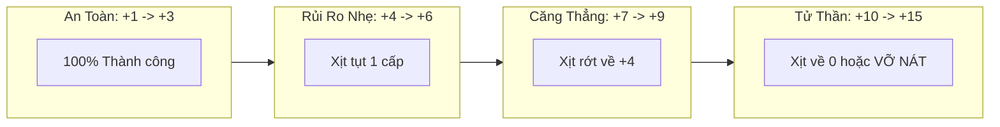

# TÀI LIỆU CÔNG THỨC TOÁN HỌC & CÂN BẰNG CHỈ SỐ (GAME MATH & BALANCE)
**Dự án:** Astraea Online - Cổ Thư Hỗn Mang (The Shattered Grimoire)  
**Tài liệu:** Combat Formulas, Stat Scaling, EXP Curves & Probability Tables  
**Phiên bản:** 1.0 - Chuẩn Production  

---

## MỤC LỤC
1. [HỆ THỐNG THUỘC TÍNH CƠ BẢN & CÔNG THỨC QUY ĐỔI](#1-hệ-thống-thuộc-tính-cơ-bản--công-thức-quy-đổi)
2. [CÔNG THỨC TÍNH SÁT THƯƠNG & KHẮC CHẾ (COMBAT FORMULAS)](#2-công-thức-tính-sát-thương--khắc-chế-combat-formulas)
3. [ĐƯỜNG CONG KINH NGHIỆM (EXP CURVE CẤP 1 - 60)](#3-đường-cong-kinh-nghiệm-exp-curve-cấp-1---60)
4. [BẢNG CHỈ SỐ QUÁI VẬT & MA THÚ BẠO CHÚA (MONSTER STATS TABLE)](#4-bảng-chỉ-số-quái-vật--ma-thú-bạo-chúa-monster-stats-table)
5. [MÔ HÌNH TOÁN XÁC SUẤT CƯỜNG HÓA VŨ KHÍ (+1 ĐẾN +15)](#5-mô-hình-toán-xác-suất-cường-hóa-vũ-khí-1-đến-15)
6. [HỆ THỐNG TRỌNG SỐ DÒNG NGẪU NHIÊN (AFFIX RNG WEIGHTS)](#6-hệ-thống-trọng-số-dòng-ngẫu-nhiên-affix-rng-weights)
7. [CÂN BẰNG PVP & TỶ LỆ TRỪNG PHẠT TÊN ĐỎ](#7-cân-bằng-pvp--tỷ-lệ-trừng-phạt-tên-đỏ)

---

## 1. HỆ THỐNG THUỘC TÍNH CƠ BẢN & CÔNG THỨC QUY ĐỔI

Mỗi nhân vật khởi tạo tại Cấp 1 có bộ chỉ số nền cơ sở (Base Stats):
- `Base_HP = 200`, `Base_MP = 100`
- `Base_Phys_ATK = 15`, `Base_Magic_ATK = 15`
- `Base_Armor = 10`, `Base_Magic_Resist = 10`
- `Base_Crit_Rate = 5%`, `Base_Crit_Damage = 150%`
- `Base_Move_Speed = 200` (pixels/giây trên màn hình canvas)

### 1.1. Công Thức Thăng Cấp & Điểm Tiềm Năng
- Mỗi khi tăng 1 Cấp độ (Level Up):
  - Nhận tự động: `+30 HP Tối Đa`, `+10 MP Tối Đa`, `+1 Giáp`, `+1 Kháng Phép`.
  - Nhận **5 Điểm Tiềm Năng (TN)** để người chơi tự do phân bổ.

### 1.2. Bảng Quy Đổi Điểm Tiềm Năng Chi Tiết

$$\begin{aligned}
\text{Total\_Phys\_ATK} &= \text{Base\_Phys\_ATK} + (\text{STR} \times 3.0) + \text{Gear\_Phys\_ATK} \\
\text{Total\_Magic\_ATK} &= \text{Base\_Magic\_ATK} + (\text{INT} \times 3.5) + \text{Gear\_Magic\_ATK} \\
\text{Total\_HP} &= \text{Base\_HP} + (\text{Level} \times 30) + (\text{VIT} \times 25.0) + \text{Gear\_HP} \\
\text{Total\_MP} &= \text{Base\_MP} + (\text{Level} \times 10) + (\text{INT} \times 15.0) + \text{Gear\_MP} \\
\text{Total\_Armor} &= \text{Base\_Armor} + (\text{Level} \times 1) + (\text{VIT} \times 1.5) + \text{Gear\_Armor} \\
\text{Total\_Crit\_Chance} &= \text{Base\_Crit} + (\text{DEX} \times 0.15\%) + \text{Gear\_Crit} \quad (\text{Max Cap: } 75\%) \\
\text{Total\_Crit\_Dmg} &= 150\% + (\text{STR} \times 0.20\%) + \text{Gear\_Crit\_Dmg} \\
\text{Total\_Evasion} &= (\text{DEX} \times 0.20\%) + \text{Gear\_Evasion} \quad (\text{Max Cap: } 40\%) \\
\text{Total\_Attack\_Speed} &= 1.0 + (\text{DEX} \times 0.001) \quad (\text{Hệ số nhân tốc độ ra đòn})
\end{aligned}$$

---

## 2. CÔNG THỨC TÍNH SÁT THƯƠNG & KHẮC CHẾ (COMBAT FORMULAS)

Hệ thống tính toán sát thương được xây dựng theo chuẩn MMORPG chống lạm phát chỉ số (Diminishing Returns) giống cơ chế phòng ngự của Warcraft 3 / League of Legends / Diablo.

### 2.1. Công Thức Giảm Trừ Sát Thương Theo Giáp (Damage Mitigation)
Tỷ lệ giảm trừ sát thương vật lý nhận vào ($DR_{phys}$) và ma pháp ($DR_{magic}$) được tính như sau:

$$DR_{phys} = \frac{\text{Armor}}{\text{Armor} + 400 + (8 \times \text{Attacker\_Level})}$$

*Ví dụ minh họa:*
- Nhân vật cấp 20 có `Armor = 200`. Địch cấp 20 tấn công.
- Tỷ lệ cản sát thương: $DR = \frac{200}{200 + 400 + 160} = \frac{200}{760} \approx 26.3\%$ (Người chơi chỉ nhận $73.7\%$ sát thương).
- Khi `Armor = 600`, tỷ lệ cản: $DR = \frac{600}{600 + 560} \approx 51.7\%$.

### 2.2. Kiểm Tra Né Đòn (Accuracy vs Evasion)
Xác suất đánh trúng của đòn đánh:

$$\text{Hit\_Rate} = \min\Big(0.95, \, \max\big(0.05, \, 1.0 - (\text{Defender\_Evasion} - \text{Attacker\_Accuracy})\big)\Big)$$

- Luôn giữ tối thiểu 5% cơ hội đánh trúng hoặc né tránh ngẫu nhiên để tạo tính bất ngờ trong combat.

### 2.3. Công Thức Sát Thương Cuối Cùng (Final Output Damage)

$$\text{Raw\_Damage} = (\text{Base\_Skill\_Damage} + \text{Stat\_Scaling}) \times \text{Resonance\_Multiplier}$$

Trong đó:
- $\text{Resonance\_Multiplier} = 1.3$ (Nếu Sách Phép trùng Ấn Ký Nguyên Tố bẩm sinh).
- Nếu không trùng hệ: $\text{Resonance\_Multiplier} = 1.0$.

Nếu kích hoạt Bạo Kích (Critical Hit):
$$\text{Crit\_Damage} = \text{Raw\_Damage} \times \frac{\text{Total\_Crit\_Dmg}}{100}$$

Sát thương thực tế mục tiêu gánh chịu (Final Damage Taken):
$$\text{Final\_Damage} = \text{Crit\_Damage} \times (1 - DR) \times \text{PvP\_Modifier}$$

*(Lưu ý: $\text{PvP\_Modifier} = 0.6$ khi 2 người chơi đánh nhau để tránh hiện tượng sốc chết trong 1 nốt nhạc).*

---

## 3. ĐƯỜNG CONG KINH NGHIỆM (EXP CURVE CẤP 1 - 60)

Hệ thống EXP được thiết kế theo hàm lũy thừa dốc nhằm tạo cảm giác lên cấp nhanh ở giai đoạn đầu (tạo hưng phấn) và chậm dần ở mốc 40+ để kích thích người chơi giao lưu, lập đội săn Boss dã ngoại.

$$\text{EXP\_Required}(L) = \left\lfloor 100 \times L^{2.15} + 50 \times L \right\rfloor$$

### 3.1. Bảng EXP Mẫu Theo Từng Cột Mốc

| Cấp Độ (Level) | EXP Cần Để Lên Cấp Kế | Tổng EXP Tích Lũy | Thời Gian Cày Ước Tính | Khu Vực Hoạt Động |
| :---: | :---: | :---: | :---: | :--- |
| **1** | 150 | 0 | 1 phút | Làng Khởi Nguyên |
| **5** | 3,450 | 7,200 | 10 phút | Cánh Đồng Nấm |
| **10 (Thức Tỉnh)** | 14,800 | 45,500 | 30 phút | Đền Thần Vực |
| **15** | 35,200 | 165,000 | 1.5 giờ | Rừng Sơ Khai (Boss Spore King) |
| **20** | 65,400 | 410,000 | 3 giờ | Thung Lũng Cỏ Gió |
| **30** | 158,000 | 1,480,000 | 8 giờ | Đầm Lầy Tử Khí |
| **40** | 295,000 | 3,750,000 | 20 giờ | Hẻm Núi Gió Hú (Bắt đầu PK) |
| **50** | 480,000 | 7,600,000 | 45 giờ | Núi Lửa Tro Tàn |
| **60 (Max Cấp)** | 720,000 | 13,800,000 | 90+ giờ | Vết Nứt Hư Không & Vực Đá Quý |

### 3.2. Công Thức Phân Chia EXP Trong Tổ Đội (Party)
Khi 1 thành viên trong tổ đội hạ gục quái vật:

$$\text{Total\_Party\_EXP} = \text{Monster\_EXP} \times [1 + 0.10 \times (\text{Số thành viên cùng map} - 1)]$$

- Đội 1 người: $100\%$ EXP
- Đội 2 người: $110\%$ EXP chia đều ($55\%$ mỗi người)
- Đội 3 người: $120\%$ EXP chia đều ($40\%$ mỗi người)
- Đội 4 người: $130\%$ EXP chia đều (Nếu đứng sát nhau cùng màn hình được buff thêm **+10% Party Synergy**, tổng cộng nhận **$140\%$ EXP**).

---

## 4. BẢNG CHỈ SỐ QUÁI VẬT & MA THÚ BẠO CHÚA (MONSTER STATS TABLE)

| Tên Quái Vật | Cấp Độ | Máu (HP) | Sát Thương (ATK) | Giáp (Armor) | EXP Rơi | Vàng (Gold) | Tỷ Lệ Rơi Đồ Đặc Biệt |
| :--- | :---: | :---: | :---: | :---: | :---: | :---: | :--- |
| **Ốc Sên Vỏ Gai** | 1 | 80 | 8 - 12 | 2 | 25 | 2 - 5 | 10% Nhặt Mảnh Tàn Trang |
| **Nấm Độc Biến Dị** | 5 | 220 | 18 - 24 | 8 | 70 | 8 - 15 | 8% Mảnh Tàn Trang, 2% Đá Cấp 1 |
| **Heo Rừng Cuồng Nộ** | 10 | 650 | 45 - 60 | 20 | 210 | 25 - 40 | 5% Đá Cấp 1, 1% Trang Bị Lam |
| **Ma Thú Spore King (Boss)** | **15** | **18,500** | **120 - 160** | **65** | **8,500** | **500 - 1,200** | **100% Rơi Sách Lam, 30% Đá Cấp 2** |
| **Sói Bão Cỏ Gió** | 22 | 1,800 | 95 - 120 | 45 | 520 | 60 - 90 | 4% Đá Cấp 2, 2% Bụi Ma Pháp |
| **Bạo Trăn Đầm Lầy** | 30 | 3,400 | 160 - 210 | 80 | 1,100 | 120 - 180 | 3% Đá Cấp 2, 1% Sách Lam |
| **Xà Thần Hydra (Boss)** | **35** | **85,000** | **350 - 480** | **150** | **38,000** | **3,000 - 6,000** | **80% Sách Tím (Epic), 50% Đá Cấp 3** |
| **Hắc Báo Tro Tàn** | 42 | 6,200 | 280 - 350 | 140 | 2,400 | 250 - 380 | 5% Đá Cấp 3, 3% Bụi Ma Pháp |
| **Hỏa Viêm Golem (Boss)** | **48** | **240,000** | **750 - 980** | **320** | **110,000** | **15,000** | **100% Sách Tím, 20% Sách Vàng** |
| **Void Herald (World Boss)**| **60** | **850,000** | **1,800 - 2,400**| **580** | **450,000** | **50,000** | **100% Sách Thần Thoại Vàng, Bùa Hộ Mệnh**|

---

## 5. MÔ HÌNH TOÁN XÁC SUẤT CƯỜNG HÓA VŨ KHÍ (+1 ĐẾN +15)

Cơ chế cường hóa là cỗ máy "hút vàng" (Gold Sink) và giữ giá trị cho tài nguyên trong game.

### 5.1. Bảng Tính Kỳ Vọng Chi Phí (Expected Cost Matrix)

*Giả định: Đá Cường Hóa sơ cấp = 1,000 Vàng, Đá trung cấp = 5,000 Vàng, Đá cao cấp = 25,000 Vàng.*

| Cấp Độ Mục Tiêu | Tỷ Lệ Cơ Bản | Phí Vàng Mỗi Lần | Loại Đá Yêu Cầu | Số Lần Thử Trung Bình (Kỳ Vọng) | Chỉ Số Vũ Khí Tăng Thêm |
| :---: | :---: | :---: | :---: | :---: | :---: |
| **+1** | 100% | 1,000 | Đá Cấp 1 x1 | 1 lần | +5 ATK |
| **+2** | 100% | 2,000 | Đá Cấp 1 x2 | 1 lần | +10 ATK |
| **+3** | 100% | 3,000 | Đá Cấp 1 x3 | 1 lần | +18 ATK |
| **+4** | 60% | 5,000 | Đá Cấp 2 x1 | 1.67 lần | +30 ATK (Bắt đầu phát sáng trắng) |
| **+5** | 50% | 8,000 | Đá Cấp 2 x2 | 3.2 lần (do rớt +4) | +45 ATK |
| **+6** | 45% | 12,000 | Đá Cấp 2 x3 | 6.5 lần | +65 ATK |
| **+7** | 35% | 20,000 | Đá Cấp 3 x1 | ~14 lần (Rớt về +4) | +95 ATK (Hào quang xanh lơ) |
| **+8** | 25% | 30,000 | Đá Cấp 3 x2 | ~35 lần | +135 ATK |
| **+9** | 20% | 45,000 | Đá Cấp 3 x3 | ~90 lần | +185 ATK |
| **+10** | 15% | 70,000 | Đá Cấp 4 x1 | ~220 lần | +260 ATK (Hào quang vàng kim) |
| **+11** | 10% | 100,000 | Đá Cấp 4 x2 | ~550 lần | +360 ATK |
| **+12** | 8% | 150,000 | Đá Cấp 4 x3 | ~1,200 lần | +490 ATK |
| **+13** | 5% | 250,000 | Đá Cấp 5 x1 | ~3,100 lần | +660 ATK (Hào quang đỏ rực + Sét) |
| **+14** | 3% | 400,000 | Đá Cấp 5 x2 | ~8,500 lần | +880 ATK |
| **+15** | **1.5%** | 1,000,000 | Đá Cấp 5 x5 | **~25,000 lần** | **+1,250 ATK (Cầu vồng tím Thần Khí)** |

---

## 6. HỆ THỐNG TRỌNG SỐ DÒNG NGẪU NHIÊN (AFFIX RNG WEIGHTS)

Khi một cuốn Sách Phép rơi ra từ Ma Thú Bạo Chúa, server thực thi thuật toán chọn dòng ngẫu nhiên dựa trên bảng trọng số:

$$\text{Xác suất ra dòng } i = \frac{\text{Weight}_i}{\sum \text{Weights}}$$

### 6.1. Bảng Trọng Số & Biên Độ Chỉ Số (Min - Max Range)

| Mã Dòng (Affix ID) | Tên Thuộc Tính Hiển Thị | Trọng Số (Weight) | Tỷ Lệ Xuất Hiện (%) | Khoảng Giá Trị Min - Max |
| :--- | :--- | :---: | :---: | :---: |
| `AFFIX_CDR` | Giảm thời gian hồi chiêu | 150 | 15.0% | `3% ~ 10%` |
| `AFFIX_AOE` | Mở rộng bán kính diện rộng chiêu | 120 | 12.0% | `5% ~ 15%` |
| `AFFIX_PROJ_SPD` | Tăng tốc độ bay của đường đạn | 140 | 14.0% | `10% ~ 25%` |
| `AFFIX_MANA_LEECH`| Hút Mana khi tấn công | 80 | 8.0% | `1.0% ~ 3.0%` |
| `AFFIX_CRIT_CHANCE`| Tăng tỷ lệ bạo kích | 100 | 10.0% | `2.0% ~ 6.0%` |
| `AFFIX_CRIT_DMG` | Tăng sát thương bạo kích | 90 | 9.0% | `8.0% ~ 20.0%` |
| `AFFIX_ATK_SPEED` | Tăng tốc độ xuất chiêu cơ bản | 110 | 11.0% | `3.0% ~ 8.0%` |
| `AFFIX_PENETRATION`| Xuyên giáp / Xuyên kháng phép | 70 | 7.0% | `5.0% ~ 12.0%` |
| `AFFIX_RES_BOOST` | Tăng thêm sát thương đồng hệ | 60 | 6.0% | `5.0% ~ 15.0%` |
| `AFFIX_ALL_STATS` | Tăng toàn bộ 4 chỉ số tiềm năng | 30 | 3.0% | `+5 ~ +15 Điểm` |
| **TỔNG** | - | **1,000** | **100%** | - |

---

## 7. CÂN BẰNG PVP & TỶ LỆ TRỪNG PHẠT TÊN ĐỎ

### 7.1. Điều Chỉnh Sát Thương Người vs Người (PvP Damage Normalization)
Để đảm bảo trong PvP không có hiện tượng 1 chiêu "one-shot" gây ức chế:
- **Global PvP Multiplier:** Toàn bộ sát thương giữa người chơi với nhau tự động nhân với hệ số **$0.60$ (Giảm 40% sát thương gốc)**.
- **Kháng hiệu ứng khống chế (Crowd Control Diminishing Returns):**
  - Nếu người chơi bị làm chậm hoặc choáng 2 lần liên tiếp trong vòng 4 giây, thời gian tác dụng của lần thứ 2 giảm đi **50%**, lần thứ 3 được **miễn nhiễm khống chế trong 3 giây**.

### 7.2. Bảng Phạt Hắc Danh (Điểm PK & Rơi Đồ Khi Tử Trận)

| Điểm PK | Màu Tên Hiển Thị | Tỷ Lệ Rơi Vàng Đang Giữ | Xác Suất Rơi 1 Món Đồ Trên Người | Hình Phạt Phụ |
| :---: | :---: | :---: | :---: | :--- |
| **0** | **Trắng** | 0% | **0% (Không bao giờ rớt)** | Không có |
| **1 - 3** | **Cam Nhạt** | 3% Vàng | 5% | Giảm 10% tốc chạy khi vào Thành Phố |
| **4 - 9** | **Đỏ Tươi** | 10% Vàng | **25%** | Lính gác cổng thành tấn công ngay khi gặp |
| **10+** | **Đỏ Đậm (Đại Ma Đầu)** | **25% Vàng** | **50%** | Bị cấm dùng Trụ Dịch Chuyển & Cửa Hàng NPC |
