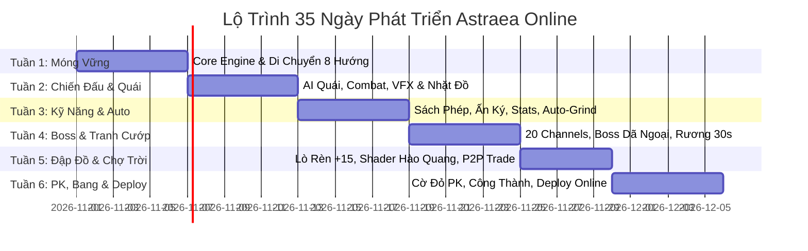

# KẾ HOẠCH TRIỂN KHAI PHÁT TRIỂN THEO TỪNG NGÀY (DAY-BY-DAY SPRINT ROADMAP)
**Dự án:** Astraea Online - Cổ Thư Hỗn Mang  
**Mục tiêu:** Xây dựng hoàn chỉnh Web MMORPG 2.5D Isometric 8 hướng (Vibe Võ Lâm Truyền Kỳ / Diablo)  
**Thời gian:** 35 Ngày (5 Tuần Tăng Tốc - 7 Ngày/Tuần)  
**Phiên bản:** 1.0 - Lộ trình thực thi chi tiết  

---

## TỔNG QUAN TIẾN ĐỘ 5 TUẦN

---

## TUẦN 1: MÓNG CÔNG NGHỆ, CLIENT/SERVER & DI CHUYỂN 8 HƯỚNG

### 🎯 Ngày 1: Khởi Tạo Dự Án Monorepo & Kiến Trúc Core
- **Mục tiêu:** Thiết lập môi trường phát triển đồng bộ giữa Client và Server.
- **Công việc cụ thể:**
  1. Khởi tạo cấu trúc Monorepo: Thư mục `client/` (Phaser 3 + Vite + TypeScript) và `server/` (Node.js + Colyseus + TypeScript) và `shared/` (chứa Data Types & Math formulas dùng chung).
  2. Cấu hình file `package.json`, TypeScript `tsconfig.json` với path aliases.
  3. Cài đặt ESLint, Prettier và build script cho cả 2 phía.
- **Kết quả đầu ra (Deliverable):** Gõ `npm run dev` khởi động đồng thời cả Web Client cổng `3000` và Colyseus Server cổng `2567`.

### 🎯 Ngày 2: Bản Đồ Lưới Ô 2.5D Isometric (Tilemap Engine)
- **Mục tiêu:** Hiển thị bản đồ góc nhìn chéo 45 độ (Diamond Isometric) mượt mà.
- **Công việc cụ thể:**
  1. Thiết lập ma trận tọa độ Isometric: Hàm chuyển đổi giữa `Cartesian (x, y)` và `Isometric (isoX, isoY)`:
     $$isoX = (x - y) \times \frac{\text{TileWidth}}{2}, \quad isoY = (x + y) \times \frac{\text{TileHeight}}{2}$$
  2. Tạo bộ Tilemap Làng Khởi Nguyên kích thước $64 \times 64$ ô với các lớp Ground, Obstacles (vật cản không đi qua được).
  3. Tích hợp thuật toán tìm đường **A* Pathfinding (hoặc Navmesh)** trên lưới Isometric.
- **Kết quả đầu ra:** Click chuột vào vị trí bất kỳ trên map, hệ thống tự vẽ đường đi ngắn nhất tránh các tảng đá/cây cối.

### 🎯 Ngày 3: Asset Pipeline - Cắt Ghép Sprite Sheet 8 Hướng
- **Mục tiêu:** Đưa nhân vật cử động 8 hướng mượt mà vào engine.
- **Công việc cụ thể:**
  1. Chuẩn hóa bộ khung chuyển động 8 hướng cho nhân vật:
     - 5 Trạng thái: `Idle` (Đứng chờ), `Walk` (Di chuyển), `Attack` (Chém), `Hurt` (Trúng đòn), `Die` (Tử trận).
     - 8 Hướng la bàn: N, NE, E, SE, S, SW, W, NW (Áp dụng lật ảnh FlipX cho 3 hướng đối xứng).
  2. Sử dụng TexturePacker gom toàn bộ frame ảnh thành 1 file Texture Atlas `.png` và `.json`.
  3. Khởi tạo `AnimationController` trong Phaser để tự động phát chuỗi frame theo góc quay chuột.
- **Kết quả đầu ra:** Nhân vật đứng thở và quay mặt theo đúng hướng chuột rê trên màn hình.

### 🎯 Ngày 4: Hệ Thống Điều Khiển Hybrid (PC Click & Mobile Joystick)
- **Mục tiêu:** Chơi mượt trên cả trình duyệt máy tính lẫn điện thoại cảm ứng.
- **Công việc cụ thể:**
  1. **Chế độ PC:** Click chuột trái để di chuyển theo tọa độ click, click vào quái để tự động tiếp cận và tấn công. Phím tắt `1, 2, 3, 4` tung chiêu.
  2. **Chế độ Mobile:** Tự động nhận diện thiết bị cảm ứng, bật cụm **Cần gạt ảo (Virtual Joystick)** bên trái và cụm nút kỹ năng hình quạt bên phải màn hình.
  3. Camera cuộn mượt mà (Smooth Camera Follow với Lerp $0.1$).
- **Kết quả đầu ra:** Thao tác di chuyển thử nghiệm trên điện thoại và PC đều phản hồi cực kỳ nhanh nhạy.

### 🎯 Ngày 5: Kết Nối WebSocket & Đồng Bộ Nhiều Người Chơi (Multiplayer Sync)
- **Mục tiêu:** 2 người chơi mở 2 tab trình duyệt nhìn thấy nhau di chuyển trong thời gian thực.
- **Công việc cụ thể:**
  1. Xây dựng `LobbyRoom` và `MapRoom` trên Colyseus Server.
  2. Quản lý State nhân vật: `x, y, currentHp, state, direction`.
  3. Client gửi gói tin Input di chuyển lên Server. Server kiểm tra tính hợp lệ (Anti-Cheat Server-Authoritative) và broadcast State về cho các Client xung quanh.
- **Kết quả đầu ra:** Mở 2 cửa sổ Chrome cạnh nhau, nhân vật ở tab 1 chạy thì tab 2 thấy di chuyển mượt mà.

### 🎯 Ngày 6: Nội Suy Chuyển Động (Client-side Interpolation) & Đóng Gói Tuần 1
- **Mục tiêu:** Loại bỏ hoàn toàn hiện tượng giật cục khi mạng lag (Ping 100ms+).
- **Công việc cụ thể:**
  1. Áp dụng kỹ thuật nội suy tuyến tính (Linear Interpolation - LERP) giữa các snapshot trạng thái gửi về từ server.
  2. Xử lý logic vào/ra bản đồ (Player Join/Leave Room).
  3. Tổng duyệt và đóng gói bản Prototype Tuần 1.
- **Kết quả đầu ra:** 10 người cùng vào chạy nhảy trên map không hề bị giật lag, FPS ổn định 60.

---

## TUẦN 2: QUÁI VẬT, CHIẾN ĐẤU, MÁU/MANA & RƠI ĐỒ

### 🎯 Ngày 7: Kiến Trúc Entity-Component-System (ECS) Cho Nhân Vật & Quái
- **Mục tiêu:** Xây dựng khung code chuẩn để mở rộng hàng trăm loại quái và NPC.
- **Công việc cụ thể:**
  1. Tạo class cơ sở `BaseEntity` kế thừa `Phaser.GameObjects.Container`.
  2. Tích hợp Máy trạng thái hữu hạn (**FSM - Finite State Machine**): Chuyển đổi trơn tru giữa `IdleState`, `WalkState`, `AttackState`, `HurtState`, `DeadState`.
  3. Tạo class `PlayerEntity` và `MonsterEntity` kế thừa `BaseEntity`.
- **Kết quả đầu ra:** Quái vật và người chơi chia sẻ chung logic vật lý và render nhưng độc lập về luồng điều khiển.

### 🎯 Ngày 8: Trí Tuệ Nhân Tạo Của Quái Vật (Monster AI Engine)
- **Mục tiêu:** Quái vật tự đi tuần và đuổi đánh người chơi khi vào tầm ngắm.
- **Công việc cụ thể:**
  1. Viết AI State trên Server:
     - `Patrol`: Đi loanh quanh bán kính 3m quanh ổ quái.
     - `Aggro Check`: Quét người chơi trong bán kính 6m.
     - `Chase`: Đuổi theo người chơi theo thuật toán A*.
     - `Attack`: Dừng lại ở cự ly 1.5m và vung đòn đánh mỗi 1.5 giây.
     - `Return`: Nếu người chơi chạy quá 15m, quái bỏ truy đuổi, chạy về ổ và hồi đầy máu.
- **Kết quả đầu ra:** Bãi quái Heo Rừng và Ốc Sên tự động đuổi đánh khi người chơi đến gần.

### 🎯 Ngày 9: Hệ Thống Tính Sát Thương, Hitbox & Damage Popup
- **Mục tiêu:** Đánh quái hiện số sát thương nảy lên màn hình cực kỳ đã mắt.
- **Công việc cụ thể:**
  1. Áp dụng công thức tính giảm trừ giáp và bạo kích từ tài liệu toán học (Document 03).
  2. Tạo hệ thống **Damage Text Popup Pool**:
     - Sát thương thường: Chữ số màu vàng cam nhỏ nảy lên theo hình cung parabol.
     - Sát thương bạo kích: Chữ số đỏ to kèm hiệu ứng rung lắc (Screen Shake).
     - Né đòn: Chữ *"MISS"* màu xám bay nhẹ lên trên.
- **Kết quả đầu ra:** Chém quái hiện số sát thương nảy liên tục, hiệu ứng hit-stop tạo cảm giác chém có lực.

### 🎯 Ngày 10: Hiệu Ứng VFX Kỹ Năng Ma Pháp (Particle FX)
- **Mục tiêu:** Tung chiêu ma pháp có hiệu ứng đường đạn và nổ rực rỡ.
- **Công việc cụ thể:**
  1. Tạo `ProjectilePool` cho đạn ma pháp (Cầu Lửa, Tia Sét, Băng Tiễn).
  2. Cấu hình hiệu ứng hạt Phaser Particle Emitter bám theo đuôi đạn.
  3. Hiệu ứng nổ khi chạm mục tiêu (Impact Splash) và vệt cháy xém trên mặt đất.
- **Kết quả đầu ra:** Kỹ năng phóng Cầu Lửa bay tới mục tiêu, nổ tung tóe tia lửa khi chạm quái.

### 🎯 Ngày 11: Thanh Sinh Mệnh (HUD HP/MP & Billboard Trên Đầu)
- **Mục tiêu:** Hiển thị rõ ràng lượng máu để người chơi nắm bắt tình hình.
- **Công việc cụ thể:**
  1. Thiết kế cụm thanh máu/mana chính góc trên bên trái màn hình (Ảnh đại diện, Level, Thanh HP đỏ, Thanh MP xanh, Thanh EXP vàng).
  2. Tạo thanh máu nổi (Billboard Floating Bar) trên đầu từng quái vật và người chơi khác.
  3. Thanh máu đổi màu: Người chơi cờ trắng tên xanh, người chơi đồ sát tên đỏ rực.
- **Kết quả đầu ra:** Máu tụt theo thời gian thực khi dính đòn, hiệu ứng thanh máu lùi dần (Lagging red bar) giống game AAA.

### 🎯 Ngày 12: Quái Chết, Rơi Đồ Vương Vãi & Nhặt 1 Chạm
- **Mục tiêu:** Quái ngã xuống bung tiền vàng và trang bị ra đất, người chơi bấm nhặt.
- **Công việc cụ thể:**
  1. Xử lý animation quái ngã gục và tan biến dần (Fade out).
  2. Đọc bảng Drop Table: Tính tỷ lệ rơi Vàng, Đá Cường Hóa, Mảnh Tàn Trang.
  3. Hiệu ứng đồ rơi vung vãi quanh xác quái vật kèm cột sáng phẩm chất (Lam, Tím).
  4. Người chơi đến gần bấm phím `Space` hoặc chạm nút "Nhặt" trên màn hình để hút đồ vào túi.
- **Kết quả đầu ra:** Trải nghiệm farm quái sơ khai hoàn chỉnh: Tìm quái -> Đánh -> Nhận EXP lên cấp -> Nhặt vàng và trang bị.

---

## TUẦN 3: SÁCH PHÉP, ẤN KÝ, TIỀM NĂNG & AUTO-GRIND

### 🎯 Ngày 13: Giao Diện Túi Đồ (Inventory 40 Ô) & Trang Bị
- **Mục tiêu:** Quản lý hành trang, mặc giáp và vũ khí.
- **Công việc cụ thể:**
  1. Thiết kế UI Túi đồ 40 ô lưới dạng popup kính mờ hiện đại.
  2. Tạo 8 ô trang bị trên nhân vật: Vũ khí, Áo, Quần, Găng, Giày, Nhẫn 1, Nhẫn 2, và **2 Ô Sách Phép (Main & Sub)**.
  3. Cơ chế Drag & Drop hoặc Click vào vật phẩm hiện bảng thông số chi tiết (Tooltip so sánh chỉ số).
- **Kết quả đầu ra:** Mặc trang bị vào người làm tăng ngay lập tức chỉ số ATK, HP trên bảng nhân vật.

### 🎯 Ngày 14: Hệ Thống Sách Phép & Cây Kỹ Năng 4 Tầng
- **Mục tiêu:** Trang bị sách mở ra cây kỹ năng độc quyền.
- **Công việc cụ thể:**
  1. Lập trình logic hấp thụ 50% EXP quái để thăng cấp cuốn sách (Cấp 1 đến 10).
  2. Giao diện Cây Kỹ Năng:
     - Tầng 1: Mở chiêu cơ bản.
     - Tầng 2: Cho phép người chơi click chọn **Nhánh A** hoặc **Nhánh B**.
     - Tầng 3: Mở nội tại.
     - Tầng 4: Tuyệt kỹ tối thượng.
  3. Tính năng dùng "Bụi Ma Pháp" để tẩy điểm sách.
- **Kết quả đầu ra:** Thay đổi cuốn sách đang cầm sẽ thay đổi toàn bộ 4 nút bấm kỹ năng trên màn hình.

### 🎯 Ngày 15: Nghi Thức Thức Tỉnh Cấp 10 (Roll Ấn Ký Nguyên Tố)
- **Mục tiêu:** Mở khóa Ấn Ký Bẩm Sinh ngẫu nhiên cho nhân vật.
- **Công việc cụ thể:**
  1. Viết sự kiện chạm Bệ Đá Thần Vực khi đạt Cấp 10.
  2. Hiệu ứng hoạt họa quay thưởng vòng tròn 6 nguyên tố (Hỏa, Băng, Lôi, Độc, Quang, Ám) với âm thanh kịch tính.
  3. Server lưu vĩnh viễn hệ nguyên tố của nhân vật vào cơ sở dữ liệu.
  4. Áp dụng logic thưởng 30% sát thương đồng hệ và đổi màu hạt VFX chiêu thức.
- **Kết quả đầu ra:** Người chơi nhận danh hiệu Ấn Ký, tung chiêu đổi sang màu sắc đặc trưng của hệ mình sở hữu.

### 🎯 Ngày 16: Bảng Cộng Điểm Tiềm Năng (STR, INT, DEX, VIT)
- **Mục tiêu:** Người chơi tự do xây dựng đường build nhân vật theo ý muốn.
- **Công việc cụ thể:**
  1. Giao diện cộng điểm với 4 nút `+` cạnh từng chỉ số.
  2. Tự động tính toán trước các chỉ số sau khi cộng (Preview stats change) trước khi bấm "Xác Nhận".
  3. Server kiểm tra bảo mật: Không cho phép cộng vượt quá số điểm TN đang có.
- **Kết quả đầu ra:** Cộng điểm STR tăng sát thương vật lý rõ rệt, cộng VIT thấy thanh máu dài ra ngay lập tức.

### 🎯 Ngày 17: Tính Năng Treo Máy Tự Động (Auto-Grind H5)
- **Mục tiêu:** Tự động hóa trải nghiệm cày cuốc cho người chơi bận rộn.
- **Công việc cụ thể:**
  1. Nút bật/tắt Auto trên giao diện hoặc phím nóng.
  2. Vòng lặp logic: Tự dò tìm quái trong phạm vi 8m -> Tiếp cận -> Dùng kỹ năng có sẵn -> Nhặt đồ -> Lặp lại.
  3. Bộ giám sát sinh mệnh: Tự uống bình HP khi máu < 50%, tự uống Mana khi MP < 30%.
  4. Ngắt an toàn: Dừng ngay khi túi đồ đầy hoặc bị người khác bật Cờ Đỏ tấn công.
- **Kết quả đầu ra:** Bật Auto, nhân vật tự động chạy cày quái và nhặt đồ mượt mà không cần người chơi đụng tay.

### 🎯 Ngày 18: Hệ Thống Đối Thoại NPC & Nhiệm Vụ Chương 1
- **Mục tiêu:** Dẫn dắt người chơi từ cấp 1 đến 15 qua cốt truyện mạch lạc.
- **Công việc cụ thể:**
  1. Khung hội thoại NPC với ảnh chân dung minh họa và chữ chạy từng ký tự (Typewriter effect).
  2. Bảng theo dõi tiến độ nhiệm vụ góc phải màn hình (VD: *"Tiêu diệt 0/10 Heo Rừng"*).
  3. Phần thưởng trả nhiệm vụ: Trả thưởng Vàng, EXP và Sách Phép khởi đầu.
- **Kết quả đầu ra:** Hoàn thành chuỗi nhiệm vụ Chương 1, bước chân vào Đại Đô Thành.

---

## TUẦN 4: 20 CHANNELS, SĂN BOSS DÃ NGOẠI & TRANH CƯỚP 30S

### 🎯 Ngày 19: Xây Dựng Hệ Thống Phân Khu (20 Channels / Map)
- **Mục tiêu:** Chia bản đồ thành 20 phòng độc lập để giải phóng hiệu năng máy chủ.
- **Công việc cụ thể:**
  1. Kiến trúc Server: Sử dụng Colyseus dynamically spawn 20 Room instances tương ứng `zone_1` đến `zone_20`.
  2. UI Dropdown chọn Khu vực trên góc trên cùng màn hình.
  3. Cơ chế Trụ Dịch Chuyển: Chạm trụ -> Chọn khu -> Chuyển đổi WebSocket room mà không cần tải lại trang web (Thời gian hồi: 10 giây).
- **Kết quả đầu ra:** Đổi khu trơn tru trong tích tắc, bãi quái khu 1 đông có thể chuyển sang khu 2 vắng để cày.

### 🎯 Ngày 20: Hệ Thống Boss Dã Ngoại & Cảnh Báo Toàn Server
- **Mục tiêu:** Đưa những con Boss khổng lồ đầu tiên vào thế giới dã ngoại.
- **Công việc cụ thể:**
  1. Lập trình cron-job sinh Boss Spore King và Gorefang theo khung giờ ngẫu nhiên tại các khu dã ngoại.
  2. Cơ chế thông báo đỏ toàn server:
     > *"Ma Thú Bạo Chúa Spore King đã xuất hiện tại Rừng Sơ Khai - Khu 3!"*
  3. Kích thước quái vật Boss phóng to gấp 2.5 lần quái thường, sở hữu các chiêu thức dậm đất và quạt đòn diện rộng.
- **Kết quả đầu ra:** Cả server nhận được tin báo đỏ, người chơi rủ nhau chuyển sang Khu 3 để săn Boss.

### 🎯 Ngày 21: Bảng Tính Sát Thương Thời Gian Thực (Top Damage & Last-Hit)
- **Mục tiêu:** Phân định công bằng công sức đánh Boss của từng người chơi.
- **Công việc cụ thể:**
  1. Server ghi nhận bảng `DamageTracker` cho từng con Boss: Lưu tổng sát thương của từng Player ID và Party ID.
  2. Ghi nhận riêng ID của người chơi tung đòn sát thương kết liễu cuối cùng (Last-Hit).
  3. Hiển thị bảng xếp hạng sát thương trực tiếp (Live DPS Leaderboard) góc phải màn hình cho người chơi theo dõi.
- **Kết quả đầu ra:** Khi Boss chết, server tự động in ra màn hình tên Tổ Đội đoạt Top 1 Damage và Anh Hùng kết liễu.

### 🎯 Ngày 22: Cơ Chế Rương Boss Khóa Bảo Vệ 30 Giây
- **Mục tiêu:** Bảo vệ quyền lợi cho người chơi đánh hay nhất trong 30 giây đầu.
- **Công việc cụ thể:**
  1. Tạo thực thể `BossChest` rơi ra đất tại tọa độ Boss tử trận.
  2. Gắn metadata sở hữu: `ownerId = topTeamId`, `expireTime = now + 30000ms`.
  3. Vẽ vòng sáng màu vàng bảo vệ quanh rương kèm đồng hồ đếm lùi `30, 29... 1s`.
  4. Người ngoài đến nhặt trong 30s đầu sẽ hiện thông báo lỗi: *"Rương đang được bảo vệ bởi tổ đội gây sát thương cao nhất!"*.
- **Kết quả đầu ra:** Người có công có 30 giây thư thái vào nhặt phần thưởng xứng đáng.

### 🎯 Ngày 23: Kích Hoạt Giai Đoạn Cướp Đồ Tự Do (Free Loot Chaos)
- **Mục tiêu:** Tái hiện khoảnh khắc tranh đoạt đồ nghẹt thở kiểu game cổ điển.
- **Công việc cụ thể:**
  1. Khi đồng hồ đếm lùi về 0: Xóa bỏ vòng bảo vệ, chuyển trạng thái rương thành `PUBLIC_LOOT`.
  2. Âm thanh còi báo hiệu vang lên.
  3. Bất kỳ người chơi nào đứng gần bấm nút nhặt đầu tiên sẽ chiếm đoạt được vật phẩm bên trong rương!
- **Kết quả đầu ra:** Trận săn Boss cực kỳ hồi hộp: Canh đúng giây thứ 31 là cả đám người chơi cùng lao vào tranh cướp rương rơi vãi.

### 🎯 Ngày 24: Bộ Thuộc Tính Dòng Ngẫu Nhiên (Affix Engine) Cho Sách Phép
- **Mục tiêu:** Tạo giá trị độc bản cho từng cuốn sách nhặt được từ Boss.
- **Công việc cụ thể:**
  1. Áp dụng bảng trọng số Affix RNG (Document 03) trên Server.
  2. Tự động sinh ngẫu nhiên từ 1 đến 4 dòng thuộc tính (CDR, AoE size, Hút mana, Bạo kích...) khi rương Boss được mở.
  3. Giao diện Tooltip hiển thị phẩm chất màu sắc (Lam, Tím, Vàng) và dòng chữ thuộc tính lấp lánh.
- **Kết quả đầu ra:** Mỗi cuốn sách nhặt được là một bất ngờ, kích thích người chơi săn Boss liên tục để tìm dòng "chuẩn chỉ số".

---

## TUẦN 5: LÒ RÈN CƯỜNG HÓA +15, HÀO QUANG SHADER & KINH TẾ CHỢ TRỜI

### 🎯 Ngày 25: Giao Diện Lò Rèn NPC Vulcan & Nguyên Liệu
- **Mục tiêu:** Xây dựng tính năng đập đồ huyền thoại.
- **Công việc cụ thể:**
  1. Giao diện Lò Rèn với hiệu ứng ngọn lửa bập bùng:
     - Ô đặt Trang Bị chính.
     - Ô đặt Đá Cường Hóa (Cấp 1 - 5).
     - Ô phụ đặt Bột May Mắn và Bùa Hộ Mệnh.
     - Dòng hiển thị: Tỷ lệ thành công hiện tại (%), Lệ phí Vàng yêu cầu.
- **Kết quả đầu ra:** Đặt trang bị vào lò rèn, hệ thống tự nhận diện loại đá cần thiết và tính toán tỷ lệ thành công.

### 🎯 Ngày 26: Thuật Toán Rủi Ro Cường Hóa (Tụt Cấp & Vỡ Vụn)
- **Mục tiêu:** Hiện thực hóa bảng tỷ lệ toán học từ +1 đến +15.
- **Công việc cụ thể:**
  1. Viết logic xử lý kết quả trên Server:
     - Dưới +3: 100% thành công.
     - Mốc +4 ~ +6: Xịt tụt 1 cấp.
     - Mốc +7 ~ +9: Xịt rớt về mốc an toàn +4 (Nếu có bùa thì giữ nguyên cấp).
     - Mốc +10 ~ +14: Xịt về +0 hoặc nguy cơ vỡ vụn 10%.
     - Mốc +15: Tỷ lệ 1.5%, xịt vỡ nát trang bị thành Bụi Ma Pháp.
  2. Hiệu ứng búa đập xuống đe rèn với thanh hồi hộp 3 giây trước khi nổ kết quả.
- **Kết quả đầu ra:** Cảm giác thót tim hồi hộp khi bấm đập đồ mốc cao, âm thanh vỡ tan hoặc tiếng chuông thành công vang dội.

### 🎯 Ngày 27: Lập Trình Custom Fragment Shader Cho Hào Quang Vũ Khí
- **Mục tiêu:** Tạo hào quang vũ khí cực đẹp bằng GPU Shader, không tốn dung lượng ảnh.
- **Công việc cụ thể:**
  1. Viết code GLSL Shader trong WebGL Pipeline của Phaser:
     - Shader cấp +4 ~ +6: Viền phát sáng trắng mờ (Bloom Outline).
     - Shader cấp +7 ~ +9: Sóng ánh sáng xanh lơ quét dọc lưỡi kiếm.
     - Shader cấp +10 ~ +12: Ánh hào quang vàng kim tỏa sáng chói lọi.
     - Shader cấp +13 ~ +14: Hiệu ứng tia sét điện giật ngẫu nhiên chạy quanh thân kiếm.
     - Shader cấp +15: Dải ánh sáng cầu vồng chuyển màu quang phổ liên tục.
- **Kết quả đầu ra:** Nhân vật cầm kiếm +15 đi đến đâu phát sáng rực rỡ đến đó, khiến người chơi khác phải trầm trồ chiêm ngưỡng.

### 🎯 Ngày 28: Tính Năng Mở Sạp Hàng Chợ Trời (Player Stalls)
- **Mục tiêu:** Xây dựng khu chợ giao thương sầm uất tại Thành Phố.
- **Công việc cụ thể:**
  1. Tại khu chợ thành phố, bấm nút "Dựng Sạp".
  2. Nhập tên sạp hàng, chọn tối đa 10 món đồ muốn bán kèm đơn giá Vàng/Ngọc.
  3. Nhân vật chuyển sang tư thế ngồi bán hàng, phía trên đầu hiện bảng hiệu quảng cáo sạp hàng.
  4. Người chơi khác click vào sạp để duyệt mua trực tiếp, tiền tự động chuyển vào hòm thư hoặc túi đồ của chủ sạp.
- **Kết quả đầu ra:** Khu chợ tấp nập hàng chục sạp hàng ngồi san sát nhau đúng chất chợ trời game nhập vai xưa.

### 🎯 Ngày 29: Tính Năng Giao Dịch P2P Trực Tiếp 2 Bước
- **Mục tiêu:** Trao đổi vật phẩm an toàn giữa 2 người chơi đứng cạnh nhau.
- **Công việc cụ thể:**
  1. Chọn người chơi bên cạnh -> Bấm "Mời Giao Dịch".
  2. Cửa sổ giao dịch đôi hiện ra.
  3. Lập trình bảo mật 2 bước:
     - Bước 1 "Khóa Đồ": Cố định vật phẩm và tiền, không cho phép sửa đổi.
     - Bước 2 "Xác Nhận": Sau khi cả hai cùng khóa, nút xác nhận mới có hiệu lực.
- **Kết quả đầu ra:** Giao dịch an toàn 100%, chống triệt để mọi hành vi gian lận hoặc tráo đồ phút chót.

---

## TUẦN 6: PK ĐỒ SÁT, CÔNG THÀNH BANG HỘI & DEPLOY ONLINE TEST

### 🎯 Ngày 30: Chế Độ Cờ Đỏ Đồ Sát, Điểm PK & Trừng Phạt Tên Đỏ
- **Mục tiêu:** Kích hoạt tính năng PK khốc liệt ngoài dã ngoại.
- **Công việc cụ thể:**
  1. Cơ chế bật Cờ Đỏ: Đếm lùi 5 giây cảnh báo. Tắt cờ cần 30 giây rời combat.
  2. Hệ thống Điểm Tội Ác: Giết người cờ trắng +1 Điểm PK, tên đổi sang màu đỏ.
  3. Logic trừng phạt khi Tên Đỏ tử trận:
     - Rơi 10% số Vàng đang có ra đất.
     - 50% nguy cơ rớt 1 món đồ đang mặc trên người.
  4. Cơ chế rửa tội: Đánh 100 quái giảm 1 điểm PK hoặc mua "Thư Sám Hối".
- **Kết quả đầu ra:** Các bãi quái cấp cao luôn rình rập nguy hiểm, người chơi phải dè chừng những kẻ tên đỏ lởn vởn xung quanh.

### 🎯 Ngày 31: Hệ Thống Tổ Đội (Party) & Bản Đồ Nhỏ (Minimap)
- **Mục tiêu:** Tăng tính gắn kết xã hội và hỗ trợ săn quái theo nhóm.
- **Công việc cụ thể:**
  1. Mời tổ đội 4 người. Hiển thị thanh máu/mana của đồng đội trên góc màn hình.
  2. Tự động chia sẻ điểm kinh nghiệm với buff +10% EXP cho mỗi thành viên đứng cùng màn hình.
  3. Vẽ Radar Minimap ở góc phải: Hiển thị chấm vàng (Bản thân), chấm xanh (Đồng đội), chấm đỏ (Kẻ thù cờ đỏ), chấm tím (Boss).
- **Kết quả đầu ra:** Cảm giác phối hợp đội nhóm mượt mà, dễ dàng tìm thấy đồng đội trên bản đồ rộng lớn.

### 🎯 Ngày 32: Bang Hội & Sự Kiện Công Thành Vực Đá Quý
- **Mục tiêu:** Tính năng đỉnh cao quy tụ toàn bộ bang hội giao chiến vào tối Thứ Bảy.
- **Công việc cụ thể:**
  1. Hệ thống tạo Bang (Cấp 30 + 500k Vàng), quản lý thành viên, chức vụ Bang Chủ/Phó Bang.
  2. Lập trình sự kiện Vực Đá Quý (20:00 - 21:00 Thứ Bảy):
     - Khu vực chiến trường PK tự do không phạt điểm tội ác.
     - Trụ Long Mạch trung tâm: Bang hội chiếm giữ trụ cuối cùng sẽ chiến thắng.
  3. Tự động trích 5% thuế từ toàn bộ giao dịch chợ trời trong tuần trao thưởng cho Bang Chủ.
- **Kết quả đầu ra:** Chiến trường bang hội quy mô lớn, tranh giành quyền lực và mỏ tài nguyên danh giá.

### 🎯 Ngày 33: Tối Ưu Hóa Bộ Nhớ (WebGL Memory) & Tải Nhanh (Bundle Size)
- **Mục tiêu:** Game mở trên điện thoại chỉ mất 2-3 giây tải trang, chạy liên tục không bị tràn RAM.
- **Công việc cụ thể:**
  1. Chuyển đổi toàn bộ định dạng ảnh sang chuẩn **WebP nén tối ưu**.
  2. Kiểm tra bộ nhớ WebGL Canvas: Thu hồi triệt để bộ nhớ các Texture không dùng khi chuyển map.
  3. Tinh chỉnh Object Pooling cho đạn ma pháp và particle để Garbage Collector (GC) không bị giật lag.
- **Kết quả đầu ra:** Dung lượng tải đầu khởi động chỉ còn **~12MB**, FPS duy trì ổn định 60 kể cả khi máy nóng.

### 🎯 Ngày 34: Hoàn Thiện UI/UX Responsive & Âm Thanh Hiệu Ứng
- **Mục tiêu:** Giao diện sắc nét, tỷ lệ chuẩn trên mọi kích thước màn hình điện thoại và máy tính.
- **Công việc cụ thể:**
  1. Cấu hình tự động căn chỉnh khung hình Phaser Scale Manager (`Phaser.Scale.FIT`, căn giữa màn hình).
  2. Tích hợp hiệu ứng âm thanh: Tiếng chém kiếm, tiếng tung ma pháp theo 6 hệ, tiếng đập rèn lò vũ khí, tiếng vàng rơi leng keng.
  3. Nhạc nền (BGM) du dương tại Làng và hùng tráng kịch tính khi đánh Boss.
- **Kết quả đầu ra:** Trải nghiệm âm thanh và hình ảnh sống động, chỉnh chu như một tựa game thương mại.

### 🎯 Ngày 35: Triển Khai Hệ Thống Lên Mạng (Deploy Online Cho Mọi Người Test Ngay)
- **Mục tiêu:** Có đường link web online để bất kỳ ai bấm vào là chơi được ngay lập tức.
- **Công việc cụ thể:**
  1. **Deploy Frontend (Client):** Build mã nguồn và triển khai lên **Vercel / Cloudflare Pages** với tên miền HTTPS bảo mật.
  2. **Deploy Backend (Server):** Triển khai Colyseus Node.js Server lên **Render.com / Railway.app**, kết nối cổng WebSocket bảo mật `wss://`.
  3. Cấu hình biến môi trường kết nối Client - Server.
  4. Thực hiện đợt chạy thử nghiệm (Open Alpha Test) với 50 người dùng đầu tiên truy cập đồng thời qua điện thoại và máy tính.
- **Kết quả đầu ra:** Gửi link `https://astraea-online.vercel.app` cho bạn bè, bấm vào là vào game cày cuốc, săn boss, giao dịch mượt mà!
