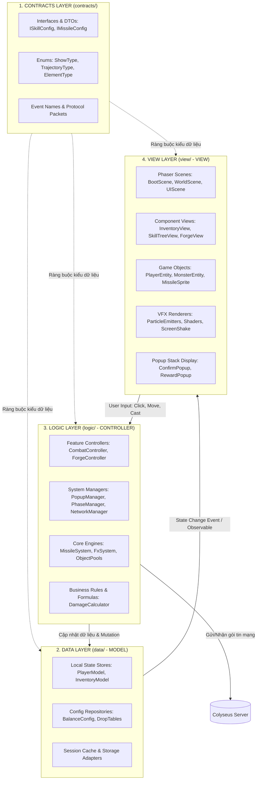
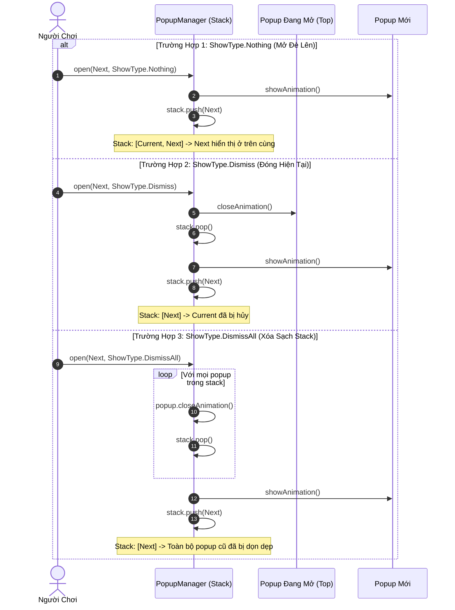
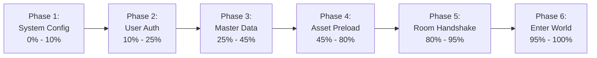
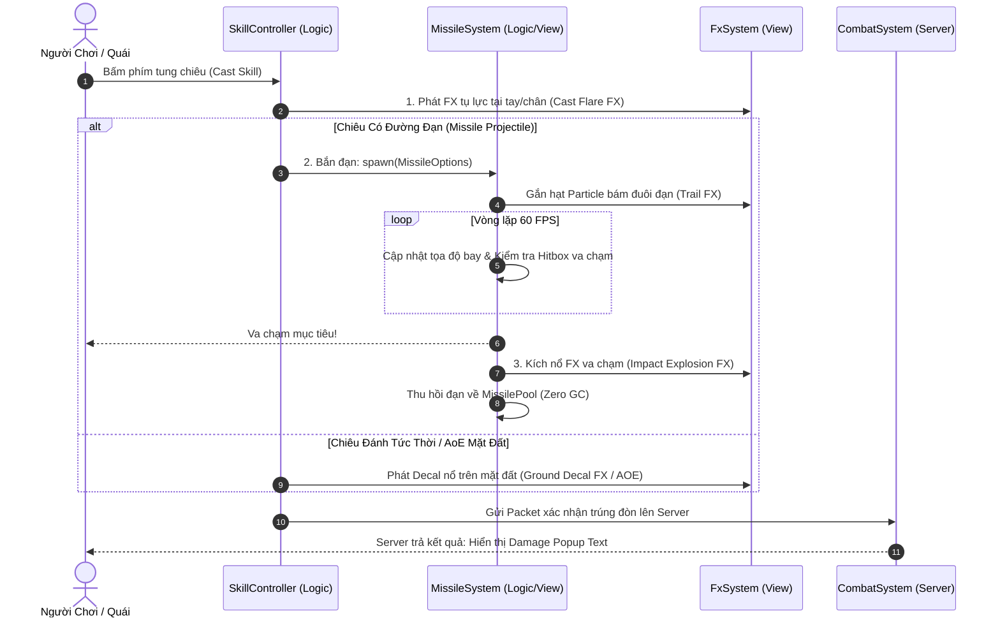
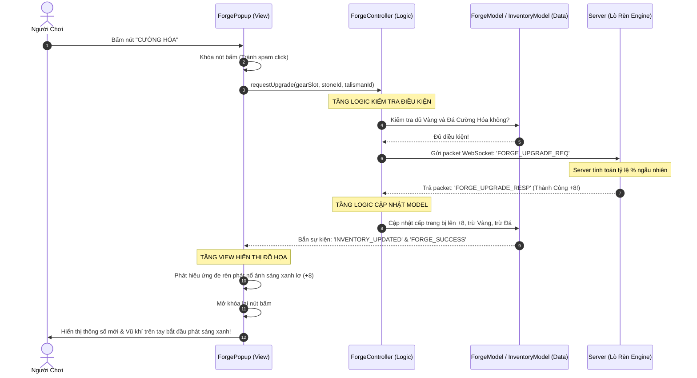

# TÀI LIỆU KIẾN TRÚC HỆ THỐNG & CẤU TRÚC MÃ NGUỒN (SYSTEM ARCHITECTURE & CODE DESIGN)
**Dự án:** Echoes of Genesis - Dư Âm Khởi Nguyên  
**Mô hình kiến trúc:** 4-Layer Architecture (`contracts`, `data`, `logic`, `view`) kết hợp Model - Controller - View (MVC)  
**Công nghệ:** TypeScript, Phaser 3 (Client), Node.js + Colyseus (Server)  
**Phiên bản:** 2.0 - Kiến trúc nâng cao (Enterprise Game Architecture)  

---

## MỤC LỤC
1. [MÔ HÌNH PHÂN TẦNG 4 LỚP (CONTRACTS - DATA - LOGIC - VIEW)](#1-mô-hình-phân-tầng-4-lớp-contracts---data---logic---view)
2. [CẤU TRÚC CÂY THƯ MỤC CHUẨN PRODUCTION (DIRECTORY TREE)](#2-cấu-trúc-cây-thư-mục-chuẩn-production-directory-tree)
3. [HỆ THỐNG QUẢN LÝ POPUP STACK & SHOWTYPE (POPUP SYSTEM)](#3-hệ-thống-quản-lý-popup-stack--showtype-popup-system)
4. [HỆ THỐNG TIẾN TRÌNH KHỞI ĐỘNG (BOOT & LOADING PHASE PIPELINE)](#4-hệ-thống-tiến-trình-khởi-động-boot--loading-phase-pipeline)
5. [HỆ THỐNG ĐẠN ĐẠO (MISSILE SYSTEM) & HIỆU ỨNG (FX SYSTEM)](#5-hệ-thống-đạn-đạo-missile-system--hiệu-ứng-fx-system)
6. [LUỒNG TƯƠNG TÁC MVC & CÁC DESIGN PATTERNS TRỌNG TÂM](#6-luồng-tương-tác-mvc--các-design-patterns-trọng-tâm)
7. [HỆ THỐNG ĐA NGÔN NGỮ (LOCALIZATION SYSTEM - I18N)](#7-hệ-thống-đa-ngôn-ngữ-localization-system---i18n)
8. [MÃ NGUỒN KHUNG TYPESCRIPT THAM CHIẾU (CODE SKELETONS)](#8-mã-nguồn-khung-typescript-tham-chiếu-code-skeletons)
9. [TỔNG KẾT & LỢI ÍCH KIẾN TRÚC](#9-tổng-kết--lợi-ích-kiến-trúc)

---

## 1. MÔ HÌNH PHÂN TẦNG 4 LỚP (CONTRACTS - DATA - LOGIC - VIEW)

Nhằm đảm bảo dự án có thể mở rộng hàng chục tính năng (Lò rèn, Sách phép, Chợ trời, Săn boss, PK) mà code không bị chồng chéo hay "spaghetti", toàn bộ hệ thống được phân lập chặt chẽ thành 4 tầng:



### Nguyên Tắc Hoạt Động Giữa Các Tầng:
1. **Tầng `contracts/` (Hợp đồng giao tiếp):**
   - Chỉ chứa Interface, Type, DTO, Enums và hằng số sự kiện.
   - **Tuyệt đối không chứa logic xử lý hay thư viện đồ họa**.
   - Mọi tầng khác (`data`, `logic`, `view`) đều import từ `contracts` để đảm bảo tính nhất quán.
2. **Tầng `data/` (Model):**
   - Nơi lưu trữ trạng thái game: `PlayerModel`, `InventoryModel`, `GuildModel`, bảng cấu hình `ConfigData`.
   - Thuần túy là dữ liệu + phương thức Get/Set/Observable.
   - **Không chứa mã lệnh liên quan đến Phaser, Canvas, hay WebSocket trực tiếp**.
3. **Tầng `logic/` (Controller / Service):**
   - Trọng tâm điều phối toàn bộ nghiệp vụ game (Business Logic).
   - Tiếp nhận hành vi từ View, tính toán hoặc gửi lên Server qua Network.
   - Khi Server trả kết quả, Logic cập nhật vào `data/` và điều phối View phản hồi.
   - Nơi quản trị `PopupManager`, `PhaseManager`, `CombatController`.
4. **Tầng `view/` (View / Presentation):**
   - Chịu trách nhiệm render đồ họa bằng Phaser 3 (Sprites, Animations, Tilemaps, Canvas, DOM UI, Shaders).
   - Lắng nghe sự kiện thay đổi dữ liệu từ `data/` hoặc chỉ thị từ `logic/` để cập nhật giao diện.
   - **Tuyệt đối không tự ý tính toán sát thương, không tự sửa data, không gọi API mạng trực tiếp**.

---

## 2. CẤU TRÚC CÂY THƯ MỤC CHUẨN PRODUCTION (DIRECTORY TREE)

```
c:\Projects\Game Online\
├── package.json
├── tsconfig.base.json
│
├── shared/                                 # CODE & TYPES DÙNG CHUNG CLIENT-SERVER
│   ├── src/
│   │   ├── contracts/                     # Hợp đồng dữ liệu chung
│   │   │   ├── IEntity.ts
│   │   │   ├── IItem.ts
│   │   │   ├── IPackets.ts
│   │   │   └── Enums.ts
│   │   └── math/                          # Công thức toán học (Damage, EXP, Iso)
│
├── server/                                 # BACKEND WEBSOCKET SERVER (COLYSEUS)
│   ├── src/
│   │   ├── contracts/                     # Schema & Event Contracts
│   │   ├── data/                          # Repositories & Database Models
│   │   ├── logic/                         # Systems: Combat, AI, Loot, Forging, PK
│   │   └── rooms/                         # ZoneRoom (20 Channels), TownRoom
│
└── client/src/                             # CLIENT PHASER 3 WEB H5 (4-LAYER MVC)
    ├── main.ts                            # Khởi tạo Game Instance
    │
    ├── contracts/                         # TẦNG 1: CONTRACTS (INTERFACES & TYPES)
    │   ├── enums/
    │   │   ├── ShowType.ts                # Enum Nothing, Dismiss, DismissAll
    │   │   ├── PhaseStatus.ts             # Pending, Running, Success, Failed
    │   │   ├── ElementType.ts             # 6 Hệ nguyên tố
    │   │   ├── TrajectoryType.ts          # ⭐ 5 Quỹ đạo đạn: Linear, Homing, Arc, Pierce, Chain
    │   │   └── ItemQuality.ts             # Trắng, Lam, Tím, Vàng
    │   ├── models/
    │   │   ├── IPlayerState.ts
    │   │   ├── IInventoryState.ts
    │   │   ├── ISkillConfig.ts            # ⭐ Cấu hình Skill, TargetType, Missile/FX Ref
    │   │   ├── IMissileConfig.ts          # ⭐ Cấu hình Đạn: Tốc độ, Hitbox, FX bay
    │   │   ├── ILocalization.ts           # ⭐ Interface & Key types cho Đa ngôn ngữ
    │   │   └── IGameConfig.ts
    │   ├── views/
    │   │   ├── IPopup.ts                  # Interface chuẩn cho mọi Popup
    │   │   └── IView.ts
    │   └── pipelines/
    │       └── IPhase.ts                  # Interface chuẩn cho Loading Phase
    │
    ├── data/                              # TẦNG 2: DATA (MODELS & STORES)
    │   ├── models/
    │   │   ├── PlayerModel.ts             # Dữ liệu HP, MP, Tọa độ, Level
    │   │   ├── InventoryModel.ts          # Danh sách 40 ô túi đồ
    │   │   ├── SkillTreeModel.ts          # Dữ liệu cây sách 4 tầng & TP
    │   │   └── ForgeModel.ts              # Trạng thái lò rèn hiện tại
    │   ├── locales/                       # ⭐ TÀI NGUYÊN ĐA NGÔN NGỮ (I18N)
    │   │   ├── vi.json                    # Từ điển Tiếng Việt chuẩn
    │   │   └── en.json                    # Từ điển Tiếng Anh quốc tế
    │   ├── configs/
    │   │   ├── SystemConfig.ts            # Âm lượng, Độ phân giải, FPS, Ngôn ngữ
    │   │   ├── SkillDataRepo.ts           # ⭐ Bảng tra cứu toàn bộ Skill Player & Quái
    │   │   └── MasterDataRepo.ts          # Cache dữ liệu Item, Quái, Boss từ Server
    │   └── stores/
    │       └── GameStore.ts               # Root State Container (Single Source of Truth)
    │
    ├── logic/                             # TẦNG 3: LOGIC (CONTROLLERS & MANAGERS)
    │   ├── managers/
    │   │   ├── PopupManager.ts            # ⭐ Quản lý Popup Stack & ShowType
    │   │   ├── PhaseManager.ts            # ⭐ Quản lý Pipeline nạp game theo Phase
    │   │   ├── LocalizationManager.ts     # ⭐ Bộ quản lý dịch ngôn ngữ & tham số động
    │   │   ├── NetworkManager.ts          # Kết nối WebSocket Colyseus Gateway
    │   │   ├── EventBus.ts                # Global Pub/Sub Event System
    │   │   └── SoundManager.ts            # Quản lý phát nhạc & SFX
    │   ├── systems/                       # ⭐ CÁC CORE ENGINES PHỤ TRÁCH COMBAT & HIỆU ỨNG
    │   │   ├── MissileSystem.ts           # ⭐ Quản lý vòng đời đạn đạo, bay, Hitbox & Pool
    │   │   └── FxSystem.ts                # ⭐ Quản lý 4 tầng FX: Ground, Hit, Attached, Shake
    │   ├── phases/                        # Các bước trong Loading Pipeline
    │   │   ├── SystemConfigPhase.ts       # Phase 1: Nạp cấu hình phần cứng & web
    │   │   ├── AuthPhase.ts               # Phase 2: Đăng nhập & Xác thực Token
    │   │   ├── MasterDataPhase.ts         # Phase 3: Tải data cân bằng game
    │   │   ├── AssetPreloadPhase.ts       # Phase 4: Nạp Sprite sheet & Tilemap
    │   │   ├── NetworkConnectPhase.ts     # Phase 5: Bắt tay WebSocket Room
    │   │   └── EnterWorldPhase.ts         # Phase 6: Khởi tạo Scene & Vào thế giới
    │   └── controllers/
    │       ├── PlayerController.ts        # Điều phối di chuyển, đánh quái
    │       ├── CombatController.ts        # Tính toán tung skill, gọi Missile/FX
    │       ├── InventoryController.ts     # Dùng đồ, trang bị, vứt đồ
    │       ├── ForgeController.ts         # Gửi lệnh đập đồ +15
    │       ├── TradeController.ts         # Quản lý mở sạp & trade P2P
    │       └── AutoGrindController.ts     # Vòng lặp tự động cày quái
    │
    └── view/                              # TẦNG 4: VIEW (PRESENTATION & PHASER)
        ├── scenes/                        # Màn chơi Phaser
        │   ├── BootScene.ts               # Điểm bắt đầu (Chạy PhaseManager)
        │   ├── LoadingScene.ts            # Vẽ thanh tiến trình Loading %
        │   ├── WorldScene.ts              # Render Isometric Map, Nhân vật, Quái
        │   └── UIScene.ts                 # Overlay HUD, Thanh phím tắt
        ├── popups/                        # ⭐ CÁC POPUP TRONG STACK
        │   ├── BasePopup.ts               # Lớp cơ sở (Animation in/out, Backdrop)
        │   ├── InventoryPopup.ts          # Popup túi đồ
        │   ├── SkillTreePopup.ts          # Popup cây kỹ năng sách
        │   ├── ForgePopup.ts              # Popup lò rèn Vulcan
        │   ├── StallPopup.ts              # Popup mở sạp bán hàng
        │   ├── TradePopup.ts              # Popup giao dịch P2P
        │   ├── ElementRollPopup.ts        # Popup quay Ấn Ký Cấp 10
        │   └── ConfirmDialogPopup.ts      # Popup thông báo / Xác nhận
        ├── components/                    # Các thành phần UI tái sử dụng
        │   ├── VirtualJoystick.ts         # Cần gạt di chuyển cảm ứng
        │   ├── HealthBarComponent.ts      # Thanh máu trên đầu quái
        │   └── ItemSlotComponent.ts       # Ô item có viền phẩm chất
        ├── entities/                      # GameObjects di động trong Map
        │   ├── PlayerEntity.ts            # Sprite 8 hướng nhân vật chính
        │   ├── RemotePlayerEntity.ts      # Người chơi khác trong khu
        │   ├── MonsterEntity.ts           # Quái vật & Boss
        │   ├── MissileEntity.ts           # ⭐ Sprite đạn đạo bay (Object Pool)
        │   └── DropItemEntity.ts          # Hòm đồ rơi trên đất
        ├── vfx/                           # ⭐ QUẢN LÝ RENDER HIỆU ỨNG THỰC THỂ
        │   ├── ParticleEmitters.ts        # Emitter hạt ma pháp 6 hệ
        │   ├── GroundDecalRenderer.ts     # Renderer vũng độc, vết cháy đất
        │   └── ScreenShakeController.ts   # Rung giật camera khi Boss đánh
        └── shaders/                       # GPU WebGL Pipelines
            └── GlowShaderPipeline.ts      # Hào quang vũ khí +4 đến +15
```

---

## 3. HỆ THỐNG QUẢN LÝ POPUP STACK & SHOWTYPE (POPUP SYSTEM)

Hệ thống quản lý cửa sổ bật lên (Modal/Popup) sử dụng cấu trúc dữ liệu **Ngăn xếp (Stack - LIFO)** kết hợp bộ điều khiển thuộc tính hiển thị `ShowType`.

### 3.1. Định Nghĩa ShowType (`contracts/enums/ShowType.ts`)
```typescript
export enum ShowType {
  /**
   * NOTHING (Overlap / Mặc định):
   * Mở popup mới đè lên popup hiện tại trên đỉnh Stack mà không đóng popup cũ.
   * Ví dụ: Đang mở Túi Đồ, bấm vào một trang bị -> Mở đè Popup Chi Tiết Trang Bị lên trên.
   */
  Nothing = 'NOTHING',

  /**
   * DISMISS:
   * Đóng (dismiss) popup đang ở đỉnh stack hiện tại rồi mới mở popup mới.
   * Ví dụ: Đang ở Popup Túi Đồ, bấm chuyển tab sang Popup Cây Kỹ Năng -> Đóng Túi Đồ và mở Cây Kỹ Năng.
   */
  Dismiss = 'DISMISS',

  /**
   * DISMISS_ALL:
   * Đóng toàn bộ tất cả popup đang tồn tại trong Stack trước khi mở popup mới.
   * Sử dụng cho: Popup Mất Kết Nối Mạng, Popup Báo Tử Trận, Popup Chuyển Bản Đồ / Chuyển Khu.
   */
  DismissAll = 'DISMISS_ALL'
}
```

### 3.2. Sơ Đồ Hoạt Động Của Popup Stack



### 3.3. Cơ Chế Back / Đóng Popup (LIFO Pop)
- Khi người chơi bấm nút **X (Đóng)** hoặc nhấn phím `ESC`:
  1. `PopupManager` lấy popup ở đỉnh stack ra (`stack.pop()`).
  2. Thực thi hoạt ảnh đóng (Fade out, Scale down) và giải phóng tài nguyên.
  3. Nếu bên dưới stack vẫn còn popup trước đó (trường hợp `ShowType.Nothing`), popup bên dưới sẽ tự động nhận lại focus và tương tác bình thường.
  4. Nếu stack rỗng, lớp màn che nền đen mờ (Dimmed Backdrop) tự động ẩn đi.

---

## 4. HỆ THỐNG TIẾN TRÌNH KHỞI ĐỘNG (BOOT & LOADING PHASE PIPELINE)

Trò chơi trực tuyến có lượng tài nguyên và logic khởi tạo lớn. Thay vì gom hết vào một hàm `preload()` khổng lồ gây đơ trình duyệt, hệ thống chia nhỏ thành **Pipeline 6 Loading Phases** độc lập.

### 4.1. Sơ Đồ 6 Giai Đoạn Nạp Game (Boot Pipeline)



### 4.2. Chi Tiết Từng Giai Đoạn & Nhiệm Vụ

| Phase ID | Tên Giai Đoạn | Tỷ Lệ Tiến Trình | Công Việc Thực Thi Chi Tiết |
| :--- | :--- | :---: | :--- |
| **Phase 1** | `SystemConfigPhase` | `0% -> 10%` | - Kiểm tra môi trường: WebGL support, Canvas fallback.<br>- Nhận diện thiết bị: Mobile hay PC để chọn layout điều khiển.<br>- Nạp cấu hình người dùng từ `localStorage` (Âm lượng, chất lượng đồ họa). |
| **Phase 2** | `AuthPhase` | `10% -> 25%` | - Kiểm tra Token đăng nhập (JWT Token).<br>- Nếu chưa có token: Chuyển sang màn hình Đăng Nhập / Tạo Nhân Vật.<br>- Nhận User ID, Session Token và danh sách thông tin nhân vật cơ sở. |
| **Phase 3** | `MasterDataPhase` | `25% -> 45%` | - Tải dữ liệu cấu hình tĩnh từ máy chủ (hoặc CDN cache):<br>  + Danh mục Sách Phép, Cây kỹ năng 4 tầng.<br>  + Bảng chỉ số quái vật, Boss dã ngoại.<br>  + Bảng tỷ lệ đập đồ lò rèn, Drop table quái thường.<br>- Khởi tạo `MasterDataRepo`. |
| **Phase 4** | `AssetPreloadPhase` | `45% -> 80%` | - Nạp tài nguyên đồ họa cốt lõi:<br>  + Texture Atlas Sprite Sheets 8 hướng (Idle, Walk, Attack, Die).<br>  + Tilemap Làng Khởi Nguyên & Thung Lũng Cỏ Gió.<br>  + File âm thanh (SFX đòn đánh, tiếng quái gầm, BGM thành phố).<br>- Compile các Custom WebGL Shaders (Hào quang vũ khí). |
| **Phase 5** | `NetworkConnectPhase` | `80% -> 95%` | - Khởi tạo kết nối WebSocket bảo mật `wss://` tới Gateway Colyseus.<br>- Thực hiện bắt tay (Handshake) và xin cấp quyền vào bản đồ chỉ định (`zone_1` đến `zone_20`).<br>- Đồng bộ State lần đầu tiên (World Snapshot ban đầu). |
| **Phase 6** | `EnterWorldPhase` | `95% -> 100%` | - Khởi tạo `WorldScene` & `UIScene`.<br>- Spawn thực thể người chơi (`PlayerEntity`) tại tọa độ lưu trong DB.<br>- Đóng Scene Loading, mờ dần màn hình và chính thức bước chân vào đại lục Astraea! |

---

## 5. HỆ THỐNG ĐẠN ĐẠO (MISSILE SYSTEM) & HIỆU ỨNG (FX SYSTEM)

Trong kiến trúc chiến đấu thời gian thực của Astraea Online, hệ thống Kỹ Năng được chia tách độc lập giữa **Dữ Liệu (Skill Data)**, **Đạn Đạo (Missile Engine)** và **Trình Diễn Hiệu Ứng (Fx Engine)**:



### 5.1. Hệ Thống MissileSystem
- **Vai trò:** Quản lý vòng đời (Spawn, Update, Hit Check, Recycle) của mọi vật thể bay trên chiến trường.
- **5 Loại Quỹ Đạo Đạn Chuẩn (Trajectory Types):**
  1. `Linear`: Bay thẳng theo vector góc hướng (Hỏa Cầu, Băng Tiễn).
  2. `Homing`: Tự tính toán góc quay $\theta$ rượt đuổi mục tiêu di động (Quang Tiễn).
  3. `BallisticArc`: Bay theo đường cong parabol rơi từ trên trời xuống (Thiên Thạch, Lựu Đạn Độc).
  4. `PiercingLine`: Đâm xuyên qua toàn bộ quái vật trên một đường thẳng.
  5. `ChainBounce`: Nảy chuyền giữa các mục tiêu gần nhau (Lôi Dây Chuyền).
- **Tối ưu hóa Object Pool:** Khởi tạo sẵn một kho chứa 40 đối tượng `Missile` tái sử dụng tuần hoàn, tuyệt đối không gọi `new` trong combat để tránh giật lag trình duyệt.

### 5.2. Hệ Thống FxSystem
- **Vai trò:** Quản lý toàn bộ hiệu ứng thị giác của 6 Hệ nguyên tố, không can thiệp vào logic sát thương.
- **Phân cấp 4 nhóm hiệu ứng:**
  1. `GroundDecalFX`: Render dưới chân nhân vật (`depth = 10`), lưu lại vết cháy xém, vũng đầm lầy độc sủi bọt, ma trận phép thuật.
  2. `ImpactHitFX`: Nổ tia lửa, mảnh băng vỡ vụn hoặc tia sét chớp nháy tại tọa độ va chạm (tự biến mất sau 0.3s - 0.5s).
  3. `AttachedFollowFX`: Khóa vị trí bám theo người chơi (Khiên chắn thánh quang, hào quang vũ khí +15).
  4. `ScreenCameraFX`: Rung giật màn hình (`camera.shake()`) khi dính đòn chí mạng hoặc Boss dậm đất địa chấn.

---

## 6. LUỒNG TƯƠNG TÁC MVC & CÁC DESIGN PATTERNS TRỌNG TÂM

### 6.1. Ví Dụ Cụ Thể Về Luồng MVC: Tính Năng Cường Hóa Lò Rèn (+15)
Để thấy rõ sự tách biệt giữa 4 tầng:



---

## 7. HỆ THỐNG ĐA NGÔN NGỮ (LOCALIZATION SYSTEM - I18N)

Để sẵn sàng mở rộng cho cả cộng đồng game thủ trong nước lẫn quốc tế, hệ thống hỗ trợ đa ngôn ngữ (**Tiếng Việt `vi`** và **Tiếng Anh `en`**) được thiết kế hoạt động ở tầng `logic/managers/LocalizationManager.ts` kết hợp từ điển JSON lưu tại `data/locales/`.

```mermaid
graph LR
    UI[View Layer: HUD, Popup, Tooltip] -->|Yêu cầu dịch: t'KEY', params| LM[LocalizationManager]
    LM -->|Kiểm tra ngôn ngữ hiện tại| Store[(LocalStorage: vi / en)]
    LM -->|Tra cứu từ điển| Dict[(data/locales/vi.json)]
    LM -->|Nội suy chuỗi: thay thế {param}| UI
    UI -.->|Thiếu Key?| Fallback[(Fallback: data/locales/en.json)]
```

### 7.1. Cấu Trúc File Ngôn Ngữ (`data/locales/vi.json` & `en.json`)
Từ điển được tổ chức theo tiền tố tính năng dạng cây JSON lồng nhau:
```json
// data/locales/vi.json
{
  "GAME_TITLE": "Dư Âm Khởi Nguyên",
  "COMMON": {
    "CONFIRM": "Xác Nhận",
    "CANCEL": "Hủy Bỏ",
    "CLOSE": "Đóng",
    "LEVEL": "Cấp {level}"
  },
  "BROADCAST": {
    "BOSS_SPAWN": "Ma Thú Bạo Chúa {bossName} đã xuất hiện tại {mapName} - Khu {channel}!",
    "CHEST_UNLOCKED": "Rương Boss {bossName} đã mở khóa tự do! Bất kỳ ai cũng có thể nhặt!",
    "FORGE_SUCCESS_15": "Đại hiệp {playerName} vừa rèn thành công Thần Binh +15 {gearName}!"
  },
  "SYSTEM": {
    "PK_WARNING": "Khu vực chiến sự! Bật cờ đỏ sẽ bị tích điểm tội ác!",
    "INVENTORY_FULL": "Túi đồ đã đầy 40 ô! Không thể nhặt thêm vật phẩm."
  }
}
```

```json
// data/locales/en.json
{
  "GAME_TITLE": "Echoes of Genesis",
  "COMMON": {
    "CONFIRM": "Confirm",
    "CANCEL": "Cancel",
    "CLOSE": "Close",
    "LEVEL": "Lv. {level}"
  },
  "BROADCAST": {
    "BOSS_SPAWN": "Field Boss {bossName} has spawned at {mapName} - Channel {channel}!",
    "CHEST_UNLOCKED": "Boss Chest {bossName} is now unlocked! Anyone can loot!",
    "FORGE_SUCCESS_15": "Hero {playerName} has successfully forged Divine Artifact +15 {gearName}!"
  },
  "SYSTEM": {
    "PK_WARNING": "Combat Zone! Enabling Red Flag increases Karma Points!",
    "INVENTORY_FULL": "Inventory is full (40/40)! Cannot pick up more items."
  }
}
```

### 7.2. Cơ Chế Thay Thế Tham Số Động (Dynamic Interpolation)
- Hàm gọi dịch: `t(key, params)`
  ```typescript
  // Ví dụ hiển thị loa thông báo:
  const msg = LocalizationManager.getInstance().t('BROADCAST.BOSS_SPAWN', {
    bossName: 'Spore King',
    mapName: 'Rừng Sơ Khai',
    channel: 3
  });
  // Output tiếng Việt: "Ma Thú Bạo Chúa Spore King đã xuất hiện tại Rừng Sơ Khai - Khu 3!"
  // Output tiếng Anh:   "Field Boss Spore King has spawned at Rừng Sơ Khai - Channel 3!"
  ```
- **Chuyển đổi ngôn ngữ tức thời (Hot-Switching):** Khi người chơi đổi ngôn ngữ trong Cài Đặt, `LocalizationManager` phát sự kiện `LANGUAGE_CHANGED`. Toàn bộ View đang hiển thị tự động cập nhật text mà không cần tải lại trang Web!

---

## 8. MÃ NGUỒN KHUNG TYPESCRIPT THAM CHIẾU (CODE SKELETONS)

### 8.1. Hợp Đồng ShowType & IPopup (`contracts/views/IPopup.ts`)
```typescript
import { ShowType } from '../enums/ShowType';

export interface IPopup {
  /** Định danh duy nhất của Popup */
  readonly id: string;
  
  /** Kiểu hiển thị khi mở */
  readonly showType: ShowType;

  /** Cấp độ ưu tiên z-index (Popup thông báo khẩn cấp có priority cao hơn) */
  readonly priority: number;

  /** Khởi tạo các phần tử đồ họa của popup */
  init(data?: any): void;

  /** Phát hoạt họa mở popup (Scale up, Fade in) */
  showAnimation(): Promise<void>;

  /** Phát hoạt họa đóng popup (Scale down, Fade out) */
  closeAnimation(): Promise<void>;

  /** Giải phóng bộ nhớ khi đóng */
  destroy(): void;
}
```

---

### 6.2. Bộ Điều Khiển Popup Stack (`logic/managers/PopupManager.ts`)
```typescript
import { IPopup } from '../../contracts/views/IPopup';
import { ShowType } from '../../contracts/enums/ShowType';

export class PopupManager {
  private static instance: PopupManager;
  private popupStack: IPopup[] = [];
  private backdropContainer: Phaser.GameObjects.Container | null = null;
  private scene!: Phaser.Scene;

  private constructor() {}

  public static getInstance(): PopupManager {
    if (!PopupManager.instance) {
      PopupManager.instance = new PopupManager();
    }
    return PopupManager.instance;
  }

  public init(uiScene: Phaser.Scene): void {
    this.scene = uiScene;
    this.createBackdrop();
  }

  /**
   * Mở một popup mới theo ShowType chỉ định
   */
  public async open(popup: IPopup, showType: ShowType = ShowType.Nothing, data?: any): Promise<void> {
    popup.init(data);

    switch (showType) {
      case ShowType.Nothing:
        // Đè lên popup hiện tại trong stack
        break;

      case ShowType.Dismiss:
        // Đóng popup ở đỉnh stack hiện tại
        if (this.popupStack.length > 0) {
          const currentTop = this.popupStack.pop()!;
          await currentTop.closeAnimation();
          currentTop.destroy();
        }
        break;

      case ShowType.DismissAll:
        // Đóng toàn bộ popup trong stack
        while (this.popupStack.length > 0) {
          const p = this.popupStack.pop()!;
          await p.closeAnimation();
          p.destroy();
        }
        break;
    }

    // Đẩy popup mới vào stack và hiển thị
    this.popupStack.push(popup);
    this.updateBackdrop();
    await popup.showAnimation();
  }

  /**
   * Đóng popup ở đỉnh stack (Tương đương nút X hoặc bấm ESC)
   */
  public async closeCurrent(): Promise<void> {
    if (this.popupStack.length === 0) return;

    const topPopup = this.popupStack.pop()!;
    await topPopup.closeAnimation();
    topPopup.destroy();

    this.updateBackdrop();
  }

  /**
   * Đóng toàn bộ mọi popup
   */
  public async closeAll(): Promise<void> {
    while (this.popupStack.length > 0) {
      const p = this.popupStack.pop()!;
      await p.closeAnimation();
      p.destroy();
    }
    this.updateBackdrop();
  }

  public get currentPopup(): IPopup | null {
    return this.popupStack.length > 0 ? this.popupStack[this.popupStack.length - 1] : null;
  }

  private createBackdrop(): void {
    const bg = this.scene.add.rectangle(0, 0, this.scene.scale.width, this.scene.scale.height, 0x000000, 0.6);
    bg.setOrigin(0, 0);
    bg.setInteractive(); // Chặn click xuyên xuống map dưới
    bg.on('pointerdown', () => this.closeCurrent());

    this.backdropContainer = this.scene.add.container(0, 0, [bg]);
    this.backdropContainer.setVisible(false);
    this.backdropContainer.setDepth(900); // Nằm dưới popup (z-index 1000+)
  }

  private updateBackdrop(): void {
    if (!this.backdropContainer) return;
    const hasPopups = this.popupStack.length > 0;
    this.backdropContainer.setVisible(hasPopups);
  }
}
```

---

### 6.3. Hợp Đồng Pipeline Khởi Động (`contracts/pipelines/IPhase.ts`)
```typescript
import { PhaseStatus } from '../enums/PhaseStatus';

export interface PhaseContext {
  userId?: string;
  token?: string;
  characterId?: string;
  masterData?: any;
  selectedZoneId?: number;
  [key: string]: any;
}

export interface IPhase {
  /** Tên định danh giai đoạn */
  readonly phaseName: string;

  /** Trọng số phần trăm trong tổng tiến trình 100% (Ví dụ: 20 nghĩa là chiếm 20%) */
  readonly weight: number;

  /** Trạng thái hiện tại của Phase */
  status: PhaseStatus;

  /**
   * Thực thi logic của giai đoạn
   * @param context Bộ nhớ ngữ cảnh chia sẻ giữa các phase
   * @param onProgress Callback báo cáo tiến độ chi tiết nội bộ phase (0.0 đến 1.0)
   */
  execute(context: PhaseContext, onProgress: (progress: number) => void): Promise<void>;
}
```

---

### 6.4. Bộ Điều Phối Loading Phase (`logic/managers/PhaseManager.ts`)
```typescript
import { IPhase, PhaseContext } from '../../contracts/pipelines/IPhase';
import { PhaseStatus } from '../../contracts/enums/PhaseStatus';

export class PhaseManager {
  private phases: IPhase[] = [];
  private context: PhaseContext = {};
  private currentPhaseIndex: number = 0;
  private totalWeight: number = 0;
  private completedWeight: number = 0;

  /** Đăng ký các Phase vào Pipeline */
  public addPhase(phase: IPhase): this {
    this.phases.push(phase);
    this.totalWeight += phase.weight;
    return this;
  }

  /**
   * Bắt đầu chạy tuần tự các phase
   * @param onTotalProgress Callback trả về tổng tiến trình (0 - 100%) và tên bước hiện tại
   */
  public async startPipeline(
    onTotalProgress: (percentage: number, currentPhaseName: string) => void
  ): Promise<PhaseContext> {
    for (this.currentPhaseIndex = 0; this.currentPhaseIndex < this.phases.length; this.currentPhaseIndex++) {
      const phase = this.phases[this.currentPhaseIndex];
      phase.status = PhaseStatus.Running;

      try {
        await phase.execute(this.context, (phaseProgress) => {
          // Tính toán tổng % tiến độ trên thanh loading
          const currentWeightProgress = this.completedWeight + phase.weight * phaseProgress;
          const totalPercentage = Math.min(100, Math.floor((currentWeightProgress / this.totalWeight) * 100));
          onTotalProgress(totalPercentage, phase.phaseName);
        });

        phase.status = PhaseStatus.Success;
        this.completedWeight += phase.weight;
      } catch (error) {
        phase.status = PhaseStatus.Failed;
        console.error(`Giai đoạn [${phase.phaseName}] thất bại:`, error);
        throw error;
      }
    }

    onTotalProgress(100, 'Khởi tạo hoàn tất!');
    return this.context;
  }
}
```

---

### 6.5. Triển Khai Thực Tế 1 Phase Mẫu (`logic/phases/MasterDataPhase.ts`)
```typescript
import { IPhase, PhaseContext } from '../../contracts/pipelines/IPhase';
import { PhaseStatus } from '../../contracts/enums/PhaseStatus';
import { MasterDataRepo } from '../../data/configs/MasterDataRepo';

export class MasterDataPhase implements IPhase {
  public readonly phaseName = 'Tải Dữ Liệu Cấu Hình Game';
  public readonly weight = 20; // Chiếm 20% trên thanh loading bar
  public status = PhaseStatus.Pending;

  public async execute(context: PhaseContext, onProgress: (progress: number) => void): Promise<void> {
    onProgress(0.1);
    
    // 1. Tải bảng kỹ năng sách phép
    const skills = await fetch('/api/configs/skills.json').then((r) => r.json());
    onProgress(0.4);

    // 2. Tải bảng chỉ số quái vật & Boss
    const monsters = await fetch('/api/configs/monsters.json').then((r) => r.json());
    onProgress(0.7);

    // 3. Tải bảng tỷ lệ lò rèn & Drop table
    const forgeTable = await fetch('/api/configs/forge_rates.json').then((r) => r.json());
    onProgress(0.9);

    // Lưu vào Repository tầng Data
    MasterDataRepo.getInstance().init({ skills, monsters, forgeTable });
    context.masterData = MasterDataRepo.getInstance();

    onProgress(1.0);
  }
}
```

---

### 8.6. Triển Khai Missile & MissileSystem (`logic/systems/MissileSystem.ts`)
```typescript
import Phaser from 'phaser';
import { TrajectoryType } from '../../contracts/enums/TrajectoryType';
import { FxSystem } from './FxSystem';

export interface IMissileSpawnOptions {
  id: string;
  texture: string;
  startX: number;
  startY: number;
  targetX: number;
  targetY: number;
  targetEntityId?: string;
  speed: number;
  hitboxRadius: number;
  maxDistance: number;
  trajectory: TrajectoryType;
  impactFxId: string;
  onHit: (hitEntityId?: string) => void;
}

export class Missile extends Phaser.GameObjects.Sprite {
  public isActive: boolean = false;
  private options!: IMissileSpawnOptions;
  private distanceTraveled: number = 0;
  private velocityX: number = 0;
  private velocityY: number = 0;

  constructor(scene: Phaser.Scene) {
    super(scene, 0, 0, '');
  }

  public launch(options: IMissileSpawnOptions): void {
    this.options = options;
    this.setTexture(options.texture);
    this.setPosition(options.startX, options.startY);
    this.setVisible(true);
    this.isActive = true;
    this.distanceTraveled = 0;
    this.setDepth(150);

    const angle = Phaser.Math.Angle.Between(options.startX, options.startY, options.targetX, options.targetY);
    this.setRotation(angle);
    this.velocityX = Math.cos(angle) * options.speed;
    this.velocityY = Math.sin(angle) * options.speed;
  }

  public updateMissile(deltaMs: number, nearbyEntities: { id: string; x: number; y: number; radius: number }[]): void {
    if (!this.isActive) return;

    const dt = deltaMs / 1000;
    const moveX = this.velocityX * dt;
    const moveY = this.velocityY * dt;

    this.x += moveX;
    this.y += moveY;
    this.distanceTraveled += Math.sqrt(moveX * moveX + moveY * moveY);

    // 1. Kiểm tra va chạm Hitbox
    for (const entity of nearbyEntities) {
      const distSq = Phaser.Math.Distance.Squared(this.x, this.y, entity.x, entity.y);
      const hitDist = this.options.hitboxRadius + entity.radius;
      if (distSq <= hitDist * hitDist) {
        this.triggerHit(entity.id);
        return;
      }
    }

    // 2. Hết tầm bay
    if (this.distanceTraveled >= this.options.maxDistance) {
      this.triggerHit(undefined);
    }
  }

  private triggerHit(targetEntityId?: string): void {
    this.isActive = false;
    this.setVisible(false);

    // Phát FX va chạm
    FxSystem.getInstance().playImpact(this.options.impactFxId, this.x, this.y);

    // Xử lý sát thương
    this.options.onHit(targetEntityId);
  }
}

export class MissileSystem {
  private static instance: MissileSystem;
  private scene!: Phaser.Scene;
  private pool: Missile[] = [];
  private activeMissiles: Missile[] = [];

  public static getInstance(): MissileSystem {
    if (!MissileSystem.instance) {
      MissileSystem.instance = new MissileSystem();
    }
    return MissileSystem.instance;
  }

  public init(scene: Phaser.Scene): void {
    this.scene = scene;
    for (let i = 0; i < 40; i++) {
      const m = new Missile(scene);
      scene.add.existing(m);
      m.setVisible(false);
      this.pool.push(m);
    }
  }

  public spawn(options: IMissileSpawnOptions): void {
    let missile = this.pool.pop() || new Missile(this.scene);
    missile.launch(options);
    this.activeMissiles.push(missile);
  }

  public update(deltaMs: number, entities: { id: string; x: number; y: number; radius: number }[]): void {
    for (let i = this.activeMissiles.length - 1; i >= 0; i--) {
      const m = this.activeMissiles[i];
      m.updateMissile(deltaMs, entities);

      if (!m.isActive) {
        this.activeMissiles.splice(i, 1);
        this.pool.push(m);
      }
    }
  }
}
```

---

### 8.7. Triển Khai FxSystem (`logic/systems/FxSystem.ts`)
```typescript
import Phaser from 'phaser';

export class FxSystem {
  private static instance: FxSystem;
  private scene!: Phaser.Scene;

  public static getInstance(): FxSystem {
    if (!FxSystem.instance) {
      FxSystem.instance = new FxSystem();
    }
    return FxSystem.instance;
  }

  public init(scene: Phaser.Scene): void {
    this.scene = scene;
  }

  public playImpact(fxId: string, x: number, y: number): void {
    const emitter = this.scene.add.particles(x, y, 'fx_sparks', {
      speed: { min: 80, max: 200 },
      angle: { min: 0, max: 360 },
      scale: { start: 1.0, end: 0 },
      lifespan: 350,
      gravityY: 100,
      quantity: 12,
      blendMode: 'ADD'
    });

    this.scene.time.delayedCall(400, () => {
      emitter.destroy();
    });

    const flashSprite = this.scene.add.sprite(x, y, fxId);
    flashSprite.setDepth(160);
    flashSprite.play(fxId + '_anim');
    flashSprite.once('animationcomplete', () => {
      flashSprite.destroy();
    });
  }

  public shakeScreen(durationMs: number = 150, intensity: number = 0.008): void {
    this.scene.cameras.main.shake(durationMs, intensity);
  }

  public spawnGroundDecal(texture: string, x: number, y: number, durationMs: number): void {
    const decal = this.scene.add.sprite(x, y, texture);
    decal.setDepth(5);
    decal.setAlpha(0.85);

    this.scene.tweens.add({
      targets: decal,
      alpha: 0,
      delay: durationMs - 500,
      duration: 500,
      onComplete: () => decal.destroy()
    });
  }
}
```

---

### 8.8. Triển Khai LocalizationManager (`logic/managers/LocalizationManager.ts`)
```typescript
import { EventBus } from './EventBus';

export type LanguageCode = 'vi' | 'en';

export class LocalizationManager {
  private static instance: LocalizationManager;
  private currentLang: LanguageCode = 'vi';
  private dictionaries: Record<LanguageCode, Record<string, any>> = {
    vi: {},
    en: {}
  };

  private constructor() {}

  public static getInstance(): LocalizationManager {
    if (!LocalizationManager.instance) {
      LocalizationManager.instance = new LocalizationManager();
    }
    return LocalizationManager.instance;
  }

  /**
   * Khởi tạo và nạp từ điển ngôn ngữ
   */
  public async init(defaultLang?: LanguageCode): Promise<void> {
    // 1. Đọc ngôn ngữ đã lưu trong LocalStorage (hoặc lấy ngôn ngữ trình duyệt)
    const saved = localStorage.getItem('eog_language') as LanguageCode;
    this.currentLang = defaultLang || saved || 'vi';

    // 2. Tải song song cả 2 file từ điển
    const [viData, enData] = await Promise.all([
      fetch('/locales/vi.json').then((r) => r.json()),
      fetch('/locales/en.json').then((r) => r.json())
    ]);

    this.dictionaries.vi = viData;
    this.dictionaries.en = enData;
  }

  /**
   * Thay đổi ngôn ngữ tức thời tại Runtime (Hot-Switching)
   */
  public setLanguage(lang: LanguageCode): void {
    if (this.currentLang === lang) return;
    this.currentLang = lang;
    localStorage.setItem('eog_language', lang);

    // Phát sự kiện toàn cục để toàn bộ giao diện tự cập nhật chữ
    EventBus.emit('LANGUAGE_CHANGED', { lang });
  }

  public get language(): LanguageCode {
    return this.currentLang;
  }

  /**
   * Hàm dịch chuỗi chính với cơ chế nội suy tham số {param}
   * @param path Đường dẫn key theo dạng 'BROADCAST.BOSS_SPAWN'
   * @param params Bộ tham số thay thế động { bossName: 'Spore King' }
   */
  public t(path: string, params?: Record<string, string | number>): string {
    const keys = path.split('.');
    let result = this.resolveKey(this.dictionaries[this.currentLang], keys);

    // Fallback sang tiếng Anh nếu tiếng Việt thiếu key
    if (!result && this.currentLang !== 'en') {
      result = this.resolveKey(this.dictionaries.en, keys);
    }

    // Nếu vẫn không tìm thấy, trả về chính đường dẫn key
    if (!result) return path;

    // Thay thế các tham số dạng {variableName}
    if (params) {
      Object.keys(params).forEach((key) => {
        result = result.replace(new RegExp(`\\{${key}\\}`, 'g'), String(params[key]));
      });
    }

    return result;
  }

  private resolveKey(dict: any, keys: string[]): string | null {
    let current = dict;
    for (const k of keys) {
      if (current && typeof current === 'object' && k in current) {
        current = current[k];
      } else {
        return null;
      }
    }
    return typeof current === 'string' ? current : null;
  }
}
```

---

## 9. TỔNG KẾT & LỢI ÍCH KIẾN TRÚC
1. **Dễ Kiểm Thử & Bảo Trì:** Vì `logic/` tách rời 100% khỏi `view/`, toàn bộ công thức tính toán và controller có thể viết Unit Test tự động mà không cần phải bật giao diện Phaser canvas.
2. **Hiệu Năng Web 60 FPS Tuyệt Đối:** `MissileSystem` và `FxSystem` đều tích hợp sẵn cơ chế **Object Pooling**, không cấp phát bộ nhớ rác (Zero Garbage Collection) giúp duy trì 60 FPS khi 50 người cùng tung chiêu trên 1 màn hình.
3. **Đa Ngôn Ngữ Linh Hoạt (I18n):** `LocalizationManager` cho phép chuyển đổi tức thời giữa Tiếng Việt và Tiếng Anh chỉ bằng 1 dòng lệnh mà không phải tải lại trang, sẵn sàng đưa game vươn ra thị trường quốc tế.
4. **Trải Nghiệm Người Dùng (UX) Mượt Mà:**
   - Hệ thống Popup Stack ngăn chặn triệt để lỗi người chơi mở chồng chéo popup vô tận hoặc lỗi giao diện không đóng được.
   - Các Loading Phase rõ ràng, minh bạch giúp người chơi luôn biết game đang tải phần gì (không bao giờ bị đứng hình ở 99% mà không rõ lý do).
5. **Phù Hợp Hoàn Hảo Cho Dự Án Lâu Dài:** Dễ dàng phân công công việc: Một người chuyên làm giao diện (`view/`), một người chuyên code dữ liệu & mạng (`data/` & `logic/`) mà không bao giờ bị xung đột mã nguồn (Merge Conflict).

