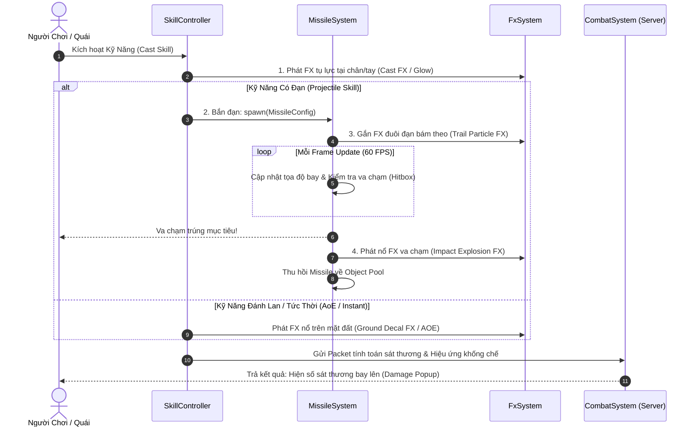
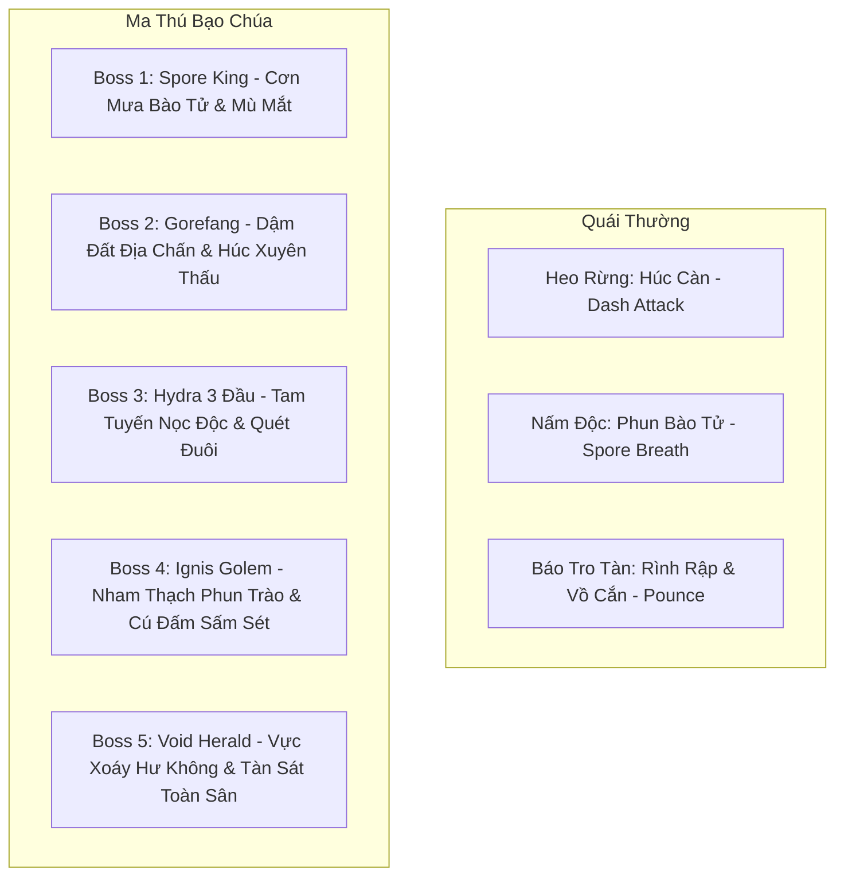
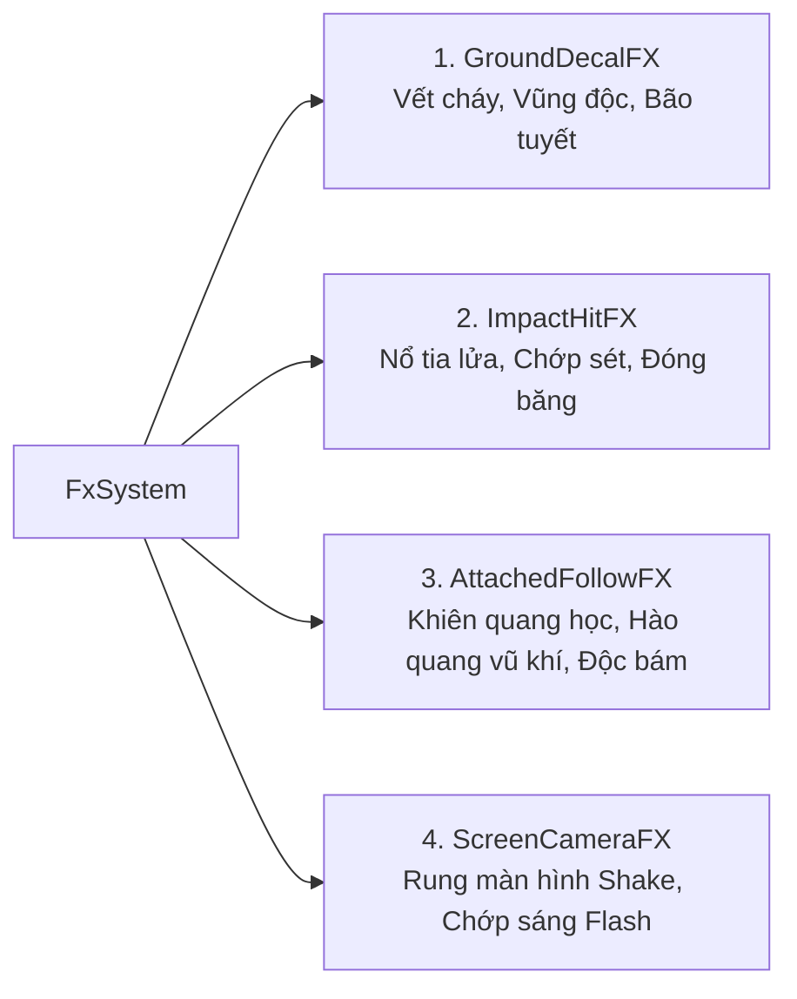

# TÀI LIỆU THIẾT KẾ HỆ THỐNG SKILL, MISSILE SYSTEM & FX SYSTEM
**Dự án:** Astraea Online - Cổ Thư Hỗn Mang  
**Mục tiêu:** Xây dựng danh mục kỹ năng dựng sẵn cho Player/Quái, hệ thống quản lý đạn đạo (MissileSystem) và hiệu ứng hình ảnh (FxSystem)  
**Công nghệ:** TypeScript, Phaser 3 WebGL, Colyseus WebSocket, Object Pooling  
**Phiên bản:** 1.0 - Chuẩn Kỹ Thuật Chuyên Sâu  

---

## MỤC LỤC
1. [TỔNG QUAN KIẾN TRÚC SKILL - MISSILE - FX](#1-tổng-quan-kiến-trúc-skill---missile---fx)
2. [DANH MỤC SKILL DỰNG SẴN CHO PLAYER (6 BỘ CỔ THƯ NGUYÊN TỐ)](#2-danh-mục-skill-dựng-sẵn-cho-player-6-bộ-cổ-thư-nguyên-tố)
3. [DANH MỤC SKILL DỰNG SẴN CHO QUÁI VẬT & MA THÚ BẠO CHÚA (BOSS)](#3-danh-mục-skill-dựng-sẵn-cho-quái-vật--ma-thú-bạo-chúa-boss)
4. [HỆ THỐNG QUẢN LÝ ĐẠN ĐẠO (MISSILE SYSTEM)](#4-hệ-thống-quản-lý-đạn-đạo-missile-system)
5. [HỆ THỐNG QUẢN LÝ HIỆU ỨNG HÌNH ẢNH (FX SYSTEM)](#5-hệ-thống-quản-lý-hiệu-ứng-hình-ảnh-fx-system)
6. [MÃ NGUỒN KHUNG TYPESCRIPT THAM CHIẾU (CODE SKELETONS)](#6-mã-nguồn-khung-typescript-tham-chiếu-code-skeletons)

---

## 1. TỔNG QUAN KIẾN TRÚC SKILL - MISSILE - FX

Trong một tựa game MMORPG cày cuốc, khi một kỹ năng được kích hoạt, một chuỗi tương tác phối hợp chặt chẽ giữa **Skill System**, **Missile System** và **Fx System** sẽ diễn ra:



- **Skill System (Tầng Logic):** Nắm giữ toàn bộ dữ liệu cấu hình kỹ năng (Mana, Cooldown, Phạm vi, Loại mục tiêu, Tỷ lệ sát thương).
- **Missile System (Tầng Logic & View):** Điều khiển đường bay của các vật thể đạn đạo (thẳng, rượt đuổi mục tiêu, parabol rơi từ trời, nảy chuyền giật sét) và xử lý va chạm hitbox.
- **Fx System (Tầng View Presentation):** Quản lý toàn bộ hiệu ứng hình ảnh (Particle Emitters, Sprite Animations, GLSL Shaders, Rung màn hình). Không can thiệp vào logic sát thương.

---

## 2. DANH MỤC SKILL DỰNG SẴN CHO PLAYER (6 BỘ CỔ THƯ NGUYÊN TỐ)

Mỗi cuốn Cổ Thư (Grimoire) thuộc 1 trong 6 Hệ mang một bộ chiêu thức độc bản chia thành 4 Tầng:

```
[Tầng 1: Active Core] -> Kỹ năng đánh chính
     ├── [Tầng 2 - Nhánh A] (Tốc độ / Xuyên thấu)  HOẶC  [Tầng 2 - Nhánh B] (Diện rộng / Bộc phá)
[Tầng 3: Passive Perk] -> Nội tại bổ trợ chỉ số
     └── [Tầng 4: Tuyệt Kỹ Thức Tỉnh] -> Chiêu tối thượng nộ khí
```

---

### 🔥 2.1. Cổ Thư Hỏa Diễm (Ignis Grimoire - Sát Thương Bỏng Dồn Dập)
*Đặc trưng:* Tông màu Đỏ - Cam. Đòn đánh có xác suất gây bỏng rút máu theo thời gian.

| Tầng | Tên Kỹ Năng | Loại Chiêu | Mana / Cooldown | Mô Tả Hiệu Ứng Chiêu Thức | Missile & FX Tương Ứng |
| :---: | :--- | :---: | :---: | :--- | :--- |
| **Tầng 1** | **Hỏa Cầu Thuật** *(Fireball)* | Đạn thẳng | 15 MP / 1.5s | Bắn 1 quả cầu lửa bay thẳng 8m, gây 140% sát thương phép. | `MISSILE_FIREBALL` + Hạt khói lửa bay đuôi. |
| **Tầng 2A** | **Hỏa Tiễn Xuyên Phá** | Đạn xuyên | 25 MP / 3.0s | Nén lửa thành mũi tên nhọn xuyên qua tối đa 3 kẻ địch trên đường bay. | `MISSILE_PIERCING_ARROW` + Vệt sáng kéo dài. |
| **Tầng 2B** | **Liệt Hỏa Bộc Phá** | Diện rộng | 30 MP / 4.0s | Nổ bộc phá quanh chân mục tiêu bán kính 3m, thiêu đốt 3 quái vật. | Không có đạn. `FX_FIRE_BURST` nổ tung tóe. |
| **Tầng 3** | **Tâm Hỏa Cháy Bỏng** | Nội tại | Thụ động | Tăng 8% sát thương chí mạng phép; gây bỏng rút thêm 1.5% HP/giây. | `FX_BURNING_AURA` vòng lửa nhỏ quanh chân. |
| **Tầng 4** | **Thiên Hỏa Giáng Trần** *(Meteor)* | Tuyệt kỹ AoE | 80 MP / 25s | Triệu hồi 1 khối thiên thạch khổng lồ rơi từ trời xuống gây 450% sát thương và tạo vũng lửa. | `MISSILE_METEOR_FALL` (Quỹ đạo Parabol) + Rung màn hình. |

---

### ❄️ 2.2. Cổ Thư Băng Giá (Glacies Grimoire - Khống Chế & Làm Chậm)
*Đặc trưng:* Tông màu Xanh Lơ - Trắng tuyết. Làm chậm kẻ địch, đóng băng diện rộng.

| Tầng | Tên Kỹ Năng | Loại Chiêu | Mana / Cooldown | Mô Tả Hiệu Ứng Chiêu Thức | Missile & FX Tương Ứng |
| :---: | :--- | :---: | :---: | :--- | :--- |
| **Tầng 1** | **Băng Tiễn** *(Ice Bolt)* | Đạn thẳng | 12 MP / 1.2s | Phóng mũi gai băng gây 120% sát thương, làm chậm mục tiêu 25% trong 2s. | `MISSILE_ICE_BOLT` + Bụi sương mù rơi rớt. |
| **Tầng 2A** | **Tam Băng Xạ** | Bắn rẻ quạt | 22 MP / 3.0s | Bắn 3 mũi tên băng tỏa ra hình nón góc 45 độ, kiểm soát diện rộng. | 3x `MISSILE_ICE_BOLT` góc lệch 15 độ. |
| **Tầng 2B** | **Hàn Băng Tỏa Tượng** | Khống chế đơn | 28 MP / 6.0s | Hóa đá mục tiêu bằng cột băng nhô lên từ đất trong 1.5s. | Không có đạn. `FX_ICE_PRISON` cột băng trồi lên. |
| **Tầng 3** | **Băng Giáp Linh Thể** | Nội tại | Thụ động | Tăng 15 Giáp cơ bản; khi bị tấn công có 20% phản làm chậm kẻ đánh. | `FX_FROST_SHIELD` bông tuyết quay quanh thân. |
| **Tầng 4** | **Bão Tuyết Vĩnh Cửu** *(Blizzard)* | Tuyệt kỹ AoE | 75 MP / 20s | Tạo vùng bão tuyết bán kính 6m trong 4s, gây sát thương mỗi 0.5s và đóng băng cứng. | `FX_BLIZZARD_ZONE` bão tuyết cuộn xoáy trên mặt đất. |

---

### ⚡ 2.3. Cổ Thư Lôi Điện (Fulgur Grimoire - Bạo Kích & Giật Lan Nhanh)
*Đặc trưng:* Tông màu Vàng chanh - Tím điện. Tốc độ ra đòn cực cao, sát thương nảy chuyền.

| Tầng | Tên Kỹ Năng | Loại Chiêu | Mana / Cooldown | Mô Tả Hiệu Ứng Chiêu Thức | Missile & FX Tương Ứng |
| :---: | :--- | :---: | :---: | :--- | :--- |
| **Tầng 1** | **Tia Sét Xung Kích** | Đạn tức thời | 14 MP / 1.0s | Phóng tia điện thẳng tới mục tiêu, 130% sát thương, 10% gây tê liệt 0.5s. | `MISSILE_LIGHTNING_BEAM` vẽ tia zíc-zắc. |
| **Tầng 2A** | **Lôi Dây Chuyền** *(Chain)*| Đạn nảy | 32 MP / 4.5s | Tia sét đánh trúng mục tiêu sẽ nảy sang 3 quái đứng gần (giảm 15% dmg mỗi nảy). | `MISSILE_CHAIN_LIGHTNING` nhảy chuyền mục tiêu. |
| **Tầng 2B** | **Lôi Bộc Điện Từ** | Bộc phá AoE | 26 MP / 3.5s | Kích nổ từ trường quanh thân người chơi đẩy lùi kẻ địch ra xa 2m. | `FX_LIGHTNING_NOVA` sóng điện tỏa tròn 360 độ. |
| **Tầng 3** | **Thần Tốc Quá Tải** | Nội tại | Thụ động | Tăng 10% Tốc đánh và 5% Tỷ lệ bạo kích tổng thể. | `FX_SPARK_TRAIL` tia chớp giật le lói sau gót chân. |
| **Tầng 4** | **Lôi Thần Trảm Kích** | Tuyệt kỹ đơn | 90 MP / 18s | Giáng 1 cột sét khổng lồ từ tầng mây xuống đầu mục tiêu gây 520% bạo kích chí mạng. | `FX_THUNDER_STRIKE` cột sét trời giáng chói lòa. |

---

### 🧪 2.4. Cổ Thư Cực Độc (Venom Grimoire - Ăn Mòn Giáp & Giảm Hồi Máu)
*Đặc trưng:* Tông màu Xanh chuối dạ quang - Tím độc. Bào mòn sinh lực bền bỉ.

| Tầng | Tên Kỹ Năng | Loại Chiêu | Mana / Cooldown | Mô Tả Hiệu Ứng Chiêu Thức | Missile & FX Tương Ứng |
| :---: | :--- | :---: | :---: | :--- | :--- |
| **Tầng 1** | **Bào Tử Độc Tố** | Đạn bay chậm | 10 MP / 1.0s | Bắn cầu độc xanh lơ lửng, gây 110% sát thương và 3 tầng độc rút máu. | `MISSILE_POISON_ORB` + Bọt bong bóng sủi bọt. |
| **Tầng 2A** | **Axit Ăn Mòn** | Đạn xuyên | 24 MP / 3.0s | Phun tia axit làm giảm 30% Giáp của toàn bộ địch trúng đòn trong 4s. | `MISSILE_ACID_SPRAY` vệt dịch màu tím bắn xa. |
| **Tầng 2B** | **Đầm Lầy Độc** | Đặt bẫy đất | 28 MP / 5.0s | Ném bình độc tạo vũng bùn độc tồn tại 5s trên mặt đất. | `MISSILE_POISON_VIAL` (Ném cong) + `FX_POISON_POOL`. |
| **Tầng 3** | **Khí Độc Hấp Huyết** | Nội tại | Thụ động | Hồi 10% lượng sát thương độc gây ra thành máu cho bản thân. | `FX_DRAIN_LEAF` hạt xanh lục bay ngược về nhân vật. |
| **Tầng 4** | **Đại Dịch Hỗn Loạn** | Tuyệt kỹ diện rộng | 70 MP / 22s | Phát tán làn sóng độc xanh khổng lồ khiến kẻ địch trúng đòn bị câm lặng 2s và ngộ độc nặng. | `FX_VENOM_EXPULSION` sương độc tràn ngập màn hình. |

---

### ☀️ 2.5. Cổ Thư Thánh Quang (Lux Grimoire - Hồi Phục & Giáp Thánh)
*Đặc trưng:* Tông màu Vàng Hoàng Kim - Trắng rực rỡ. Hút máu, buff khiên và khắc chế Ám.

| Tầng | Tên Kỹ Năng | Loại Chiêu | Mana / Cooldown | Mô Tả Hiệu Ứng Chiêu Thức | Missile & FX Tương Ứng |
| :---: | :--- | :---: | :---: | :--- | :--- |
| **Tầng 1** | **Quang Tiễn Trừng Phạt**| Đạn đuổi | 16 MP / 1.5s | Bắn mũi tên ánh sáng tự uốn cong đuổi theo mục tiêu, gây 130% sát thương. | `MISSILE_HOMING_LIGHT` đạn bay lượn lách bám mục tiêu. |
| **Tầng 2A** | **Thánh Quang Khiên** | Tự bảo vệ | 30 MP / 8.0s | Tạo lớp khiên chắn hấp thụ sát thương bằng 25% HP tối đa trong 5s. | `FX_HOLY_BARRIER` quả cầu hào quang vàng bao quanh. |
| **Tầng 2B** | **Ánh Sáng Cứu Rỗi** | Hồi máu tổ đội | 35 MP / 6.0s | Phát nổ ánh sáng hồi 20% HP cho bản thân và đồng đội đứng cạnh 4m. | `FX_HEAL_BURST` hào quang vàng kim tỏa từ dưới đất lên. |
| **Tầng 3** | **Quang Minh Tâm Pháp** | Nội tại | Thụ động | Tăng 10% hiệu lực hồi máu; giảm 15% sát thương nhận từ hệ Ám. | `FX_LIGHT_HALO` vầng hào quang trên đầu nhân vật. |
| **Tầng 4** | **Phán Quyết Thiên Đường**| Tuyệt kỹ dội đòn| 85 MP / 24s | Gọi 5 thanh kiếm ánh sáng rơi cắm thẳng xuống đất tiêu diệt tà ma. | 5x `MISSILE_SWORD_RAIN` dội thẳng từ trời xuống. |

---

### 🌑 2.6. Cổ Thư Hắc Ám (Umbra Grimoire - Nguyền Rủa & Hút Mana)
*Đặc trưng:* Tông màu Đen - Tím thẫm Hư Không. Bào mòn mana và bộc phát sát thương ngầm.

| Tầng | Tên Kỹ Năng | Loại Chiêu | Mana / Cooldown | Mô Tả Hiệu Ứng Chiêu Thức | Missile & FX Tương Ứng |
| :---: | :--- | :---: | :---: | :--- | :--- |
| **Tầng 1** | **Ám Ảnh Tiễn** | Đạn thẳng | 12 MP / 1.2s | Bắn cầu hắc ám gây 125% sát thương, rút 20 Mana của địch hồi cho mình. | `MISSILE_SHADOW_BOLT` kèm luồng khói đen bám đuôi. |
| **Tầng 2A** | **Hắc Hồn Trảo** | Cận chiến ám | 25 MP / 3.0s | Vuốt quỷ trồi lên cào rách đối thủ, gây trạng thái Nguyền Rủa giảm 20% công. | `FX_DARK_CLAW` vết cào móng vuốt màu tím cắt ngang. |
| **Tầng 2B** | **Hắc Động Tí Hon** | Hút gom quái | 35 MP / 6.0s | Ném quả cầu hắc ám xoáy tròn hút toàn bộ quái vật xung quanh 3m vào tâm. | `MISSILE_BLACKHOLE` xoáy vortex hút các thực thể. |
| **Tầng 3** | **Dòng Chảy Hư Không** | Nội tại | Thụ động | Mỗi khi tiêu diệt 1 kẻ địch, hồi phục ngay 3% HP và 3% Mana. | `FX_SOUL_SIPHON` linh hồn tím bay vào cơ thể. |
| **Tầng 4** | **Hư Không Nuốt Chửng** | Tuyệt kỹ nổ chậm | 95 MP / 30s | Đặt dấu ấn tử thần lên mục tiêu, sau 3s phát nổ gây 500% sát thương diện rộng. | `FX_DOOM_MARK` biểu tượng đầu lâu nhấp nháy trên đầu. |

---

## 3. DANH MỤC SKILL DỰNG SẴN CHO QUÁI VẬT & MA THÚ BẠO CHÚA (BOSS)

Quái vật và Boss có hệ thống skill riêng biệt phục vụ cơ chế chiến đấu dã ngoại (Field Boss Mechanics):



### 3.1. Kỹ Năng Quái Thường
1. **Heo Rừng Cuồng Nộ - Chiêu `BOAR_CHARGE` (Húc Càn):**
   - *Cơ chế:* Dừng lại 0.5s gõ móng xuống đất (báo hiệu đỏ), sau đó lao vút tới phía trước 6m với tốc độ cực nhanh, gây sát thương và hất văng người chơi.
2. **Nấm Độc Biến Dị - Chiêu `SPORE_SHOT` (Bắn Bào Tử):**
   - *Cơ chế:* Bắn quả cầu nấm bay chậm về phía người chơi, để lại bãi độc nhỏ khi chạm đất.
3. **Sói Cỏ Gió - Chiêu `BLEED_BITE` (Cắn Xé):**
   - *Cơ chế:* Cắn nhanh 2 nhát liên tiếp, gây hiệu ứng Chảy Máu (Bleed) rút 15 máu/giây trong 4s.

---

### 3.2. Kỹ Năng Của 5 Đại Ma Thú Bạo Chúa (Field Boss Mechanics)

#### 👑 Boss 1: Spore King (Cấp 15 - Rừng Sơ Khai)
- **Skill 1: Bão Bào Tử (Spore Storm - AoE):**
  - Đập mạnh thân nấm xuống đất, tung ra hàng trăm hạt bào tử bay lơ lửng bán kính 5m. Ai đứng trong vùng bị giảm 50% tầm nhìn và mất máu liên tục.
- **Skill 2: Triệu Hồi Nấm Con (Summon Minions):**
  - Khi máu xuống dưới 50%, triệu hồi 4 Nấm Độc Biến Dị ra bảo vệ bản thân.

#### 👑 Boss 2: Gorefang (Cấp 25 - Thung Lũng Cỏ Gió)
- **Skill 1: Địa Chấn Thung Lũng (Earthquake Stomp):**
  - Nhảy lên không trung và dậm mạnh 2 chân trước xuống đất tạo vòng sóng xung kích màu vàng bán kính 6m, làm choáng toàn bộ người chơi trong 2 giây.
- **Skill 2: Húc Xuyên Đội Hình (Rampage Charge):**
  - Chọn người chơi ở xa nhất, lao xuyên qua toàn bộ đội hình với tốc độ x3, húc tung bất cứ ai cản đường.

#### 👑 Boss 3: Xà Thần 3 Đầu - Hydra (Cấp 35 - Đầm Lầy Tử Khí)
- **Skill 1: Tam Tuyến Phun Độc (Triple Acid Breath):**
  - 3 đầu cùng lúc phun ra 3 luồng axit hình nón theo 3 hướng khác nhau góc 120 độ.
- **Skill 2: Quét Đuôi Tử Thần (Tail Sweep):**
  - Quét đuôi 1 vòng 360 độ quanh thân đánh văng toàn bộ đấu sĩ cận chiến ra xa 8m.

#### 👑 Boss 4: Hỏa Viêm Ma Thần - Ignis Golem (Cấp 48 - Núi Lửa Tro Tàn)
- **Skill 1: Nham Thạch Phun Trào (Lava Fissure):**
  - Đấm mạnh tay xuống đất, tạo ra 3 khe nứt nham thạch rực lửa bắn thẳng về phía người chơi gây sát thương cực lớn.
- **Skill 2: Giáp Dung Nham (Molten Shield):**
  - Bật khiên lửa phản lại 20% sát thương nhận vào cho người tấn công trong vòng 6 giây.

#### 👑 Boss 5: Bóng Ma Hư Không - Void Herald (Cấp 60 - Vết Nứt Hư Không)
- **Skill 1: Hố Đen Hỗn Mang (Void Singularity):**
  - Tạo hố đen giữa sân hút toàn bộ người chơi trong phạm vi 12m vào tâm và phát nổ sau 3 giây (Yêu cầu người chơi phải nhanh chóng dùng tốc biến hoặc chạy ngược hướng hút).
- **Skill 2: Vết Cắt Không Gian (Dimensional Slash):**
  - Chém ra 4 luồng sóng hư không hình chữ X cắt ngang toàn bộ bản đồ.

---

## 4. HỆ THỐNG QUẢN LÝ ĐẠN ĐẠO (MISSILE SYSTEM)

`MissileSystem` chịu trách nhiệm sinh đạn, cập nhật vị trí từng frame (60 FPS), kiểm tra va chạm hitbox với mục tiêu và tự thu hồi về Object Pool.

### 4.1. 5 Loại Quỹ Đạo Đạn Đạo (Trajectory Types)
```typescript
export enum TrajectoryType {
  Linear = 'LINEAR',              // Bay thẳng theo vector hướng (Hỏa Cầu, Băng Tiễn)
  Homing = 'HOMING',              // Tự bẻ lái rượt đuổi mục tiêu di động (Quang Tiễn)
  BallisticArc = 'BALLISTIC_ARC', // Ném cầu vồng rơi từ trên trời xuống (Thiên Thạch, Lựu Đạn Độc)
  PiercingLine = 'PIERCING_LINE', // Tia sáng đâm xuyên qua nhiều quái vật (Lôi Quang)
  ChainBounce = 'CHAIN_BOUNCE'    // Nảy chuyền giữa các mục tiêu gần nhau (Lôi Dây Chuyền)
}
```

### 4.2. Vòng Đời Của Một Viên Đạn (Missile Lifecycle)
1. **Khởi tạo (Spawn):** Lấy từ `MissilePool`. Gán vị trí xuất phát $(x_0, y_0)$, mục tiêu $(x_t, y_t)$, tốc độ $v$, tầm bắn xa nhất $D_{max}$ và bán kính hitbox $R$.
2. **Cập nhật (Update - 60 FPS):**
   - *Bay thẳng:* $x_{t+1} = x_t + v_x \cdot \Delta t, \quad y_{t+1} = y_t + v_y \cdot \Delta t$.
   - *Bám đuổi (Homing):* Tính góc quay $\theta$ hướng về mục tiêu, xoay dần với tốc độ bẻ lái $\omega$ (Turn Rate).
   - *Tạo hạt bám đuôi:* Yêu cầu `FxSystem` phát hạt tại tọa độ hiện tại của đạn.
3. **Va chạm (Hit Check):**
   - Kiểm tra khoảng cách Euclid tới các thực thể sống: $\sqrt{(x_m - x_e)^2 + (y_m - y_e)^2} \le R_m + R_e$.
   - Nếu trúng: Kích hoạt callback `onHit(target)`, gọi `FxSystem.playImpact()` và thu hồi đạn về Pool.
4. **Hết tầm bắn (Out of Range):** Nếu đạn bay vượt quá $D_{max}$ mà không trúng ai -> Tự động tan biến và trả về Pool.

---

## 5. HỆ THỐNG QUẢN LÝ HIỆU ỨNG HÌNH ẢNH (FX SYSTEM)

`FxSystem` điều khiển toàn bộ hiệu ứng hình ảnh trong game mà không tốn dung lượng rác Garbage Collection:

### 5.1. Bốn Nhóm Hiệu Ứng Chính



1. **Ground Decal FX (Hiệu ứng mặt đất):**
   - Nằm ở lớp render dưới chân nhân vật (`depth = 10`).
   - Ví dụ: Vệt đất cháy đen sau vụ nổ thiên thạch, vòng đầm lầy xanh sủi bọt, ma trận phép thuật.
2. **Impact Hit FX (Hiệu ứng va chạm trúng đòn):**
   - Xuất hiện tại vị trí va chạm và tự biến mất sau 0.3s - 0.5s.
   - Ví dụ: Tia lửa bắn tung tóe khi kiếm chém trúng giáp, mảnh băng vỡ vụn, tia chớp nổ.
3. **Attached Follow FX (Hiệu ứng bám theo thực thể):**
   - Khóa vị trí bám theo tọa độ $(x, y)$ của nhân vật (Binding container).
   - Ví dụ: Khiên chắn ánh sáng xoay quanh người, hào quang vũ khí +15 phát sáng theo từng bước chạy.
4. **Screen Camera FX (Hiệu ứng màn hình tổng thể):**
   - Tác động trực tiếp lên Phaser Camera.
   - Ví dụ: Rung lắc màn hình (`camera.shake(200, 0.01)`) khi Boss dậm đất hoặc đòn chí mạng nổ ra.

---

## 6. MÃ NGUỒN KHUNG TYPESCRIPT THAM CHIẾU (CODE SKELETONS)

### 6.1. Hợp Đồng Cấu Hình Skill (`contracts/models/ISkillConfig.ts`)
```typescript
import { ElementType } from '../enums/ElementType';
import { TrajectoryType } from '../enums/TrajectoryType';

export enum SkillTargetType {
  SingleTarget = 'SINGLE_TARGET', // Cần click chọn mục tiêu cụ thể
  Directional = 'DIRECTIONAL',     // Bắn theo hướng con trỏ chuột / joystick
  AreaOfEffect = 'AOE_LOCATION',   // Chọn một điểm trên mặt đất
  SelfCast = 'SELF_CAST'           // Tự tung quanh bản thân
}

export interface ISkillConfig {
  id: string;
  name: string;
  element: ElementType;
  targetType: SkillTargetType;
  manaCost: number;
  cooldown: number; // Tính bằng milli-giây (ms)
  castRange: number; // Khoảng cách tối đa (pixels)
  damageMultiplier: number; // 1.5 = 150% sát thương
  
  // Cấu hình đạn (nếu chiêu có bắn đạn)
  missile?: {
    texture: string;
    trajectory: TrajectoryType;
    speed: number;
    hitboxRadius: number;
    maxDistance: number;
    trailFxId?: string;
    impactFxId: string;
  };

  // Cấu hình FX trực tiếp (nếu không có đạn)
  castFxId?: string;
  groundFxId?: string;
}
```

---

### 6.2. Triển Khai Missile & MissileSystem (`logic/systems/MissileSystem.ts`)
```typescript
import Phaser from 'phaser';
import { TrajectoryType } from '../../contracts/enums/TrajectoryType';
import { FxSystem } from './FxSystem';

export interface IMissileSpawnOptions {
  id: string;
  texture: string;
  startX: number;
  startY: number;
  targetX: number;
  targetY: number;
  targetEntityId?: string;
  speed: number;
  hitboxRadius: number;
  maxDistance: number;
  trajectory: TrajectoryType;
  impactFxId: string;
  onHit: (hitEntityId?: string) => void;
}

export class Missile extends Phaser.GameObjects.Sprite {
  public isActive: boolean = false;
  private options!: IMissileSpawnOptions;
  private distanceTraveled: number = 0;
  private velocityX: number = 0;
  private velocityY: number = 0;

  constructor(scene: Phaser.Scene) {
    super(scene, 0, 0, '');
  }

  public launch(options: IMissileSpawnOptions): void {
    this.options = options;
    this.setTexture(options.texture);
    this.setPosition(options.startX, options.startY);
    this.setVisible(true);
    this.isActive = true;
    this.distanceTraveled = 0;
    this.setDepth(150); // Nằm trên quái và map

    // Tính vector vận tốc
    const angle = Phaser.Math.Angle.Between(options.startX, options.startY, options.targetX, options.targetY);
    this.setRotation(angle);
    this.velocityX = Math.cos(angle) * options.speed;
    this.velocityY = Math.sin(angle) * options.speed;
  }

  public updateMissile(deltaMs: number, nearbyEntities: { id: string; x: number; y: number; radius: number }[]): void {
    if (!this.isActive) return;

    const dt = deltaMs / 1000;
    const moveX = this.velocityX * dt;
    const moveY = this.velocityY * dt;

    this.x += moveX;
    this.y += moveY;
    this.distanceTraveled += Math.sqrt(moveX * moveX + moveY * moveY);

    // 1. Kiểm tra va chạm với các thực thể sống gần đó
    for (const entity of nearbyEntities) {
      const distSq = Phaser.Math.Distance.Squared(this.x, this.y, entity.x, entity.y);
      const hitDist = this.options.hitboxRadius + entity.radius;
      if (distSq <= hitDist * hitDist) {
        this.triggerHit(entity.id);
        return;
      }
    }

    // 2. Kiểm tra nếu bay quá tầm bắn tối đa
    if (this.distanceTraveled >= this.options.maxDistance) {
      this.triggerHit(undefined);
    }
  }

  private triggerHit(targetEntityId?: string): void {
    this.isActive = false;
    this.setVisible(false);

    // Phát FX va chạm nổ tung tóe
    FxSystem.getInstance().playImpact(this.options.impactFxId, this.x, this.y);

    // Gọi hàm xử lý sát thương
    this.options.onHit(targetEntityId);
  }
}

export class MissileSystem {
  private static instance: MissileSystem;
  private scene!: Phaser.Scene;
  private pool: Missile[] = [];
  private activeMissiles: Missile[] = [];

  public static getInstance(): MissileSystem {
    if (!MissileSystem.instance) {
      MissileSystem.instance = new MissileSystem();
    }
    return MissileSystem.instance;
  }

  public init(scene: Phaser.Scene): void {
    this.scene = scene;
    // Khởi tạo sẵn 40 đối tượng đạn trong Object Pool
    for (let i = 0; i < 40; i++) {
      const m = new Missile(scene);
      scene.add.existing(m);
      m.setVisible(false);
      this.pool.push(m);
    }
  }

  public spawn(options: IMissileSpawnOptions): void {
    let missile = this.pool.pop();
    if (!missile) {
      missile = new Missile(this.scene);
      this.scene.add.existing(missile);
    }

    missile.launch(options);
    this.activeMissiles.push(missile);
  }

  public update(deltaMs: number, entities: { id: string; x: number; y: number; radius: number }[]): void {
    for (let i = this.activeMissiles.length - 1; i >= 0; i--) {
      const m = this.activeMissiles[i];
      m.updateMissile(deltaMs, entities);

      if (!m.isActive) {
        this.activeMissiles.splice(i, 1);
        this.pool.push(m); // Trả về Pool
      }
    }
  }
}
```

---

### 6.3. Triển Khai FxSystem (`logic/systems/FxSystem.ts`)
```typescript
import Phaser from 'phaser';

export class FxSystem {
  private static instance: FxSystem;
  private scene!: Phaser.Scene;

  public static getInstance(): FxSystem {
    if (!FxSystem.instance) {
      FxSystem.instance = new FxSystem();
    }
    return FxSystem.instance;
  }

  public init(scene: Phaser.Scene): void {
    this.scene = scene;
  }

  /**
   * Phát hiệu ứng va chạm nổ hạt tại tọa độ (Impact Explosion)
   */
  public playImpact(fxId: string, x: number, y: number): void {
    // 1. Tạo hiệu ứng hạt nổ tung tóe
    const emitter = this.scene.add.particles(x, y, 'fx_sparks', {
      speed: { min: 80, max: 200 },
      angle: { min: 0, max: 360 },
      scale: { start: 1.0, end: 0 },
      lifespan: 350,
      gravityY: 100,
      quantity: 12,
      blendMode: 'ADD'
    });

    // Tự động giải phóng sau 400ms
    this.scene.time.delayedCall(400, () => {
      emitter.destroy();
    });

    // 2. Hoạt họa Sprite nổ tâm (Frame Flash)
    const flashSprite = this.scene.add.sprite(x, y, fxId);
    flashSprite.setDepth(160);
    flashSprite.play(fxId + '_anim');
    flashSprite.once('animationcomplete', () => {
      flashSprite.destroy();
    });
  }

  /**
   * Rung lắc Camera tạo cảm giác đòn đánh có trọng lượng
   */
  public shakeScreen(durationMs: number = 150, intensity: number = 0.008): void {
    this.scene.cameras.main.shake(durationMs, intensity);
  }

  /**
   * Đặt hiệu ứng lưu lại trên mặt đất (Vũng lửa, đầm độc)
   */
  public spawnGroundDecal(texture: string, x: number, y: number, durationMs: number): void {
    const decal = this.scene.add.sprite(x, y, texture);
    decal.setDepth(5); // Dưới chân nhân vật
    decal.setAlpha(0.85);

    this.scene.tweens.add({
      targets: decal,
      alpha: 0,
      delay: durationMs - 500,
      duration: 500,
      onComplete: () => decal.destroy()
    });
  }
}
```

---

## 7. TỔNG KẾT & QUY TRÌNH TÍCH HỢP
1. **Dữ liệu phân tách:** Dữ liệu skill cấu hình bằng file JSON/TypeScript tại tầng `contracts`, giúp Designer có thể cân bằng lại sát thương, tốc độ đạn mà không cần sửa code logic.
2. **Hiệu năng Web 60 FPS:** `MissileSystem` và `FxSystem` đều dùng cấu trúc **Object Pool**, tái sử dụng 100% đối tượng đạn và hạt, không bao giờ tạo rác khiến trình duyệt bị khựng hình.
3. **Mở rộng dễ dàng:** Khi muốn thêm 1 con quái mới hoặc 1 cuốn sách mới, chỉ việc khai báo thêm ID trong bảng `ISkillConfig` và gán texture đạn/FX tương ứng.
