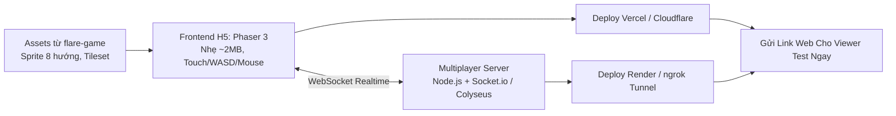

# BÁO CÁO ĐÁNH GIÁ & KHAI THÁC TÀI NGUYÊN FLARE (FLARE-ENGINE & FLARE-GAME)
**Dự án:** Echoes of Genesis (Astraea Online)  
**Tài liệu tham chiếu:** [flare-engine](https://github.com/flareteam/flare-engine) & [flare-game](https://github.com/flareteam/flare-game)  
**Ngày lập:** 24/10/2026  

---

## 1. TỔNG QUAN VỀ HAI KHO NGUỒN FLARE

| Tiêu chí | `flare-engine` | `flare-game` (Empyrean Campaign) |
| :--- | :--- | :--- |
| **Bản chất** | Core Engine mã nguồn mở 2D Action-RPG (C++ / SDL2) | Game ARPG hoàn chỉnh chạy trên flare-engine (Assets & Config) |
| **Giấy phép** | GNU GPL v3 | CC-BY-SA 3.0 / CC-BY 3.0 / OpenGameArt |
| **Nền tảng gốc** | Desktop (Windows, Linux, macOS, Android) | Dữ liệu game (Data files, PNG, OGG, INI) |
| **Chế độ chơi** | **Offline Single-Player** (Không có mạng) | Chiến dịch chơi đơn Diablo-style |
| **Giá trị với dự án ta** | **Thuật toán & Cơ chế ARPG** (Tham khảo logic) | **Mỏ vàng Asset 2.5D Isometric 8 hướng** (Dùng trực tiếp) |

---

## 2. GIÁ TRỊ ĐÓNG GÓP CHO DỰ ÁN ECHOES OF GENESIS

### 2.1. `flare-game`: Mỏ Vàng Đồ Họa 2.5D Isometric 8 Hướng (Dùng Trực Tiếp)
Kho tài nguyên `flare-game` giải quyết được 80% áp lực sản xuất asset ban đầu cho dự án:

1. **Sprite Nhân Vật & Động Tác 8 Hướng (Player Sprites):**
   - Đầy đủ chuyển động mượt mà theo 8 góc la bàn (N, NE, E, SE, S, SW, W, NW).
   - Bộ animation chuẩn: `Idle` (Đứng thở), `Walk/Run` (Di chuyển), `Attack` (Chém kiếm, Bắn cung, Niệm phép), `Hit` (Trúng đòn), `Die` (Tử trận).
2. **Hệ Thống Phân Lớp Trang Bị (Paperdoll System):**
   - Asset đã tách sẵn các layer trang phục theo 8 hướng: Thân trần, Giáp da, Áo choàng pháp sư, Giáp sắt, Mũ nón, Kiếm, Khiên, Cung tên.
   - Khi nhân vật nhặt hoặc thay đổi trang bị, chỉ cần gán layer sprite tương ứng mà không cần render lại toàn bộ nhân vật.
3. **Bộ Quái Vật Đa Dạng (Monster Bestiary):**
   - Đầy đủ quái vật dã ngoại 8 hướng: Goblin, Khung Xương (Skeleton), Zombie, Bọ cạp, Nhện khổng lồ, Minotaur, Golem đá... Phù hợp ngay với Chương 1 & Chương 2 trong GDD.
4. **Hệ Thống Bản Đồ Isometric Tilesets:**
   - Địa hình làng mạc, đồng cỏ, rừng rậm, phế tích đá, hầm ngục ngầm (Dungeon), dung nham.
   - Chuẩn kích thước lưới Isometric (64x32 hoặc 128x64 px).
5. **VFX & Kỹ Năng Ma Pháp (Spell Effects):**
   - Quả cầu lửa (Fireball), tia sét (Lightning), mảnh băng (Ice shards), vệt chém kiếm (Slash effect), vòng tròn triệu hồi ma pháp.
6. **Icons & Âm Thanh (SFX/UI):**
   - Hơn 500 icon trang bị, bình máu (HP Potion), bình mana, ngọc bổ trợ, cuộn giấy truyền tống.
   - Bộ âm thanh bước chân, tiếng chém kim loại, tiếng quái vật rên rỉ, nhạc nền phong cách kỳ ảo u tối.

---

### 2.2. `flare-engine`: Tham Khảo Logic & Công Thức ARPG (Reference Architecture)
Dù không sử dụng mã nguồn C++ trực tiếp trong môi trường Web, kiến trúc của `flare-engine` là cuốn "bách khoa toàn thư" để áp dụng vào TypeScript/Node.js:

1. **Toán học tọa độ Isometric:**
   - Công thức chiếu trục tọa độ kim cương (Diamond Isometric Grid): chuyển đổi qua lại giữa tọa độ logic màn chơi $(x, y)$ và tọa độ render màn hình $(isoX, isoY)$.
   - Thuật toán sắp xếp độ sâu hiển thị (**Z-Sorting / Depth Sorting**) giúp nhân vật đi trước/sau cây cối, cột đá không bị lỗi hiển thị.
2. **Cấu trúc dữ liệu trang bị & Affix RNG:**
   - Cách tổ chức file định nghĩa vật phẩm, chỉ số Prefix/Suffix ngẫu nhiên, tỉ lệ rớt đồ (Loot Table).
3. **Cơ chế tính toán sát thương & Hitbox:**
   - Công thức tính né đòn, bạo kích, kháng cự nguyên tố.

---

## 3. ĐÁNH GIÁ VIỆC DÙNG TRỰC TIẾP `FLARE-ENGINE` ĐỂ HOST TEST HÔM NAY

### ❌ Tại sao KHÔNG THỂ dùng nguyên bản `flare-engine` để test hôm nay?
1. **Bản chất Offline Single-Player:**
   - `flare-engine` được thiết kế thuần túy cho game **chơi đơn offline trên máy tính cá nhân**. Nó **hoàn toàn không có kiến trúc mạng (No Multiplayer, No WebSocket, No Client-Server sync)**.
   - Nếu tìm cách đưa lên web, mỗi người xem truy cập link sẽ chỉ chơi một mình đơn độc, **không thể nhìn thấy nhau, không test được tính năng kết nối nhiều người**.
2. **C++ & WebAssembly (Emscripten) Cực Kỳ Nặng & Cồng Kềnh:**
   - Muốn chạy `flare-engine` trên trình duyệt phải cấu hình chuỗi build Emscripten để biên dịch C++ sang WebAssembly (`.wasm`), gói ảo hóa toàn bộ thư mục dữ liệu asset thành file `.data` nặng từ 50MB - 100MB.
   - Thời gian thiết lập chuỗi build này rất phức tạp, dễ phát sinh lỗi tương thích trình duyệt.
3. **Trải Nghiệm Điều Khiển Không Tương Thích Mobile Web:**
   - Flare được thiết kế phục vụ chuột và bàn phím desktop. Khi chạy trên web di động (Safari/Chrome), không có cụm phím ảo Joystick cảm ứng, người dùng trên điện thoại sẽ không thao tác được.

---

## 4. PHƯƠNG ÁN TỐI ƯU: CÓ LINK DEMO ONLINE CHO VIEWER TEST NGAY HÔM NAY

Để người xem/cộng đồng có thể **bấm vào link web trên điện thoại hoặc máy tính, cùng tham gia vào 1 bản đồ và thấy nhau di chuyển 8 hướng mượt mà trong hôm nay**, phương án chuẩn nhất là:

### Kế Hoạch Triển Khai Trong Vài Tiếng:
1. **Lấy Asset (15 phút):**
   - Trích xuất 1 bộ Sprite nhân vật hiệp sĩ/pháp sư (8 hướng đi bộ + đứng chờ) và 1 bộ gạch nền cỏ/đá từ `flare-game`.
2. **Xây dựng Client Phaser 3 H5 (1 - 2 tiếng):**
   - Dựng bản đồ Isometric nhỏ.
   - Nhân vật di chuyển mượt mà 8 hướng theo click chuột (PC) và cụm Joystick ảo trên màn hình cảm ứng (Mobile).
3. **Đồng Bộ Multiplayer WebSocket (1 tiếng):**
   - Server Node.js nhẹ nhận tọa độ `(x, y, direction)` và phát broadcast tới các người chơi khác.
   - Nhiều người mở link đồng thời sẽ thấy các nhân vật khác cùng chạy nhảy trên màn hình.
4. **Phát Hành Online Tức Thì (15 phút):**
   - **Frontend:** Đẩy lên Vercel hoặc Cloudflare Pages (Miễn phí, có link HTTPS, CDN toàn cầu).
   - **Backend:** Chạy trên Render.com hoặc mở cổng trực tiếp bằng Cloudflare Tunnel / ngrok từ máy tính của bạn.
   - **Kết quả:** Có ngay đường link `https://...` gửi lên nhóm/livestream để mọi người bấm vào chơi thử ngay lập tức!
