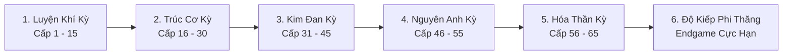

# HỆ THỐNG TU TIÊN CẢNH GIỚI & DANH SÁCH TƯỚNG GACHA SPINE 2D
**Dự án:** Echoes of Genesis (Astraea Online - Cổ Thư Hỗn Mang)  
**Tài liệu:** Cultivation System & Spine 2D Hero Roster Specification  
**Phiên bản:** 1.0 - Chính thức  

---

## MỤC LỤC TÀI LIỆU
1. [BỐI CẢNH "THIÊN ĐỊA QUY NHẤT" (THE CONVERGENCE)](#1-bối-cảnh-thiên-địa-quy-nhất-the-convergence)
2. [HỆ THỐNG CẢNH GIỚI TU TIÊN & ĐỘT PHÁ LÔI KIẾP](#2-hệ-thống-cảnh-giới-tu-tiên--đột-phá-lôi-kiếp)
3. [GAMEPLAY B: AUTO-BATTLER SPINE 2D (5V5 SQUAD TACTICS)](#3-gameplay-b-auto-battler-spine-2d-5v5-squad-tactics)
4. [HỆ THỐNG GACHA: ĐÀI TRIỆU HOÁN THÁI HƯ (TAIJI ASTRAL ALTAR)](#4-hệ-thống-gacha-đài-triệu-hoán-thái-hư-taiji-astral-altar)
5. [CƠ CHẾ LIÊN THÔNG DUAL-GAMEPLAY (DUYÊN PHẬN & TRỢ CHIẾN)](#5-cơ-chế-liên-thông-dual-gameplay-duyên-phận--trợ-chiến)
6. [HỒ SƠ CHI TIẾT 16 TƯỚNG SPINE 2D (HERO ROSTER PROFILE)](#6-hồ-sơ-chi-tiết-16-tướng-spine-2d-hero-roster-profile)
7. [CÁC CHẾ ĐỘ CHƠI DÀNH RIÊNG CHO ĐỘI HÌNH TƯỚNG (PVE / PVP)](#7-các-chế-độ-chơi-dành-riêng-cho-đội-hình-tướng-pve--pvp)

---

## 1. BỐI CẢNH "THIÊN ĐỊA QUY NHẤT" (THE CONVERGENCE)

### 1.1. Vụ Nổ Xé Rách Không Gian
Năm 1042 Kỷ Nguyên Ánh Sáng, khi Hội Đồng Pháp Sư kích nổ **Đại Cổ Thư Khởi Nguyên (The Genesis Grimoire)** để phong tỏa Vết Nứt Hư Không, xung lực năng lượng vượt quá giới hạn thực tại đã xé toạc màng ngăn cách giữa các chiều không gian:
* **Đại Lục Astraea (Tây Huyễn):** Vùng đất của Ma Pháp Grimoire, Thánh Kỵ Sĩ Giáo Đình, Thợ Rèn Rồng và Tinh Linh Thần Vực.
* **Thương Khung Vực (Đông Phương Tu Tiên):** Vùng đất cổ xưa của các Tiên Môn Đạo Gia, Kiếm Tu ngự kiếm phi hành, Ma Đạo Huyết Tộc và Luyện Đan Đại Sư.

Hai thế giới bị hút xoáy và sáp nhập làm một trong dị tượng mang tên **"Thiên Địa Quy Nhất" (The Great Convergence)**:
* **Mana** hòa quyện với **Linh Khí Trời Đất** tạo thành một nguồn năng lượng hỗn hợp gọi là **Hỗn Nguyên Khí**.
* Các bậc đại năng Đông - Tây phát hiện ra rằng: Sách Phép Grimoire có thể dùng để khắc ghi Công Pháp Tu Chân; và ngược lại, Kim Đan, Nguyên Anh có thể kích phát uy lực vô tận cho các câu chú ngữ ma thuật cổ xưa.

### 1.2. Kẻ Thức Tỉnh Song Tu (Người Chơi)
Người chơi sinh ra dưới thời điểm hai thế giới giao thoa, sở hữu đan điền đặc dị vừa dung nạp được Linh Căn Tu Tiên, vừa có thể điều khiển Cổ Thư Tây Huyễn. Người chơi mang trọng trách chu du khắp đại lục hỗn mang, một mặt cày cuốc đột phá cảnh giới, mặt khác thu thập các Tàn Trang Anh Linh để triệu hồi những vị tiền bối đại năng từ cả hai giới về dưới trướng.

---

## 2. HỆ THỐNG CẢNH GIỚI TU TIÊN & ĐỘT PHÁ LÔI KIẾP

Thay vì chỉ sử dụng cấp độ Level 1 - 60 truyền thống, game áp dụng hệ thống **Cảnh Giới Tu Tiên** làm thước đo cảnh giới tối thượng cho cả Nhân Vật Chính và các Tướng Gacha.



### 2.1. Chi Tiết 6 Đại Cảnh Giới

| Cảnh Giới | Cấp Độ Tương Ứng | Điều Kiện Đột Phá | Đặc Quyền & Sức Mạnh Thức Tỉnh |
| :--- | :---: | :--- | :--- |
| **Luyện Khí (Qi Condensation)** | Lv 1 - 15 | Tích lũy đủ EXP cày quái | Khơi thông 6 kinh mạch, mở khóa Ấn Ký Nguyên Tố bẩm sinh. |
| **Trúc Cơ (Foundation Establishment)** | Lv 16 - 30 | Cắn **Trúc Cơ Đan** (Luyện từ Lò Rèn) | Mở khóa **Phi Kiếm / Cánh Bay** (tăng 30% tốc độ chạy, lướt qua chướng ngại vật). Mở Ô Sách Phụ (Sub Slot). |
| **Kim Đan (Core Formation)** | Lv 31 - 45 | Vượt qua **Tam Trọng Lôi Kiếp** + **Ngưng Đan Lộ** | Ngưng tụ Kim Đan nội thể: Tăng 20% toàn bộ chỉ số, mở Ô Bí Thuật Hộ Thể thứ 3. Kích hoạt hào quang chân thân. |
| **Nguyên Anh (Nascent Soul)** | Lv 46 - 55 | Vượt qua **Lục Trọng Lôi Kiếp** + **Hóa Anh Đan** | Nguyên Anh xuất khiếu: **Tự động hồi sinh 1 lần** với 30% HP khi bị giết (Hồi chiêu: 180s). Cho phép ngự kiếm bay qua vực thẳm. |
| **Hóa Thần (Soul Formation)** | Lv 56 - 65 | Vượt qua **Cửu Trọng Lôi Kiếp** + **Thần Hồn Thảo** | Thần niệm bao trùm: Mở khóa kỹ năng Tối Thượng Thần Thông, tăng 50% tầm đánh, giảm 15% thời gian hồi chiêu toàn bộ skill. |
| **Độ Kiếp / Phi Thăng (Ascension)** | Lv 65+ (Max) | Khiêu chiến **Thiên Đạo Thẩm Phán** tại Vết Nứt Hư Không | Chân thân Bất Tử, mở khóa slot mang 2 Tướng Trợ Chiến ra ngoài bản đồ dã ngoại cùng lúc. Danh hiệu Thần Thoại toàn server. |

### 2.2. Cơ Chế Độ Kiếp & Thiên Kiếp Lôi Đình (Lôi Kiếp Event)
Khi nhân vật đạt đỉnh phong của mỗi cảnh giới (ví dụ: Trúc Cơ tầng 9, Kim Đan tầng 9):
1. **Nghẽn Cảnh Giới (Bottleneck):** EXP không thể tăng thêm, nút bấm **[ĐỘ KIẾP]** trên giao diện sáng rực lửa.
2. **Kích hoạt Thiên Kiếp:** 
   * Bầu trời dã ngoại tối sầm, mây giông vần vũ, sấm sét tím/vàng gầm rú trên đỉnh đầu.
   * Server bắn ra các đạo **Thiên Kiếp Sấm Sét** giáng thẳng vào nhân vật (Mỗi đòn rút 25% - 40% Max HP).
   * Người chơi phải kích hoạt kỹ năng phòng hộ, cắn đan dược hồi máu hoặc nhờ đồng đội đứng gần chia sẻ sát thương lôi kiếp.
3. **Thành công:** Hào quang vàng kim bùng nổ, nhân vật bay lên không trung, phát thông báo chữ vàng toàn server:  
   > ⚡ *"Kẻ Thức Tỉnh **[Tên Người Chơi]** đã vượt qua Lục Trọng Lôi Kiếp, chính thức ngưng tụ **NGUYÊN ANH THÀNH CÔNG**, thiên địa rung chuyển!"*

---

## 3. GAMEPLAY B: AUTO-BATTLER SPINE 2D (5V5 SQUAD TACTICS)

Song song với việc điều khiển nhân vật chính chém quái dã ngoại theo góc nhìn 2.5D Isometric, game mở ra một thế giới chiến thuật đỉnh cao với chế độ **Đội Hình Tướng Spine 2D**.

### 3.1. Cấu Trúc Đội Hình 5 Tướng
* **Chiến trường Side-View:** Góc nhìn ngang 2D, đội người chơi đứng bên trái, đối phương đứng bên phải.
* **Bố cục 5 Vị Trí:**
  * **Tiền Tuyến (Hàng Trước - 2 Vị Trí):** Dành cho Tanker (Đỡ đòn), Đấu Sĩ cận chiến đỡ sát thương và thu hút nộ khí.
  * **Hậu Phương (Hàng Sau - 3 Vị Trí):** Dành cho Xạ Thủ (Cung thủ/Phi kiếm), Pháp Sư (Nuker AOE), Hỗ Trợ (Healer/Buffer).

```
[ ĐỘI HÌNH TA ]                        [ ĐỘI HÌNH ĐỊCH ]
[Hàng Sau 1: Pháp Sư]                   [Hàng Trước: Quái Tank]   [Hàng Sau: Boss]
       [Hàng Trước 1: Đỡ Đòn] ──VS──
[Hàng Sau 2: Trị Liệu]                  [Hàng Trước: Đấu Sĩ]     [Hàng Sau: Pháp Sư]
       [Hàng Trước 2: Đấu Sĩ] ──VS──
[Hàng Sau 3: Xạ Thủ]                    [Hàng Sau: Sát Thủ]
```

### 3.2. Cơ Chế Chiến Đấu & Năng Lượng Nộ (Ultimate Energy)
1. **Đánh thường tự động:** Tướng tự xuất chiêu theo animation Spine mượt mà (chém, bắn đạn ma pháp, vung trượng).
2. **Thanh Nộ Khí (Energy Bar - 1000 Điểm):**
   * Tích nộ khi: Ra đòn đánh thường (+150 nộ), bị địch đánh (+100 nộ), hạ gục địch (+200 nộ).
   * Khi thanh nộ đầy 100%, khung viền Avatar tướng lóe sáng rực rỡ kèm tiếng chuông hiệu ứng.
3. **Kích hoạt Tuyệt Kỹ (Ultimate Cut-In):**
   * Người chơi chạm vào Avatar để giải phóng Ultimate (hoặc bật chế độ **AUTO** để máy tự dùng khi đầy).
   * Camera phóng to (Zoom-in) vào tướng Spine, màn hình tối lại, tướng thực hiện hoạt ảnh thi triển nộ độc quyền cực kỳ mãn nhãn.

---

## 4. HỆ THỐNG GACHA: ĐÀI TRIỆU HOÁN THÁI HƯ (TAIJI ASTRAL ALTAR)

### 4.1. Cốt Truyện Gacha
Đài Triệu Hoán Thái Hư là một tế đàn cổ đại hình Bát Quái ngự trị giữa giao điểm của hai thế giới. Bằng cách hiến tế **Mực Khởi Nguyên** và **Linh Thạch**, người chơi có thể triệu hồi hồn phách của các anh hùng, kiếm tiên và ma thần cổ đại nhập vào các hình thể Spine 2D.

### 4.2. Các Bể Triệu Hồi (Banners)
1. **Bể Tầm Tiên Thường (Standard Banner):** Dùng **Lệnh Bài Tầm Tiên** (Cày cuốc từ quái dã ngoại, nhiệm vụ ngày). Rơi tướng từ R đến SSR.
2. **Bể Thần Ma Giới Hạn (Event UP Banner):** Dùng **Hồn Ngọc Khởi Nguyên** (Tiền cao cấp/Sự kiện). Tăng 50% tỉ lệ xuất hiện của Tướng UR tiêu điểm theo tuần (VD: Tuần Lễ Kiếm Tiên Tiêu Dao, Tuần Lễ Nữ Thánh Kỵ Sĩ Jeanne).

### 4.3. Bảng Tỷ Lệ Rơi & Cơ Chế Bảo Hiểm (Pity System)

| Phẩm Chất Tướng | Khung Viền & Hào Quang | Tỷ Lệ Xuất Hiện Gốc | Cơ Chế Bảo Hiểm (Pity) |
| :--- | :--- | :---: | :--- |
| **R (Hiếm)** | Khung Lam - Ánh Bạc | **80.0%** | Xuất hiện phổ thông |
| **SR (Sử Thi)** | Khung Tím - Áo Choàng Tím | **16.5%** | **Chắc chắn có ít nhất 1 tướng SR mỗi 10 lần quay (10-pull Pity)** |
| **SSR (Truyền Thuyết)** | Khung Vàng Kim - Tia Lửa Vàng | **3.0%** | **Chắc chắn ra 1 tướng SSR sau tối đa 60 lần quay (Hard Pity 60)** |
| **UR (Thần Thoại)** | Khung Đỏ Hỗn Mang - Cầu Vồng Thần | **0.5%** | Trong Bể Giới Hạn: Khi nổ SSR, có 50% tỷ lệ là Tướng UR tiêu điểm. Nếu lệch, tướng SSR kế tiếp **chắc chắn 100% là Tướng UR**. |

### 4.4. Cơ Chế Thăng Tinh & Đột Phá Hồn Tướng (Duplicate Shards)
* Khi quay trùng tướng đã sở hữu: Hệ thống tự động chuyển hóa thành **Mảnh Hồn Tướng (Hero Shards)**.
* Dùng Mảnh Hồn để **Thăng Tinh (1 Sao ➔ 5 Sao ➔ Ngũ Tinh Thần Cảnh)**:
  * Mỗi sao tăng 10% chỉ số cơ bản.
  * Đạt 3 Sao: Mở khóa Kỹ Năng Nội Tại 2 (Passive Perk 2).
  * Đạt 5 Sao: Cường hóa Tuyệt Kỹ Nộ (Nâng cấp visual VFX và tăng 35% sát thương kỹ năng nộ).

---

## 5. CƠ CHẾ LIÊN THÔNG DUAL-GAMEPLAY (DUYÊN PHẬN & TRỢ CHIẾN)

Để hai gameplay không bị tách biệt rời rạc, game xây dựng 3 cầu nối sức mạnh trực tiếp:

### 5.1. Duyên Phận Thuộc Tính (Passive Collection Bond)
Chỉ cần người chơi **sở hữu tướng trong bộ sưu tập** (không cần mang vào đội hình), nhân vật chính ở thế giới dã ngoại Isometric tự động nhận vĩnh viễn các dòng chỉ số cộng dồn:
* Kích hoạt Duyên Phận **"Kiếm Ý Thông Thiên"** (Sở hữu Lý Tiêu Dao + Lục Tuyết Kỳ): Nhân vật chính tăng **+5% Tỷ lệ Bạo Kích** và **+15 Tốc độ chạy**.
* Kích hoạt Duyên Phận **"Thánh Ma Bất Lưỡng Lập"** (Sở hữu Jeanne + Diệp Hắc): Nhân vật chính tăng **+500 HP** và **+5% Hút Máu**.

### 5.2. Kỹ Năng Trợ Chiến Xuất Kích (Striker Call System)
* Trên thanh phím nóng dã ngoại của Nhân vật chính, có 1 ô phím tắt đặc biệt: **[Nút Trợ Chiến - Phím Space hoặc G]**.
* Người chơi được chọn 1 Tướng Spine 2D yêu thích làm **"Hộ Vệ Xuất Chiến"**:
  * Khi tích đủ Nộ Khí dã ngoại (bằng cách chém quái), bấm nút Trợ Chiến:
  * Tướng Spine 2D sẽ từ không gian nhảy vọt xuống sàn đấu, phóng thẳng chiêu Ultimate quét sạch quái vật xung quanh trong bán kính 10 mét, buff khiên/máu cho nhân vật chính rồi lướt đi trong vòng 2.5 giây!

### 5.3. Vòng Tuần Hoàn Kinh Tế & Tài Nguyên
* **Đi Cày Quái Isometric (Gameplay A):** Nhặt được *Lệnh Bài Tầm Tiên, Linh Dược Nâng Cấp Tướng, Mảnh Hồn Tướng Thường*.
* **Vượt Ải & Leo Tháp Đội Hình Spine (Gameplay B):** Thưởng *Đá Cường Hóa +15, Sách Phép Tím/Vàng Mythic, Bình Đan Dược Đột Phá Cảnh Giới* cho Nhân vật chính mang đi PK cướp rương dã ngoại!

---

## 6. HỒ SƠ CHI TIẾT 16 TƯỚNG SPINE 2D (HERO ROSTER PROFILE)

Dưới đây là đặc tả chi tiết 16 Tướng đầu tiên chia đều cho 4 Trận Doanh Đông - Tây:

---

### TRẬN DOANH I: TIÊN MÔN KIẾM TÔNG (ĐÔNG PHƯƠNG CHÍNH ĐẠO)

#### 1. Thanh Huyền Kiếm Tiên - Lý Tiêu Dao (UR)
* **Trận doanh:** Tiên Môn | **Linh căn:** Phong - Lôi | **Cảnh giới:** Hóa Thần Sơ Kỳ
* **Vai trò:** Đấu Sĩ / Sát Thủ Hàng Sau (Bạo kích chí mạng, lướt xuyên giáp).
* **Thiết kế Spine 2D:** Bạch y phiêu dật, mái tóc đen cột dải lụa đỏ, 7 thanh phi kiếm cổ bay lơ lửng sau lưng theo quỹ đạo Bát Quái. Dáng đứng lơ lửng cách mặt đất 10cm.
* **Bộ Kỹ Năng Spine:**
  * *Skill 1 - Vạn Tật Kiếm (Active):* Phóng 3 đạo kiếm khí xuyên thấu toàn bộ hàng trước địch, gây sát thương Lôi và giảm 20% giáp mục tiêu trong 4s.
  * *Skill 2 - Kiếm Ý Hộ Thể (Passive):* Tăng 25% tỷ lệ Né Đòn. Mỗi khi né thành công, tự động phản kích 1 phi kiếm gây sát thương chuẩn.
  * *Tuyệt Kỹ Nộ - VẠN KIẾM QUY TÔNG (Ultimate):* Zoom-in camera, Lý Tiêu Dao bắt quyết chỉ tay lên trời; 7 phi kiếm hóa thành trận mưa vạn kiếm xé toạc bầu trời dội thẳng xuống toàn bộ 5 tướng địch.
* **Buff Nhân Vật Chính:** Tăng vĩnh viễn +5% Bạo kích. Mở khóa ngoại trang **"Phi Kiếm Ngự Phong"** cho nhân vật chính cưỡi dã ngoại.
* **Voice Line:** *"Kiếm xuất như long, trảm tận yêu ma vạn trượng!"*

#### 2. Tuyết Mai Kiếm Cơ - Lục Tuyết Nhi (SSR)
* **Trận doanh:** Tiên Môn | **Linh căn:** Băng Tuyết | **Cảnh giới:** Kim Đan Đỉnh Phong
* **Vai trò:** Khống Chế Cứng Hàng Sau (Đóng băng diện rộng).
* **Thiết kế Spine 2D:** Áo lụa màu lam tuyết, tay cầm Tràng Kiếm Băng Tinh tỏa hơi lạnh bốc khói mờ ảo.
* **Bộ Kỹ Năng Spine:**
  * *Skill 1 - Băng Tâm Kiếm Khí:* Bắn làn sóng băng giá làm chậm 40% tốc đánh và tốc chạy của 2 kẻ địch hàng trước.
  * *Skill 2 - Tuyết Liên Nở Rộ (Passive):* Tướng địch bị đóng băng sẽ nhận thêm 30% sát thương từ mọi nguồn.
  * *Tuyệt Kỹ Nộ - TUYẾT VŨ THIÊN THU:* Triệu hồi một bông hoa sen băng khổng lồ nở bung giữa lòng đội hình địch, đóng băng toàn bộ kẻ địch trong 2.5 giây.
* **Buff Nhân Vật Chính:** +10% Kháng hiệu ứng làm chậm.

#### 3. Bát Quái Chưởng Môn - Huyền Cơ Chân Nhân (SR)
* **Trận doanh:** Tiên Môn | **Linh căn:** Thái Cực Âm Dương | **Cảnh giới:** Trúc Cơ Viên Mãn
* **Vai trò:** Hỗ Trợ Đội Hình (Tạo khiên Thái Cực, hồi Nộ khí đồng đội).
* **Thiết kế Spine 2D:** Đạo sĩ râu dài, tay cầm phất trần trắng, sau lưng lơ lửng đĩa Bát Quái xoay tròn phát sáng vàng nhạt.
* **Bộ Kỹ Năng Spine:**
  * *Skill 1 - Thái Cực Hộ Thuẫn:* Ban lớp khiên năng lượng hấp thụ sát thương bằng 15% HP tối đa cho 2 tướng thấp máu nhất.
  * *Tuyệt Kỹ Nộ - CÀN KHÔN ĐẠI NÃ DI:* Đảo ngược dòng năng lượng, buff ngay 300 điểm Nộ Khí cho toàn đội.

#### 4. Thần Đồng Luyện Đan - Tiểu Đan Đồng (R)
* **Trận doanh:** Tiên Môn | **Linh căn:** Mộc Dược | **Cảnh giới:** Luyện Khí Tầng 8
* **Vai trò:** Hồi Máu Đơn Mục Tiêu (Healer sơ cấp).
* **Thiết kế Spine 2D:** Bé trai buộc tóc hai búi củ tỏi, ôm một bình hồ lô đan dược to hơn người, thi thoảng ngã dúi dụi ngộ nghĩnh.
* **Bộ Kỹ Năng Spine:**
  * *Skill 1 - Quăng Linh Đan:* Ném đan dược hồi phục 20% HP cho đồng minh thấp máu nhất.
  * *Tuyệt Kỹ Nộ - NỒI ĐAN NỔ TUNG:* Nồi thuốc nổ tung khói thơm ngào ngạt, hồi máu và tăng 10% công cho toàn đội trong 5 giây.

---

### TRẬN DOANH II: MA ĐẠO CỔ TỘC (HẮC ÁM & TÀI NĂNG TÀ ĐẠO)

#### 5. Cửu U Ma Tôn - Diệp Hắc (UR)
* **Trận doanh:** Ma Đạo | **Linh căn:** Ma Huyết - U Hỏa | **Cảnh giới:** Hóa Thần Đỉnh Phong
* **Vai trò:** Pháp Sư Dồn Sát Thương & Hút Máu (Dark Nuker / Life Steal).
* **Thiết kế Spine 2D:** Hắc bào rách rưới bay phần phật trong ma phong, sừng quỷ đen trên trán, một tay cầm Ma Trượng Đầu Lâu tỏa khói tím, mắt đỏ ngầu rực lửa.
* **Bộ Kỹ Năng Spine:**
  * *Skill 1 - Huyết Ma Câu Hồn:* Bàn tay bóng tối từ lòng đất túm lấy tướng địch có công cao nhất, kéo về phía trước và câm lặng trong 2 giây.
  * *Skill 2 - Phệ Hồn Huyết Hải (Passive):* Mỗi khi có bất kỳ mục tiêu nào trên sân ngã xuống (bất kể ta hay địch), Diệp Hắc hồi ngay 15% HP tối đa và tăng 10% Công (cộng dồn tối đa 5 tầng).
  * *Tuyệt Kỹ Nộ - CỬU U MA THẦN GIÁNG THẾ:* Diệp Hắc bay lên giữa không trung, hóa thành bóng Ma Thần khổng lồ 3 đầu 6 tay giáng chưởng lực xuống toàn bộ đội hình địch, gây sát thương khủng khiếp và chuyển hóa 30% sát thương thành Huyết Thuẫn cho toàn đội.
* **Buff Nhân Vật Chính:** Đòn đánh dã ngoại có 8% Hút Máu.
* **Voice Line:** *"Thuận ta thì sống, nghịch ta thì hồn phi phách tán!"*

#### 6. Bạch Cốt Phu Nhân - Diễm Cơ (SSR)
* **Trận doanh:** Ma Đạo | **Linh căn:** Cốt Độc | **Cảnh giới:** Nguyên Anh Sơ Kỳ
* **Vai trò:** Sát Thủ Hàng Sau (Đâm lén, độc rút máu theo % HP).
* **Thiết kế Spine 2D:** Nữ ma đầu quyến rũ ma mị, mặc y phục đỏ thẫm bó sát, sau lưng xòe ra 6 cánh tay bằng xương trắng sắc như dao cạo.
* **Bộ Kỹ Năng Spine:**
  * *Skill 1 - Bạch Cốt Đột Kích:* Dịch chuyển tức thời ra sau lưng kẻ địch yếu máu nhất, cắm móng vuốt xương gây sát thương bộc phá.
  * *Skill 2 - Hủ Cốt Độc Tố (Passive):* Đòn đánh găm độc sâu, rút 2% HP tối đa mỗi giây trong 5s.
  * *Tuyệt Kỹ Nộ - BẠCH CỐT CHI LÂM:* Mặt đất trồi lên rừng chông xương trắng xiên thủng hàng sau địch, cấm hồi máu hoàn toàn trong 4 giây.

#### 7. Ma Cương Thiết Tướng - Thi Hầu (SR)
* **Trận doanh:** Ma Đạo | **Linh căn:** Cương Thi Thiết Thể | **Cảnh giới:** Trúc Cơ Đỉnh Phong
* **Vai trò:** Tanker Bất Tử (Chống chịu vật lý siêu hạng).
* **Thiết kế Spine 2D:** Cương thi mặc giáp sắt cổ rỉ sét, dán lá bùa vàng trên trán bay phấp phới, tay cầm quan tài sắt làm khiên.
* **Bộ Kỹ Năng Spine:**
  * *Skill 1 - Đập Quan Tài:* Nện nắp quan tài xuống đất gây choáng 1.5s kẻ địch trước mặt.
  * *Tuyệt Kỹ Nộ - THI HÓA BẤT TỬ:* Kích hoạt trạng thái Cuồng Nộ: Miễn nhiễm tử vong trong 4 giây (khi máu về 1 HP không thể chết).

#### 8. Huyết Ma Tầm Đạo Giả (R)
* **Trận doanh:** Ma Đạo | **Linh căn:** Huyết Khí | **Cảnh giới:** Luyện Khí Tầng 9
* **Vai trò:** Tiên Phong Cảm Tử.
* **Thiết kế Spine 2D:** Đao phủ tay cầm song đao gỉ máu, mắt quấn vải đen.
* **Bộ Kỹ Năng Spine:**
  * *Tuyệt Kỹ Nộ - TỰ BẠO HUYẾT ĐAN:* Lao vào hàng trước địch tự phát nổ gây sát thương diện rộng.

---

### TRẬN DOANH III: THẦN THÁNH GIÁO ĐÌNH (TÂY HUYỄN HIỆP SĨ & MỤC SƯ)

#### 9. Thánh Nữ Kỵ Sĩ - Jeanne d'Arc (UR)
* **Trận doanh:** Giáo Đình | **Nguyên tố:** Thánh Quang (Lux) | **Cảnh giới:** Thánh Kỵ Sĩ Trưởng
* **Vai trò:** Đỡ Đòn Toàn Năng (Tanker số 1 game, bảo vệ đồng đội, miễn khống chế).
* **Thiết kế Spine 2D:** Giáp bản kim loại bạc sáng bóng viền vàng ròng, tóc vàng thắt bím, tay trái mang Đại Khiên Thánh Giá chạm ngọc bích, tay phải giương cao Cờ Lệnh Ánh Sáng tung bay kiêu hãnh.
* **Bộ Kỹ Năng Spine:**
  * *Skill 1 - Thánh Thuẫn Khiêu Khích:* Đập mạnh khiên xuống sàn, phát ra sóng chấn động vàng kim ép toàn bộ hàng trước địch phải tấn công Jeanne trong 3s.
  * *Skill 2 - Lời Thề Bất Khuất (Passive):* Khi máu giảm xuống dưới 30%, tạo ngay lớp khiên bằng 50% HP tối đa và miễn nhiễm mọi khống chế (choáng, đóng băng, câm lặng) trong 5s.
  * *Tuyệt Kỹ Nộ - BẢO HỘ THÁNH ĐIỆN:* Jeanne cắm phất cờ lệnh xuống đất, ánh sáng thiên đường rọi xuống tạo mái vòm quang học che chắn 5 tướng, giảm 60% toàn bộ sát thương nhận vào trong 6 giây.
* **Buff Nhân Vật Chính:** Tăng vĩnh viễn +10% Giáp và +5% Kháng Phép dã ngoại.
* **Voice Line:** *"Dưới ánh sáng của Thánh Điện, bóng tối không thể xâm phạm!"*

#### 10. Đại Trọng Phán Quan - Gabriel (SSR)
* **Trận doanh:** Giáo Đình | **Nguyên tố:** Lôi Phạt & Quang | **Cảnh giới:** Đại Trọng Phán Thần Quan
* **Vai trò:** Đấu Sĩ Cận Chiến Sát Thương Chuẩn (Thanh tẩy, trừng phạt kẻ địch nộ cao).
* **Thiết kế Spine 2D:** Giáp vàng hoàng gia, cánh năng lượng ánh sáng sau lưng, tay cầm Đại Kiếm Phán Quyết rực cháy lửa thiêng.
* **Bộ Kỹ Năng Spine:**
  * *Skill 1 - Kiếm Quang Trừng Phạt:* Bổ nhát kiếm ánh sáng gây sát thương chuẩn bỏ qua 100% giáp mục tiêu.
  * *Tuyệt Kỹ Nộ - THẨM PHÁN THIÊN ĐÌNH:* Triệu hồi một thanh cự kiếm từ mây trời cắm thẳng vào kẻ địch có lượng Nộ Khí cao nhất, xóa sạch toàn bộ nộ khí của mục tiêu và làm choáng 3s.

#### 11. Thánh Quang Đại Mục Sư - Eleanor (SR)
* **Trận doanh:** Giáo Đình | **Nguyên tố:** Quang Trị Liệu | **Cảnh giới:** Hồng Y Mục Sư
* **Vai trò:** Hồi Máu Toàn Đội & Giải Trừ Hiệu Ứng Xấu (Dispel Master).
* **Thiết kế Spine 2D:** Váy trắng thánh khiết, tay ôm Thánh Kinh Vàng, vòng hào quang thiên thần bay trên đầu.
* **Bộ Kỹ Năng Spine:**
  * *Skill 1 - Thanh Tẩy Ma Thuật:* Xóa bỏ toàn bộ bùa hại (độc, bỏng, câm lặng) cho tướng chủ lực của ta.
  * *Tuyệt Kỹ Nộ - CẦU NGUYỆN PHỤC SINH:* Cất tiếng hát thánh ca, hồi phục 35% HP tối đa cho toàn bộ 5 tướng đồng minh.

#### 12. Vệ Binh Đền Thánh (R)
* **Trận doanh:** Giáo Đình | **Nguyên tố:** Vật lý / Quang | **Cảnh giới:** Kỵ Sĩ Tập Sự
* **Vai trò:** Đỡ đòn cơ bản.
* **Thiết kế Spine 2D:** Binh sĩ cầm khiên sắt và giáo dài.
* **Bộ Kỹ Năng Spine:**
  * *Tuyệt Kỹ Nộ - HÀNG RÀO THÉP:* Dựng khiên giảm 30% sát thương cho bản thân trong 4s.

---

### TRẬN DOANH IV: HƯ KHÔNG & YÊU TỘC (MA PHÁP HUYỀN BÍ & HỖN MANG)

#### 13. Tinh Linh Long Vương - Tiamat (UR)
* **Trận doanh:** Hư Không Yêu Tộc | **Nguyên tố:** Hỗn Hợp Băng - Hỏa | **Cảnh giới:** Thái Cổ Thần Thú
* **Vai trò:** Pháp Sư Hủy Diệt Toàn Màn Hình (Board Wiper AOE).
* **Thiết kế Spine 2D:** Nữ vương rồng mang sừng tinh thể phát sáng, đuôi rồng dài uốn lượn uyển chuyển, cánh rồng ma pháp xòe rộng chiếm 1/3 khung hình.
* **Bộ Kỹ Năng Spine:**
  * *Skill 1 - Long Tức Băng Viêm:* Thổi luồng hơi thở rồng kép: một nửa sân thiêu đốt bỏng rát, một nửa sân đóng băng làm chậm.
  * *Skill 2 - Long Uy Áp Chế (Passive):* Tướng địch đối diện giảm 15% lực tấn công.
  * *Tuyệt Kỹ Nộ - HƯ KHÔNG DIỆT THẾ LONG TRẢO:* Hóa thành đầu rồng hắc ám khổng lồ từ rạn nứt không gian lao ra ngoạm trọn toàn bộ sân đấu đối phương.
* **Buff Nhân Vật Chính:** Mở khóa Thú Cưỡi Hư Không Dực Long ngoài map dã ngoại.
* **Voice Line:** *"Trước ngọn lửa của loài rồng, thế gian chỉ là cát bụi!"*

#### 14. Hồ Tiên Chín Đuôi - Bạch Thiển (SSR)
* **Trận doanh:** Yêu Tộc | **Linh căn:** Độc / Huyễn Thuật | **Cảnh giới:** Yêu Vương Cửu Vĩ
* **Vai trò:** Sát Thủ / Mê Hoặc (Khống chế quấy rối, bắt địch phản bội).
* **Thiết kế Spine 2D:** Nàng hồ ly xinh đẹp quyến rũ, váy lụa trắng xẻ tà, 9 chiếc đuôi cáo mềm mại bồng bềnh chuyển động uốn lượn, tay cầm quạt lông vũ điểm hoa đào.
* **Bộ Kỹ Năng Spine:**
  * *Skill 1 - Mị Ảnh Chi Nhãn:* Nháy mắt phóng trái tim hồ ly mê hoặc tướng có sát thương cao nhất phe địch, khiến mục tiêu quay sang tấn công đồng đội nó trong 2.5 giây!
  * *Skill 2 - Huyễn Hồ Phân Thân (Passive):* Khi nhận sát thương chí tử, hóa thành đàn bướm biến mất và để lại phân thân hồ ly, bản thể dịch chuyển sang vị trí an toàn.
  * *Tuyệt Kỹ Nộ - CỬU VĨ MA DIỆN LOẠN VŨ:* 9 chiếc đuôi bùng nổ năng lượng tím thẫm quất liên hoàn 9 đòn vào khắp đội hình địch, gây sát thương Độc Ăn Mòn cực lớn.
* **Buff Nhân Vật Chính:** Tăng +8% Tỷ lệ né tránh.

#### 15. Đại Pháp Sư Nguyên Tố - Merlin (SSR)
* **Trận doanh:** Hư Không Ma Đạo | **Nguyên tố:** Lôi - Hỏa | **Cảnh giới:** Đại Hiền Triết
* **Vai trò:** Pháp Sư Triệu Hồi Thiên Thạch (Burst Damage AOE).
* **Thiết kế Spine 2D:** Lão pháp sư áo tím thêu chòm sao, trượng phép ngọc phát sáng lơ lửng, cuốn Cổ Thư Grimoire tự động lật trang bay trước ngực.
* **Bộ Kỹ Năng Spine:**
  * *Skill 1 - Chuỗi Sét Dây Chuyền:* Phóng tia sét nảy qua 4 kẻ địch, gây choáng 0.5s mỗi lần nảy.
  * *Tuyệt Kỹ Nộ - SAO BĂNG RƠI DIỆT ĐỊA (METEOR STORM):* Triệu hồi 3 quả cầu thiên thạch khổng lồ từ bầu trời rơi xuống nghiền nát sân đấu, để lại vũng dung nham thiêu đốt.

#### 16. Yêu Thụ Ngàn Năm - Mộc Tinh (SR)
* **Trận doanh:** Yêu Tộc | **Linh căn:** Mộc Độc | **Cảnh giới:** Trúc Cơ
* **Vai trò:** Đỡ đòn phản sát thương.
* **Thiết kế Spine 2D:** Người cây cổ thụ gân guốc rêu phong, mắt phát sáng xanh lục.
* **Bộ Kỹ Năng Spine:**
  * *Skill 1 - Rễ Cây Ràng Buộc:* Quấn rễ trói chân 2 tướng hàng trước địch trong 2s.
  * *Tuyệt Kỹ Nộ - GAI NHỌN PHẢN ĐÒN:* Hóa cứng thân cây, phản lại 35% sát thương nhận vào trong 5s.

---

## 7. CÁC CHẾ ĐỘ CHƠI DÀNH RIÊNG CHO ĐỘI HÌNH TƯỚNG (PVE / PVP)

Khi người chơi sở hữu và rèn luyện các tướng Spine 2D, các chế độ chơi sau sẽ mở ra tại giao diện **"Ải Chiến Thuật"**:

### 7.1. Tháp Hư Không (The Void Pagoda - 100 Tầng)
* **Luật chơi:** Khiêu chiến từng tầng tháp, mỗi tầng có đội hình quái và Boss trấn giữ khác nhau với các hiệu ứng buff kỳ dị (VD: Tầng 30 quái miễn nhiễm phép, Tầng 50 quái phản sát thương vật lý).
* **Phần thưởng:** 
  * Vượt tầng nhận *Lệnh Bài Tầm Tiên, Đan Dược Đột Phá Cảnh Giới*.
  * Quà mốc tầng 10/20/50/100: Rương chọn Tướng SSR và Sách Phép Mythic cho Nhân vật chính.

### 7.2. Đấu Trường Đỉnh Phong (Spine PvP Arena)
* **Cơ chế:** Đấu cờ bất đồng bộ giữa người chơi với nhau.
* **Thiết lập:** Mỗi người chơi cài đặt **Đội Hình Phòng Thủ (Defense Team)** gồm 5 tướng Spine.
* **Xếp hạng:** Thách đấu đội hình người chơi khác để leo bậc Rank: Đồng ➔ Bạc ➔ Vàng ➔ Kim Cương ➔ Tiên Giới Chí Tôn.
* **Phần thưởng mùa giải (Mỗi tuần):** Phát Kim Cương, Danh hiệu lấp lánh trên đầu nhân vật chính ở map dã ngoại.

### 7.3. Viễn Chinh Vực Thẳm (Roguelike Expedition)
* Dẫn dắt đội 5 tướng vượt qua bản đồ bàn cờ 15 ải.
* Máu của các tướng **không tự hồi** sau mỗi ải.
* Sau mỗi trận thắng, người chơi được bốc 1 trong 3 Lá Bùa May Mắn (Cộng 20% Hút máu, Tăng 30% Bạo kích, Gọi phân thân chiến đấu).

### 7.4. Săn Thái Cổ Cự Thú (World Boss Raid 5v1)
* Đội 5 tướng Spine đối đầu trực diện với một con Boss Thần Thoại khổng lồ chiếm trọn 1/2 màn hình bên phải (Thái Cổ Cự Long, Ma Thần Hư Không).
* Đua Top Sát Thương toàn server để nhận rương trang bị Thần Khí +15 và Mảnh Tướng UR siêu hiếm!

---
*Tài liệu được cập nhật chính thức vào hệ thống Master Docs của dự án Echoes of Genesis.*
