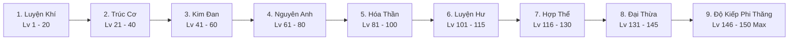

# HỆ THỐNG TU TIÊN CẢNH GIỚI & DANH SÁCH TƯỚNG GACHA SPINE 2D
**Dự án:** Echoes of Genesis (Astraea Online - Cổ Thư Hỗn Mang)  
**Tài liệu:** 9 Cultivation Realms (Cap 150), Tribulation Failure Math, 4 Factions Dynamic UI & 16 Hero Dossiers  
**Phiên bản:** 2.2 - Master Specification 9 Cảnh Giới & Rủi Ro Lôi Kiếp  

---

## MỤC LỤC TÀI LIỆU
1. [BỐI CẢNH "THIÊN ĐỊA QUY NHẤT" & 4 ĐẠI TRẬN DOANH ĐỘC LẬP](#1-bối-cảnh-thiên-địa-quy-nhất--4-đại-trận-doanh-độc-lập)
2. [HỆ THỐNG 9 ĐẠI CẢNH GIỚI TU TIÊN & RỦI RO ĐỘ KIẾP (CAP LEVEL 150)](#2-hệ-thống-9-đại-cảnh-giới-tu-tiên--rủi-ro-độ-kiếp-cap-level-150)
3. [QUY CHUẨN GIAO DIỆN (UI) TU LUYỆN BIẾN THỂ ĐỘNG THEO 4 PHE](#3-quy-chuẩn-giao-diện-ui-tu-luyện-biến-thể-động-theo-4-phe)
4. [GAMEPLAY B: AUTO-BATTLER SPINE 2D & VÒNG SÁNG TRẬN DOANH](#4-gameplay-b-auto-battler-spine-2d--vòng-sáng-trận-doanh)
5. [HỆ THỐNG GACHA: ĐÀI TRIỆU HOÁN THÁI HƯ (TAIJI ASTRAL ALTAR)](#5-hệ-thống-gacha-đài-triệu-hoán-thái-hư-taiji-astral-altar)
6. [CƠ CHẾ LIÊN THÔNG DUAL-GAMEPLAY (DUYÊN PHẬN & TRỢ CHIẾN)](#6-cơ-chế-liên-thông-dual-gameplay-duyên-phận--trợ-chiến)
7. [HỒ SƠ CHI TIẾT 16 TƯỚNG SPINE 2D (HERO DOSSIERS)](#7-hồ-sơ-chi-tiết-16-tướng-spine-2d-hero-dossiers)
8. [CÁC CHẾ ĐỘ CHƠI DÀNH RIÊNG CHO ĐỘI HÌNH TƯỚNG (PVE / PVP)](#8-các-chế-độ-chơi-dành-riêng-cho-đội-hình-tướng-pve--pvp)

---

## 1. BỐI CẢNH "THIÊN ĐỊA QUY NHẤT" & 4 ĐẠI TRẬN DOANH ĐỘC LẬP

### 1.1. Vụ Nổ Xé Rách Không Gian & Sự Ra Đời Của 4 Đại Trận Doanh
Năm 1042 Kỷ Nguyên Ánh Sáng, khi Hội Đồng Pháp Sư kích nổ **Đại Cổ Thư Khởi Nguyên (The Genesis Grimoire)** để phong tỏa Vết Nứt Hư Không, vụ nổ chấn động không thời gian đã sáp nhập đại lục Tây Huyễn Astraea và Thương Khung Vực tu tiên làm một.

Toàn bộ thế lực Đông - Tây phân hóa thành **4 Đại Trận Doanh Độc Lập**, tranh đoạt long mạch và tàn trang:
1. **Kiếm Tông Tiên Môn (Đông Phương Chính Đạo):** Kiếm đạo nhập tiên, lấy thân làm kiếm, trừ ma vệ đạo. Bản doanh: Kiếm Các Tiên Sơn. Lãnh tụ: Lý Tiêu Dao.
2. **Vạn Huyết Ma Điện (Đông Phương Ma Đạo):** Nghịch thiên đoạt mệnh, huyết luyện đan điền, kẻ mạnh vi tôn. Bản doanh: Cửu U Hắc Diệu Thành. Lãnh tụ: Diệp Hắc.
3. **Thánh Quang Giáo Đình (Tây Phương Thánh Điện):** Ánh sáng trật tự, danh dự hiệp sĩ, thánh hóa vạn vật. Bản doanh: Đại Thánh Đường Ánh Sáng. Lãnh tụ: Jeanne d'Arc.
4. **Hư Không Ma Viện (Tây Phương Ma Pháp & Yêu Tộc):** Tri thức vô tận, ma lực rồng thần viễn cổ. Bản doanh: Tinh Túc Hư Không Viện. Lãnh tụ: Tiamat & Merlin.

### 1.2. Thân Thế Kẻ Thức Tỉnh Song Tu & Nghi Thức Chọn Phe (Cấp 20)
* Người chơi sinh ra mang **Huyết Mạch Hỗn Nguyên (Genesis Body)**, có thể tu luyện cả 4 trường phái.
* **Giai đoạn Tân Thủ (Lv 1 - 20 - Luyện Khí):** Người chơi ở vị thế Trung Lập tại Làng Khởi Nguyên.
* **Nghi Thức Gia Nhập Trận Doanh (Cấp 20 - Trúc Cơ Kỳ):** Sau khi đánh bại Boss Spore King, người chơi bước đến Ngã Tư Khởi Nguyên và được 4 Vị Sứ Giả trao Tín Vật để lựa chọn gia nhập 1 trong 4 Đại Trận Doanh.

---

## 2. HỆ THỐNG 9 ĐẠI CẢNH GIỚI TU TIÊN & RỦI RO ĐỘ KIẾP (CAP LEVEL 150)

Thay vì chỉ có 65 cấp độ ngắn ngủi, game nâng trần sức mạnh lên **Cấp 150** chia đều cho **9 Đại Cảnh Giới** chuẩn mực tu chân:

### 2.1. Chi Tiết 9 Đại Cảnh Giới & Đặc Quyền Thức Tỉnh

| STT | Đại Cảnh Giới | Thang Level | Điều Kiện Đột Phá | Đặc Quyền Sức Mạnh Thức Tỉnh |
| :---: | :--- | :---: | :--- | :--- |
| **1** | **Luyện Khí Kỳ** | **Lv 1 - 20** | 10 Tầng kinh mạch | Khơi thông đan điền, kích hoạt Linh Căn bẩm sinh. |
| **2** | **Trúc Cơ Kỳ** | **Lv 21 - 40** | Cắn **Trúc Cơ Đan** (Boss rơi) | Thức tỉnh **Ngự Kiếm / Phi Hành** (+30% tốc chạy). Mở Ô Sách thứ 2. Gia nhập 1 trong 4 Phe. |
| **3** | **Kim Đan Kỳ** | **Lv 41 - 60** | **Tam Trọng Lôi Kiếp** (3 đạo sét) | Mở Ô Sách thứ 3, hào quang đan điền, đòn đánh kèm chân hỏa. |
| **4** | **Nguyên Anh Kỳ** | **Lv 61 - 80** | **Lục Trọng Lôi Kiếp** (6 đạo sét) | **Nguyên Anh Bất Tử:** Tự động hồi sinh 1 lần khi chết (Hồi 180s). Mở slot Tướng Trợ Chiến Striker dã ngoại. |
| **5** | **Hóa Thần Kỳ** | **Lv 81 - 100** | **Cửu Trọng Lôi Kiếp** (9 đạo sét) | **Thần Niệm Ngàn Dặm:** Tăng 50% tầm đánh, giảm 15% thời gian hồi chiêu toàn bộ kỹ năng. |
| **6** | **Luyện Hư Kỳ** | **Lv 101 - 115** | Vượt **Tâm Ma Huyễn Cảnh** | Thấu thị hư không: Tấn công bỏ qua 20% Giáp/Kháng phép của mục tiêu. |
| **7** | **Hợp Thể Kỳ** | **Lv 116 - 130** | Chịu **Bát Cực Lôi Ma Kiếp** | **Pháp Tướng Thiên Địa:** Hóa khổng lồ tăng 40% HP và 30% Sát thương trong 15s combat. |
| **8** | **Đại Thừa Kỳ** | **Lv 131 - 145** | Chém gục **Tâm Ma Phân Thân** | Mở khóa slot mang **2 Tướng Spine Trợ Chiến** dã ngoại cùng lúc. |
| **9** | **Độ Kiếp Phi Thăng**| **Lv 146 - 150**| **Cửu Cửu Thiên Kiếp (81 Đạo Sét)** | Thân xác Bất Tử Thần Thoại. Tên khắc trên Bảng Phong Thần toàn server. Mở Map Tiên Giới Hỗn Mang (Endgame). |

### 2.2. Bốn Nấc Thang Tiểu Cảnh Giới Cho Mỗi Cảnh Giới
* **Sơ Kỳ (0% - 25%):** Mở khóa chỉ số nền tảng của cảnh giới.
* **Trung Kỳ (26% - 50%):** Tăng 10% uy lực toàn bộ kỹ năng.
* **Hậu Kỳ (51% - 75%):** Tăng 15% tốc độ hồi phục Mana / Nội lực.
* **Đại Viên Mãn (76% - 100%):** Đạt ngưỡng **Nghẽn Cảnh Giới (Bottleneck)**. EXP bị khóa 100% cho đến khi thực hiện nghi thức Độ Kiếp!

### 2.3. Bảng Danh Xưng 9 Cảnh Giới Chuẩn Hóa Theo 4 Phe Phái

| Cảnh Giới | Kiếm Tông Tiên Môn | Vạn Huyết Ma Điện | Thánh Quang Giáo Đình | Hư Không Ma Viện |
| :---: | :--- | :--- | :--- | :--- |
| **1** | Luyện Khí (10 Tầng) | Luyện Thể Hóa Huyết | Tập Sự Kỵ Sĩ | Ma Pháp Đồ Đệ |
| **2** | Trúc Cơ Kiếm Thai | Huyết Tủy Trúc Cơ | Thánh Kỵ Sĩ Trúc Cơ | Ma Đạo Trúc Cơ |
| **3** | Kim Đan Kiếm Tâm | Diệt Thế Huyết Đan | Quang Huy Kim Đan | Tinh Hạch Ma Đan |
| **4** | Kiếm Hồn Nguyên Anh | Ma Anh Xuất Huyết | Thánh Linh Nguyên Anh | Hư Không Nguyên Thần |
| **5** | Kiếm Thần Hóa Thần | Chân Ma Hóa Thần | Thiên Sứ Hóa Thần | Thái Cổ Hiền Triết |
| **6** | Luyện Hư Kiếm Cực | Hư Vô Ma Thể | Thánh Vực Phán Quan | Tinh Tú Luyện Hư |
| **7** | Hợp Thể Vạn Kiếm | Cửu U Ma Tôn Hợp Thể | Đại Thần Quan Hợp Thể | Hỗn Mang Thần Long Hợp Thể |
| **8** | Đại Thừa Kiếm Tiên | Vô Thượng Ma Hoàng | Tổng Lãnh Thiên Thần | Chân Lý Pháp Hoàng |
| **9** | **Độ Kiếp Phi Thăng** | **Cửu U Thiên Kiếp** | **Thánh Thần Sáng Thế** | **Hư Không Chúa Tể** |

### 2.4. Công Thức Lôi Kiếp & Rủi Ro Thất Bại Tụt Tu Vi
* **Sát thương sấm sét:** Rút từ **30% đến 50% Max HP** mỗi đạo sét.
* **Biện pháp chống đỡ:** Cắn Đan Dược Hộ Kiếp (-25% sát thương), dùng Bùa Chống Sét, nhờ đồng đội Bang Hội đứng trong vòng bát quái chia sẻ sát thương (tối đa 4 người chia sẻ giúp 20%).
* ⚠️ **Hậu quả khi ngã gục trong Lôi Kiếp:**
  * Đột phá thất bại!
  * **Tụt 20% lượng EXP của mốc Đại Viên Mãn hiện tại**, rơi vào trạng thái *"Trọng Thương Khí Huyết"* (-15% chỉ số trong 10 phút).
  * Phải cày lại 20% EXP và gom lại Đan Dược để chuẩn bị lần độ kiếp tiếp theo!

---

## 3. QUY CHUẨN GIAO DIỆN (UI) TU LUYỆN BIẾN THỂ ĐỘNG THEO 4 PHE

Khi mở giao diện **[BẢNG TU LUYỆN ĐAN ĐIỀN]**, toàn bộ Visual, Khung viền, Bảng màu và Âm thanh SFX sẽ biến đổi hoàn toàn theo Phe:

1. **Kiếm Tông Tiên Môn:**
   * Tông màu: Xanh Ngọc Bích (`#06b6d4`), Trắng Mây (`#f8fafc`), Vàng Nhạt.
   * Khung Đan Điền: Đồ hình Thái Cực Âm Dương xoay chầm chậm, phi kiếm lơ lửng bay quanh quỹ đạo Bát Quái.
   * Thanh Tu Vi: Cuộn Trúc Thư (Ngọc giản) tự mở ra khi nạp exp.
   * Hoạt ảnh Đột Phá: Vạn đạo kiếm khí rít gió bay vút lên trời xé toạc mây mù.
2. **Vạn Huyết Ma Điện:**
   * Tông màu: Đỏ Thẫm Huyết Tộc (`#dc2626`), Đen Hư Không (`#09090b`), Tím Ma Mị.
   * Khung Đan Điền: Trái Tim Ma Thần đỏ đen đập thình thịch, xúc tua bóng tối và ma hỏa vây quanh.
   * Thanh Tu Vi: Bình Thủy Tinh Huyết Dịch dâng đầy dần.
   * Hoạt ảnh Đột Phá: Màn hình đỏ ngầu, bóng ma đầu lâu 3 đầu gầm thét, năng lượng huyết sắc nổ tung.
3. **Thánh Quang Giáo Đình:**
   * Tông màu: Vàng Kim Hoàng Gia (`#eab308`), Trắng Thánh (`#ffffff`), Xanh Sapphire.
   * Khung Đan Điền: Vương Miện Ánh Sáng & Thánh Giá Khởi Nguyên, các đốm sáng thiên sứ bay lượn xung quanh.
   * Thanh Tu Vi: Dải hoa văn Kinh Thánh Mạ Vàng, các câu chữ thánh kinh phát sáng dần.
   * Hoạt ảnh Đột Phá: Chuông nhà thờ ngân vang, cột sáng rọi xuống, bung đôi Cánh Thiên Thần sau lưng.
4. **Hư Không Ma Viện:**
   * Tông màu: Tím Tinh Vân (`#a855f7`), Xanh Neon Dạ Quang (`#10b981`), Băng Lam Pha Lê.
   * Khung Đan Điền: Ma Trận Vòng Tròn 7 Lớp xoay ngược chiều, ở tâm là Hố Đen Vũ Trụ hút tinh vân.
   * Thanh Tu Vi: Ống Nghiệm Tinh Thể chứa dung dịch mana lấp lánh bụi sao.
   * Hoạt ảnh Đột Phá: Không gian nứt vỡ như gương, mắt rồng cổ đại chớp sáng rực rỡ.

* **Lõi Hỗn Nguyên Khởi Nguyên Tâm:** Nằm tại tâm đan điền, phát quang ngũ sắc minh chứng thể chất Hỗn Nguyên. Khi đổi phe tại NPC Tôn Lão Nhược, toàn bộ UI chuyển Skin tức thì, tu vi bảo lưu 100%.

---

## 4. GAMEPLAY B: AUTO-BATTLER SPINE 2D & VÒNG SÁNG TRẬN DOANH

### 4.1. Cấu Trúc Đội Hình 5 Tướng Side-View
* Chiến trường nhìn ngang cận cảnh, 2 Hàng Trước (Tanker, Đấu Sĩ) + 3 Hàng Sau (Pháp Sư, Cung Thủ, Trị Liệu).
* Đồ họa Spine 2D sống động 60 FPS mượt mà, chuyển động xương mềm mại, tích đủ 1000 Nộ Khí chạm Avatar xả Ultimate Cut-In mãn nhãn.

### 4.2. Cơ Chế Vòng Sáng Trận Doanh (Faction Aura Synergy)
* **3 Tướng cùng Phe:** +10% HP Tối Đa, +10% Lực Tấn Công.
* **4 Tướng cùng Phe:** +15% HP Tối Đa, +15% Lực Tấn Công, +5% Kháng Khống Chế.
* **5 Tướng cùng Phe (Thuần Chủng):** **+25% HP Tối Đa, +25% Lực Tấn Công, +10% Tỉ Lệ Bạo Kích** + Vòng Sáng Hào Quang rực rỡ dưới chân toàn đội!
* **Bách Gia Tranh Minh (Đủ 4 Phe):** Tăng 15% Tốc độ tích Nộ Khí cho toàn đội.

---

## 5. HỆ THỐNG GACHA: ĐÀI TRIỆU HOÁN THÁI HƯ (TAIJI ASTRAL ALTAR)

* **Bể Tầm Tiên Thường:** Dùng *Lệnh Bài Tầm Tiên* (cày cuốc rơi từ quái dã ngoại). Rơi tướng từ R đến SSR.
* **Bể Thần Ma Giới Hạn:** Dùng *Hồn Ngọc Khởi Nguyên* (Ngọc cao cấp). Tăng 50% tỉ lệ nổ Tướng UR tiêu điểm theo tuần.
* **Cơ Chế Bảo Hiểm (Pity):**
  * 10 lần quay chắc chắn nhận ít nhất 1 Tướng SR.
  * 60 lần quay chắc chắn ra 1 Tướng SSR/UR.
  * Thăng Tinh tướng từ 1 Sao đến 5 Sao Thần Cảnh bằng Mảnh Hồn Tướng.

---

## 6. CƠ CHẾ LIÊN THÔNG DUAL-GAMEPLAY (DUYÊN PHẬN & TRỢ CHIẾN)

1. **Duyên Phận Bộ Sưu Tập (Passive Bond):** Sở hữu tướng tự động buff % chỉ số vĩnh viễn cho Nhân vật chính dã ngoại.
2. **Kỹ Năng Trợ Chiến Xuất Kích (Striker Call):** Cài đặt tướng Spine làm Hộ Vệ dã ngoại. Bấm phím Space/G: Tướng Spine từ không gian đáp xuống, tung Tuyệt Kỹ quét sạch quái trong bán kính 10m rồi lướt đi trong 2.5s.
3. **Tuần Hoàn Kinh Tế:** Cày quái ngoài map nhặt vé gacha & đan dược nuôi tướng; Đánh phụ bản tướng nhặt Sách Phép Mythic & Đá Cường Hóa cho nhân vật chính.

---

## 7. HỒ SƠ CHI TIẾT 16 TƯỚNG SPINE 2D (HERO DOSSIERS)

---

### TRẬN DOANH I: KIẾM TÔNG TIÊN MÔN (ĐÔNG PHƯƠNG CHÍNH ĐẠO)

#### 1. Thanh Huyền Kiếm Tiên - Lý Tiêu Dao (UR)
* **Trận doanh:** Kiếm Tông | **Linh căn:** Phong - Lôi | **Cảnh giới:** Đại Thừa Kiếm Tiên
* **Vai trò:** Đấu Sĩ / Sát Thủ Hàng Sau (Bạo kích chí mạng, lướt xuyên giáp).
* **Thiết kế Spine 2D:** Bạch y phiêu dật, mái tóc đen cột dải lụa đỏ, 7 thanh phi kiếm cổ bay lơ lửng sau lưng theo quỹ đạo Bát Quái. Dáng đứng lơ lửng cách mặt đất 10cm.
* **Bộ Kỹ Năng Spine:**
  * *Skill 1 - Vạn Tật Kiếm (Active):* Phóng 3 đạo kiếm khí xuyên thấu toàn bộ hàng trước địch, gây sát thương Lôi và giảm 20% giáp mục tiêu trong 4s.
  * *Skill 2 - Kiếm Ý Hộ Thể (Passive):* Tăng 25% tỷ lệ Né Đòn. Mỗi khi né thành công, tự động phản kích 1 phi kiếm gây sát thương chuẩn.
  * *Tuyệt Kỹ Nộ - VẠN KIẾM QUY TÔNG (Ultimate):* Zoom-in camera, Lý Tiêu Dao bắt quyết chỉ tay lên trời; 7 phi kiếm hóa thành trận mưa vạn kiếm xé toạc bầu trời dội thẳng xuống toàn bộ 5 tướng địch.
* **Buff Nhân Vật Chính:** Tăng vĩnh viễn +5% Bạo kích. Mở khóa ngoại trang **"Phi Kiếm Ngự Phong"** cho nhân vật chính cưỡi dã ngoại.
* **Voice Line:** *"Kiếm xuất như long, trảm tận yêu ma vạn trượng!"*

#### 2. Tuyết Mai Kiếm Cơ - Lục Tuyết Nhi (SSR)
* **Trận doanh:** Kiếm Tông | **Linh căn:** Băng Tuyết | **Cảnh giới:** Kiếm Thần Hóa Thần
* **Vai trò:** Khống Chế Cứng Hàng Sau (Đóng băng diện rộng).
* **Thiết kế Spine 2D:** Áo lụa màu lam tuyết, tay cầm Tràng Kiếm Băng Tinh tỏa hơi lạnh bốc khói mờ ảo.
* **Bộ Kỹ Năng Spine:**
  * *Skill 1 - Băng Tâm Kiếm Khí:* Bắn làn sóng băng giá làm chậm 40% tốc đánh và tốc chạy của 2 kẻ địch hàng trước.
  * *Skill 2 - Tuyết Liên Nở Rộ (Passive):* Tướng địch bị đóng băng sẽ nhận thêm 30% sát thương từ mọi nguồn.
  * *Tuyệt Kỹ Nộ - TUYẾT VŨ THIÊN THU:* Triệu hồi một bông hoa sen băng khổng lồ nở bung giữa lòng đội hình địch, đóng băng toàn bộ kẻ địch trong 2.5 giây.
* **Buff Nhân Vật Chính:** +10% Kháng hiệu ứng làm chậm.

#### 3. Bát Quái Chưởng Môn - Huyền Cơ Chân Nhân (SR)
* **Trận doanh:** Kiếm Tông | **Linh căn:** Thái Cực Âm Dương | **Cảnh giới:** Kim Đan Kiếm Tâm
* **Vai trò:** Hỗ Trợ Đội Hình (Tạo khiên Thái Cực, hồi Nộ khí đồng đội).
* **Thiết kế Spine 2D:** Đạo sĩ râu dài, tay cầm phất trần trắng, sau lưng lơ lửng đĩa Bát Quái xoay tròn phát sáng vàng nhạt.
* **Bộ Kỹ Năng Spine:**
  * *Skill 1 - Thái Cực Hộ Thuẫn:* Ban lớp khiên năng lượng hấp thụ sát thương bằng 15% HP tối đa cho 2 tướng thấp máu nhất.
  * *Tuyệt Kỹ Nộ - CÀN KHÔN ĐẠI NÃ DI:* Đảo ngược dòng năng lượng, buff ngay 300 điểm Nộ Khí cho toàn đội.

#### 4. Thần Đồng Luyện Đan - Tiểu Đan Đồng (R)
* **Trận doanh:** Kiếm Tông | **Linh căn:** Mộc Dược | **Cảnh giới:** Trúc Cơ Kiếm Thai
* **Vai trò:** Hồi Máu Đơn Mục Tiêu (Healer sơ cấp).
* **Thiết kế Spine 2D:** Bé trai buộc tóc hai búi củ tỏi, ôm một bình hồ lô đan dược to hơn người, thi thoảng ngã dúi dụi ngộ nghĩnh.
* **Bộ Kỹ Năng Spine:**
  * *Skill 1 - Quăng Linh Đan:* Ném đan dược hồi phục 20% HP cho đồng minh thấp máu nhất.
  * *Tuyệt Kỹ Nộ - NỒI ĐAN NỔ TUNG:* Nồi thuốc nổ tung khói thơm ngào ngạt, hồi máu và tăng 10% công cho toàn đội trong 5 giây.

---

### TRẬN DOANH II: VẠN HUYẾT MA ĐIỆN (ĐÔNG PHƯƠNG MA ĐẠO)

#### 5. Cửu U Ma Tôn - Diệp Hắc (UR)
* **Trận doanh:** Vạn Huyết Ma Điện | **Linh căn:** Ma Huyết - U Hỏa | **Cảnh giới:** Vô Thượng Ma Hoàng
* **Vai trò:** Pháp Sư Dồn Sát Thương & Hút Máu (Dark Nuker / Life Steal).
* **Thiết kế Spine 2D:** Hắc bào rách rưới bay phần phật trong ma phong, sừng quỷ đen trên trán, một tay cầm Ma Trượng Đầu Lâu tỏa khói tím, mắt đỏ ngầu rực lửa.
* **Bộ Kỹ Năng Spine:**
  * *Skill 1 - Huyết Ma Câu Hồn:* Bàn tay bóng tối từ lòng đất túm lấy tướng địch có công cao nhất, kéo về phía trước và câm lặng trong 2 giây.
  * *Skill 2 - Phệ Hồn Huyết Hải (Passive):* Mỗi khi có bất kỳ mục tiêu nào trên sân ngã xuống, Diệp Hắc hồi ngay 15% HP tối đa và tăng 10% Công (cộng dồn tối đa 5 tầng).
  * *Tuyệt Kỹ Nộ - CỬU U MA THẦN GIÁNG THẾ:* Diệp Hắc bay lên giữa không trung, hóa thành bóng Ma Thần khổng lồ 3 đầu 6 tay giáng chưởng lực xuống toàn bộ đội hình địch, chuyển hóa 30% sát thương thành Huyết Thuẫn cho toàn đội.
* **Buff Nhân Vật Chính:** Đòn đánh dã ngoại có 8% Hút Máu.
* **Voice Line:** *"Thuận ta thì sống, nghịch ta thì hồn phi phách tán!"*

#### 6. Bạch Cốt Phu Nhân - Diễm Cơ (SSR)
* **Trận doanh:** Vạn Huyết Ma Điện | **Linh căn:** Cốt Độc | **Cảnh giới:** Chân Ma Hóa Thần
* **Vai trò:** Sát Thủ Hàng Sau (Đâm lén, độc rút máu theo % HP).
* **Thiết kế Spine 2D:** Nữ ma đầu quyến rũ ma mị, mặc y phục đỏ thẫm bó sát, sau lưng xòe ra 6 cánh tay bằng xương trắng sắc như dao cạo.
* **Bộ Kỹ Năng Spine:**
  * *Skill 1 - Bạch Cốt Đột Kích:* Dịch chuyển tức thời ra sau lưng kẻ địch yếu máu nhất, cắm móng vuốt xương gây sát thương bộc phá.
  * *Skill 2 - Hủ Cốt Độc Tố (Passive):* Đòn đánh găm độc sâu, rút 2% HP tối đa mỗi giây trong 5s.
  * *Tuyệt Kỹ Nộ - BẠCH CỐT CHI LÂM:* Mặt đất trồi lên rừng chông xương trắng xiên thủng hàng sau địch, cấm hồi máu hoàn toàn trong 4 giây.

#### 7. Ma Cương Thiết Tướng - Thi Hầu (SR)
* **Trận doanh:** Vạn Huyết Ma Điện | **Linh căn:** Cương Thi Thiết Thể | **Cảnh giới:** Ma Anh Xuất Huyết
* **Vai trò:** Tanker Bất Tử (Chống chịu vật lý siêu hạng).
* **Thiết kế Spine 2D:** Cương thi mặc giáp sắt cổ rỉ sét, dán lá bùa vàng trên trán bay phấp phới, tay cầm quan tài sắt làm khiên.
* **Bộ Kỹ Năng Spine:**
  * *Skill 1 - Đập Quan Tài:* Nện nắp quan tài xuống đất gây choáng 1.5s kẻ địch trước mặt.
  * *Tuyệt Kỹ Nộ - THI HÓA BẤT TỬ:* Kích hoạt trạng thái Cuồng Nộ: Miễn nhiễm tử vong trong 4 giây (khi máu về 1 HP không thể chết).

#### 8. Huyết Ma Tầm Đạo Giả (R)
* **Trận doanh:** Vạn Huyết Ma Điện | **Linh căn:** Huyết Khí | **Cảnh giới:** Huyết Tủy Trúc Cơ
* **Vai trò:** Tiên Phong Cảm Tử.
* **Thiết kế Spine 2D:** Đao phủ tay cầm song đao gỉ máu, mắt quấn vải đen.
* **Bộ Kỹ Năng Spine:**
  * *Tuyệt Kỹ Nộ - TỰ BẠO HUYẾT ĐAN:* Lao vào hàng trước địch tự phát nổ gây sát thương diện rộng.

---

### TRẬN DOANH III: THÁNH QUANG GIÁO ĐÌNH (TÂY HUYỄN HIỆP SĨ & MỤC SƯ)

#### 9. Thánh Nữ Kỵ Sĩ - Jeanne d'Arc (UR)
* **Trận doanh:** Thánh Quang Giáo Đình | **Nguyên tố:** Thánh Quang (Lux) | **Cảnh giới:** Tổng Lãnh Thiên Thần
* **Vai trò:** Đỡ Đòn Toàn Năng (Tanker số 1 game, bảo vệ đồng đội, miễn khống chế).
* **Thiết kế Spine 2D:** Giáp bản kim loại bạc sáng bóng viền vàng ròng, tóc vàng thắt bím, tay trái mang Đại Khiên Thánh Giá chạm ngọc bích, tay phải giương cao Cờ Lệnh Ánh Sáng tung bay kiêu hãnh.
* **Bộ Kỹ Năng Spine:**
  * *Skill 1 - Thánh Thuẫn Khiêu Khích:* Đập mạnh khiên xuống sàn, phát ra sóng chấn động vàng kim ép toàn bộ hàng trước địch phải tấn công Jeanne trong 3s.
  * *Skill 2 - Lời Thề Bất Khuất (Passive):* Khi máu giảm xuống dưới 30%, tạo ngay lớp khiên bằng 50% HP tối đa và miễn nhiễm mọi khống chế trong 5s.
  * *Tuyệt Kỹ Nộ - BẢO HỘ THÁNH ĐIỆN:* Jeanne cắm phất cờ lệnh xuống đất, ánh sáng thiên đường rọi xuống tạo mái vòm quang học che chắn 5 tướng, giảm 60% toàn bộ sát thương nhận vào trong 6 giây.
* **Buff Nhân Vật Chính:** Tăng vĩnh viễn +10% Giáp và +5% Kháng Phép dã ngoại.
* **Voice Line:** *"Dưới ánh sáng của Thánh Điện, bóng tối không thể xâm phạm!"*

#### 10. Đại Trọng Phán Quan - Gabriel (SSR)
* **Trận doanh:** Thánh Quang Giáo Đình | **Nguyên tố:** Lôi Phạt & Quang | **Cảnh giới:** Thiên Sứ Hóa Thần
* **Vai trò:** Đấu Sĩ Cận Chiến Sát Thương Chuẩn (Thanh tẩy, trừng phạt kẻ địch nộ cao).
* **Thiết kế Spine 2D:** Giáp vàng hoàng gia, cánh năng lượng ánh sáng sau lưng, tay cầm Đại Kiếm Phán Quyết rực cháy lửa thiêng.
* **Bộ Kỹ Năng Spine:**
  * *Skill 1 - Kiếm Quang Trừng Phạt:* Bổ nhát kiếm ánh sáng gây sát thương chuẩn bỏ qua 100% giáp mục tiêu.
  * *Tuyệt Kỹ Nộ - THẨM PHÁN THIÊN ĐÌNH:* Triệu hồi một thanh cự kiếm từ mây trời cắm thẳng vào kẻ địch có lượng Nộ Khí cao nhất, xóa sạch toàn bộ nộ khí của mục tiêu và làm choáng 3s.

#### 11. Thánh Quang Đại Mục Sư - Eleanor (SR)
* **Trận doanh:** Thánh Quang Giáo Đình | **Nguyên tố:** Quang Trị Liệu | **Cảnh giới:** Thánh Linh Nguyên Anh
* **Vai trò:** Hồi Máu Toàn Đội & Giải Trừ Hiệu Ứng Xấu (Dispel Master).
* **Thiết kế Spine 2D:** Váy trắng thánh khiết, tay ôm Thánh Kinh Vàng, vòng hào quang thiên thần bay trên đầu.
* **Bộ Kỹ Năng Spine:**
  * *Skill 1 - Thanh Tẩy Ma Thuật:* Xóa bỏ toàn bộ bùa hại (độc, bỏng, câm lặng) cho tướng chủ lực của ta.
  * *Tuyệt Kỹ Nộ - CẦU NGUYỆN PHỤC SINH:* Cất tiếng hát thánh ca, hồi phục 35% HP tối đa cho toàn bộ 5 tướng đồng minh.

#### 12. Vệ Binh Đền Thánh (R)
* **Trận doanh:** Thánh Quang Giáo Đình | **Nguyên tố:** Vật lý / Quang | **Cảnh giới:** Thánh Kỵ Sĩ Trúc Cơ
* **Vai trò:** Đỡ đòn cơ bản.
* **Thiết kế Spine 2D:** Binh sĩ cầm khiên sắt và giáo dài.
* **Bộ Kỹ Năng Spine:**
  * *Tuyệt Kỹ Nộ - HÀNG RÀO THÉP:* Dựng khiên giảm 30% sát thương cho bản thân trong 4s.

---

### TRẬN DOANH IV: HƯ KHÔNG MA VIỆN (TÂY PHƯƠNG MA PHÁP & YÊU TỘC)

#### 13. Tinh Linh Long Vương - Tiamat (UR)
* **Trận doanh:** Hư Không Ma Viện | **Nguyên tố:** Hỗn Hợp Băng - Hỏa | **Cảnh giới:** Hư Không Thần Long (Thái Cổ Thần Thú)
* **Vai trò:** Pháp Sư Hủy Diệt Toàn Màn Hình (Board Wiper AOE).
* **Thiết kế Spine 2D:** Nữ vương rồng mang sừng tinh thể phát sáng, đuôi rồng dài uốn lượn uyển chuyển, cánh rồng ma pháp xòe rộng chiếm 1/3 khung hình.
* **Bộ Kỹ Năng Spine:**
  * *Skill 1 - Long Tức Băng Viêm:* Thổi luồng hơi thở rồng kép: một nửa sân thiêu đốt bỏng rát, một nửa sân đóng băng làm chậm.
  * *Skill 2 - Long Uy Áp Chế (Passive):* Tướng địch đối diện giảm 15% lực tấn công.
  * *Tuyệt Kỹ Nộ - HƯ KHÔNG DIỆT THẾ LONG TRẢO:* Hóa thành đầu rồng hắc ám khổng lồ từ rạn nứt không gian lao ra ngoạm trọn toàn bộ sân đấu đối phương.
* **Buff Nhân Vật Chính:** Mở khóa Thú Cưỡi Hư Không Dực Long ngoài map dã ngoại.
* **Voice Line:** *"Trước ngọn lửa của loài rồng, thế gian chỉ là cát bụi!"*

#### 14. Hồ Tiên Chín Đuôi - Bạch Thiển (SSR)
* **Trận doanh:** Hư Không Ma Viện (Yêu Tộc) | **Linh căn:** Độc / Huyễn Thuật | **Cảnh giới:** Thái Cổ Hiền Triết
* **Vai trò:** Sát Thủ / Mê Hoặc (Khống chế quấy rối, bắt địch phản bội).
* **Thiết kế Spine 2D:** Nàng hồ ly xinh đẹp quyến rũ, váy lụa trắng xẻ tà, 9 chiếc đuôi cáo mềm mại bồng bềnh chuyển động uốn lượn, tay cầm quạt lông vũ điểm hoa đào.
* **Bộ Kỹ Năng Spine:**
  * *Skill 1 - Mị Ảnh Chi Nhãn:* Nháy mắt phóng trái tim hồ ly mê hoặc tướng có sát thương cao nhất phe địch, khiến mục tiêu quay sang tấn công đồng đội nó trong 2.5 giây!
  * *Skill 2 - Huyễn Hồ Phân Thân (Passive):* Khi nhận sát thương chí tử, hóa thành đàn bướm biến mất và để lại phân thân hồ ly, bản thể dịch chuyển sang vị trí an toàn.
  * *Tuyệt Kỹ Nộ - CỬU VĨ MA DIỆN LOẠN VŨ:* 9 chiếc đuôi bùng nổ năng lượng tím thẫm quất liên hoàn 9 đòn vào khắp đội hình địch, gây sát thương Độc Ăn Mòn cực lớn.
* **Buff Nhân Vật Chính:** Tăng +8% Tỷ lệ né tránh.

#### 15. Đại Pháp Sư Nguyên Tố - Merlin (SSR)
* **Trận doanh:** Hư Không Ma Viện | **Nguyên tố:** Lôi - Hỏa | **Cảnh giới:** Tinh Tú Luyện Hư
* **Vai trò:** Pháp Sư Triệu Hồi Thiên Thạch (Burst Damage AOE).
* **Thiết kế Spine 2D:** Lão pháp sư áo tím thêu chòm sao, trượng phép ngọc phát sáng lơ lửng, cuốn Cổ Thư Grimoire tự động lật trang bay trước ngực.
* **Bộ Kỹ Năng Spine:**
  * *Skill 1 - Chuỗi Sét Dây Chuyền:* Phóng tia sét nảy qua 4 kẻ địch, gây choáng 0.5s mỗi lần nảy.
  * *Tuyệt Kỹ Nộ - SAO BĂNG RƠI DIỆT ĐỊA (METEOR STORM):* Triệu hồi 3 quả cầu thiên thạch khổng lồ từ bầu trời rơi xuống nghiền nát sân đấu, để lại vũng dung nham thiêu đốt.

#### 16. Yêu Thụ Ngàn Năm - Mộc Tinh (SR)
* **Trận doanh:** Hư Không Ma Viện (Yêu Tộc) | **Linh căn:** Mộc Độc | **Cảnh giới:** Hư Không Nguyên Thần
* **Vai trò:** Đỡ đòn phản sát thương.
* **Thiết kế Spine 2D:** Người cây cổ thụ gân guốc rêu phong, mắt phát sáng xanh lục.
* **Bộ Kỹ Năng Spine:**
  * *Skill 1 - Rễ Cây Ràng Buộc:* Quấn rễ trói chân 2 tướng hàng trước địch trong 2s.
  * *Tuyệt Kỹ Nộ - GAI NHỌN PHẢN ĐÒN:* Hóa cứng thân cây, phản lại 35% sát thương nhận vào trong 5s.

---

## 8. CÁC CHẾ ĐỘ CHƠI DÀNH RIÊNG CHO ĐỘI HÌNH TƯỚNG (PVE / PVP)
* **Tháp Hư Không (100 Tầng):** Thử thách từng tầng với quái vật biến dị, quà mốc rương chọn tướng SSR và sách phép cổ đại.
* **Đấu Trường Xếp Hạng Spine Arena:** Đặt đội hình thủ, khiêu chiến đội hình người chơi khác để leo bậc Rank (Đồng ➔ Chí Tôn).
* **Viễn Chinh Roguelike:** Đưa đội hình vượt 15 ải bàn cờ, máu không tự hồi, bốc bài may mắn dọc đường.
* **Săn Cổ Thần Khổng Lồ (Raid 5v1):** Đội hình 5 tướng xả sát thương vào Boss thần thoại chiếm trọn 1/2 màn hình.

---
*Tài liệu Master GDD được cập nhật chính thức vào hệ thống Master Docs của dự án Echoes of Genesis.*
