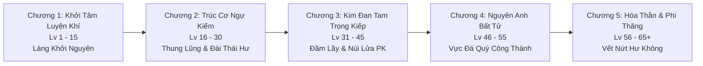
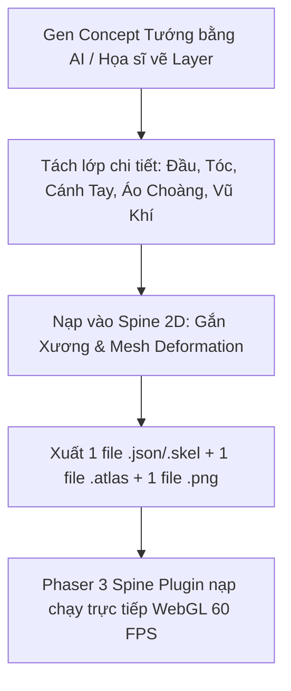

# BÁO CÁO PHÂN TÍCH THIẾT KẾ GAME & TƯ VẤN ĐỒ HỌA H5 ONLINE
**Dự án:** Echoes of Genesis (Astraea Online - Cổ Thư Hỗn Mang)  
**Nền tảng mục tiêu:** Web Browser / H5 (Cross-platform: Mobile Web & PC Web)  
**Phiên bản:** 2.0 - Bổ sung Phân Tích Pipeline Spine 2D Cho Dàn Tướng Gacha  

---

## MỤC LỤC
1. [TỔNG QUAN DỰ ÁN](#1-tổng-quan-dự-án)
2. [PHẦN I: TỔNG HỢP CỐT TRUYỆN & TÍNH NĂNG CỐT LÕI (GDD)](#phần-i-tổng-hợp-cốt-truyện--tính-năng-cốt-lõi-gdd)
   - [2.1. Bối Cảnh "Thiên Địa Quy Nhất" & Cốt Truyện Thế Giới](#21-bối-cảnh-thiên-địa-quy-nhất--cốt-truyện-thế-giới)
   - [2.2. Tuyến Nhiệm Vụ Chính Tuyến & Cảnh Giới Tu Tiên (Cấp 1 - 65)](#22-tuyến-nhiệm-vụ-chính-tuyến--cảnh-giới-tu-tiên-cấp-1---65)
   - [2.3. Hệ Thống 12 Trụ Cột Tính Năng Chi Tiết](#23-hệ-thống-12-trụ-cột-tính-năng-chi-tiết)
3. [PHẦN II: TƯ VẤN VÀ ĐÁNH GIÁ CÁC KIỂU ĐỒ HỌA CHO GAME WEB ONLINE](#phần-ii-tư-vấn-và-đánh-giá-các-kiểu-đồ-họa-cho-game-web-online)
   - [3.1. Phân Tích Chuyên Sâu Từng Phong Cách Đồ Họa](#31-phân-tích-chuyên-sâu-từng-phong-cách-đồ-họa)
   - [3.2. Bảng Ma Trận So Sánh Các Kiểu Đồ Họa](#32-bảng-ma-trận-so-sánh-các-kiểu-đồ-họa)
   - [3.3. Phân Tích Kỹ Thuật Làm VFX / FX (Kỹ Năng & Hào Quang Vũ Khí)](#33-phân-tích-kỹ-thuật-làm-vfx--fx-kỹ-năng--hào-quang-vũ-khí)
   - [3.4. Đánh Giá Pipeline Dùng AI Tạo Asset (Gemini / Generative AI)](#34-đánh-giá-pipeline-dùng-ai-tạo-asset-gemini--generative-ai)
   - [3.5. Pipeline Đồ Họa Spine 2D (Skeletal Animation) Cho Dàn Tướng Gacha](#35-pipeline-đồ-họa-spine-2d-skeletal-animation-cho-dàn-tướng-gacha)
4. [PHẦN III: ĐỀ XUẤT FRAMEWORK H5 & KIẾN TRÚC TRIỂN KHAI TEST ONLINE](#phần-iii-đề-xuất-framework-h5--kiến-trúc-triển-khai-test-online)
   - [4.1. Đề Xuất Framework H5 Tốt Nhất](#41-đề-xuất-framework-h5-tốt-nhất)
   - [4.2. Kiến Trúc Backend Multiplayer & Phân Khu (20 Channels)](#42-kiến-trúc-backend-multiplayer--phân-khu-20-channels)
   - [4.3. Phương Án Triển Khai Online Siêu Tốc Cho Mọi Người Test Ngay](#43-phương-án-triển-khai-online-siêu-tốc-cho-mọi-người-test-ngay)
5. [KẾT LUẬN & ĐỀ XUẤT CHỐT](#5-kết-luận--đề-xuất-chốt)

---

# 1. TỔNG QUAN DỰ ÁN
Dự án được định vị là một **Web Game Siêu Hỗn Hợp (Dual-Gameplay Hybrid)** kết hợp giữa cày cuốc dã ngoại thế giới mở và chiến thuật đội hình sưu tầm tướng gacha:
- **Phong cách kinh tế & cày cuốc:** Teamobi (Hiệp Sĩ Online, Ninja School), Võ Lâm Truyền Kỳ, Kiếm Thế (săn Boss dã ngoại, khóa rương 30s tranh cướp, chợ trời unbound 100%).
- **Cơ chế kỹ năng & Tu tiên:** Sách phép Grimoire Affix ngẫu nhiên song hành cùng Cảnh Giới Đột Phá Tu Chân (Luyện Khí ➔ Trúc Cơ Ngự Kiếm ➔ Kim Đan ➔ Nguyên Anh Bất Tử ➔ Độ Kiếp Lôi Đình).
- **Chiến thuật Đội hình Gacha Spine 2D:** Auto-Battler 5v5 phong cách AFK Arena / Cookie Run với dàn tướng đa văn hóa Đông - Tây (Lý Tiêu Dao, Diệp Hắc, Jeanne d'Arc, Tiamat...).

---

# PHẦN I: TỔNG HỢP CỐT TRUYỆN & TÍNH NĂNG CỐT LÕI (GDD)

## 2.1. Bối Cảnh "Thiên Địa Quy Nhất" & Cốt Truyện Thế Giới
- **Vụ Nổ Kích Hoạt Đại Phong Ấn:** Năm 1042 Kỷ Nguyên Ánh Sáng, để phong ấn Vết Nứt Hư Không, Hội Đồng Pháp Sư kích nổ Đại Cổ Thư Khởi Nguyên.
- **Thiên Địa Quy Nhất (The Convergence):** Xung lực năng lượng xé rách không thời gian, dung hợp cõi Tây Huyễn Astraea và Thương Khung Vực Đông Phương làm một. Mana hòa lẫn Linh khí sinh ra Hỗn Nguyên Khí.
- **Kẻ Thức Tỉnh Song Tu:** Người chơi mang thể chất đặc dị, vừa tu luyện đan điền, vừa điều khiển Ma Thư, đồng thời triệu hồi hồn phách các bậc tiền bối đại năng qua Đài Triệu Hoán Thái Hư.

---

## 2.2. Tuyến Nhiệm Vụ Chính Tuyến & Cảnh Giới Tu Tiên (Cấp 1 - 65)

---

## 2.3. Hệ Thống 12 Trụ Cột Tính Năng Chi Tiết
1. **Ấn Ký Nguyên Tố & Linh Căn Bẩm Sinh:** 6 Hệ (Hỏa, Băng, Lôi, Độc, Quang, Ám), thưởng 30% đồng hệ, đổi hệ tại NPC Tôn Lão Nhược.
2. **Sách Phép Grimoire & Cây Kỹ Năng 4 Tầng:** Phân nhánh A/B, hệ thống Affix dòng ngẫu nhiên rơi từ Boss.
3. **Farm Quái & Phân Bổ 4 Điểm Tiềm Năng:** STR, INT, DEX, VIT; Cơ chế Auto-Grind tự ngắt khi bị đồ sát.
4. **Săn Boss Dã Ngoại Phân 20 Channels:** Cảnh báo chữ đỏ toàn server, **Khóa bảo vệ rương 30s & Cướp đồ tự do**.
5. **Lò Rèn Cường Hóa +15 & Hào Quang Vũ Khí:** Phát sáng 5 bậc đẳng cấp (Trắng ➔ Xanh ➔ Vàng ➔ Đỏ chớp ➔ Cầu vồng Thần Khí).
6. **Kinh Tế Chợ Trời:** Quy tắc Unbound 100% đồ Boss, Mở sạp ngồi bán, Giao dịch P2P 2 bước chống tráo đồ.
7. **Chiến Đấu PK Thế Giới:** 3 Cờ (Trắng, Đỏ, Bang), Tên Đỏ chết rơi 10% Vàng và 50% nguy cơ rớt trang bị ra ngoài.
8. **Tổ Đội & Bang Hội Công Thành:** Đội 4 người +40% EXP, Công Thành Vực Đá Quý (20:00 Thứ Bảy) chiếm 5% thuế chợ trời.
9. **Cảnh Giới Tu Tiên & Lôi Kiếp Thiên Phạt:** Đột phá Luyện Khí ➔ Trúc Cơ ➔ Kim Đan ➔ Nguyên Anh ➔ Hóa Thần ➔ Độ Kiếp. Sấm sét giáng lâm toàn server.
10. **Gameplay B: Auto-Battler 5v5 Spine 2D:** Chiến trường side-view, nạp 1000 nộ xả Ultimate Cut-In hoành tráng.
11. **Gacha Đài Triệu Hoán Thái Hư:** Bể Tầm Tiên & Bể Thần Ma giới hạn, Pity 10 bảo đảm SR, 60 nổ SSR/UR.
12. **Cơ Chế Liên Thông Dual-Gameplay:** Duyên Phận tăng % Lực chiến tĩnh; Kỹ năng Trợ Chiến Striker Call gọi tướng Spine đáp xuống dọn quái dã ngoại trong 2.5s.

---

# PHẦN II: TƯ VẤN VÀ ĐÁNH GIÁ CÁC KIỂU ĐỒ HỌA CHO GAME WEB ONLINE

## 3.1. Phân Tích Chuyên Sâu Từng Phong Cách Đồ Họa

### 1. Đồ Họa Full 3D (WebGL / WebGPU)
- **Đánh giá:** Nặng, dung lượng nạp lớn (> 80MB), tụt FPS khi săn Boss đông người trên điện thoại. Không khả thi cho MMORPG cày cuốc quy mô 20 Channels.

### 2. Đồ Họa 2.5D Isometric (Pre-rendered Sprites)
- **Hệ 8 Hướng (Isometric 8-way):** Lựa chọn chuẩn mực vàng cho Gameplay A (Nhân vật chính, quái vật, bản đồ dã ngoại). Tối ưu VRAM cực tốt, cho phép 50-80 người cùng xuất hiện vẫn mượt 60 FPS.

---

## 3.2. Bảng Ma Trận So Sánh Các Kiểu Đồ Họa

| Tiêu chí đánh giá | Full 3D WebGL | 2.5D - 4 Hướng | 2.5D - 8 Hướng (Gameplay A) | 2D Spine (Gameplay B) |
| :--- | :---: | :---: | :---: | :---: |
| **Độ mượt trên Web & Mobile** | ⚠️ Thấp (20-30 FPS) | ⭐⭐⭐ Cực mượt (60 FPS) | ⭐⭐⭐ Cực mượt (60 FPS) | ⭐⭐⭐ Siêu mượt (60 FPS) |
| **Sức chứa trên 1 Màn hình** | Kém (< 10 người) | Tốt (50 - 70 người) | **Xuất sắc (50 - 80 người)** | Tối ưu 5v5 (10 tướng + hiệu ứng) |
| **Dung lượng tải Asset (Mỗi model)** | Nặng (10MB - 30MB) | Siêu nhẹ (~ 2MB) | Lý tưởng (~ 3MB - 5MB) | **Cực nhẹ (300KB - 1MB/tướng)** |
| **Góc nhìn & Thể hiện Visual** | Tự do 360 độ | Cố định 4 góc chéo | **Bao quát chiến trường 8 hướng** | **Cận cảnh Side-view, ngắm trọn vẹn ngoại hình** |
| **Animation & VFX** | Phức tạp, tốn GPU | Cứng nhắc theo frame | Mượt mà chuẩn Diablo | **Uốn lượn xương mềm, biểu cảm sống động** |

---

## 3.3. Phân Tích Kỹ Thuật Làm VFX / FX (Kỹ Năng & Hào Quang Vũ Khí)
- **Hào quang vũ khí (+4 đến +15):** Sử dụng Custom Fragment Shader (GLSL) trên WebGL. Không tốn dung lượng frame ảnh tĩnh, đổi màu động theo cấp cường hóa (+4 Trắng, +7 Lam, +10 Vàng, +13 Đỏ, +15 Cầu vồng Thần Khí).
- **Hệ thống hạt (Particle System):** Dùng Texture Pool chia sẻ chung giữa các hệ nguyên tố để giảm thiểu Overdraw.

---

## 3.4. Đánh Giá Pipeline Dùng AI Tạo Asset
- AI Concept Art ➔ 3D Proxy AI ➔ Auto-Rig Mixamo ➔ Blender Isometric Camera Script ➔ TexturePacker Atlas. Pipeline khép kín tạo asset 8 hướng chuẩn tỉ lệ 100%.

---

## 3.5. Pipeline Đồ Họa Spine 2D (Skeletal Animation) Cho Dàn Tướng Gacha

Việc tách biệt dàn tướng Gacha sang công nghệ **Spine 2D** là giải pháp vượt bậc về mặt đồ họa và tối ưu hóa hệ thống:

### Ưu điểm vượt trội của Spine 2D trên Web H5:
1. **Dung lượng siêu nhẹ (Ultra Lightweight):**  
   Mỗi tướng chỉ gồm 1 tấm ảnh Texture Atlas duy nhất và 1 file JSON lưu vị trí xương. Toàn bộ gói asset 1 tướng chỉ nặng khoảng **500KB - 1.2MB**, tải tức thì trên mạng di động.
2. **Chuyển động xương mượt mà vô tận:**  
   Không bị giật khấc giữa các khung hình như sprite sheet truyền thống. Các chuyển động tóc bay, tà áo lụa, cánh rồng vỗ, phi kiếm lượn vòng đều được nội suy toán học trơn tru 60 FPS.
3. **Dễ dàng làm Skin / Thay đổi Vũ Khí (Slot Swap):**  
   Khi nâng cấp sao hoặc đổi ngoại trang tướng, chỉ cần thay đổi texture tại vị trí tay cầm vũ khí mà không cần làm lại toàn bộ animation.
4. **Hiệu ứng Tuyệt Kỹ Phóng Đại (Cut-In Zoom):**  
   Nhờ tính chất vector/mesh của Spine, khi tướng thi triển Ultimate, camera có thể zoom sát mặt nhân vật mà hình ảnh vẫn sắc nét, không bị vỡ hạt pixel.

---

# PHẦN III: ĐỀ XUẤT FRAMEWORK H5 & KIẾN TRÚC TRIỂN KHAI TEST ONLINE

## 4.1. Đề Xuất Framework H5 Tốt Nhất: PHASER 3 + TYPESCRIPT
- Tích hợp sẵn plugin chính thức **`phaser3-spine-plugin`**, cho phép hiển thị đồng thời cả Map Isometric 2.5D và các tướng Spine 2D trên cùng một canvas WebGL siêu mượt.

## 4.2. Kiến Trúc Backend Multiplayer: NODE.JS + COLYSEUS (20 CHANNELS)
- Quản lý 20 Room độc lập tương ứng với Khu 1 -> Khu 20. Tần số tick server 20Hz, Client Interpolation 60 FPS.

## 4.3. Phương Án Triển Khai Online Siêu Tốc
- **Client:** Deploy Vercel / Cloudflare Pages.
- **Server:** Deploy Render.com / Railway.app (Hỗ trợ WebSocket WSS).

---

# 5. KẾT LUẬN & ĐỀ XUẤT CHỐT

1. **Về Kiến Trúc Đồ Họa Song Hành (Dual-Graphics Architecture):**
   * **Gameplay A (Cày cuốc, Thế giới mở):** Áp dụng **2.5D Isometric 8 Hướng** (Pre-rendered Sprites). Đảm bảo 50-80 người chơi cùng săn Boss không giật lag.
   * **Gameplay B (Đội hình Gacha, Trợ chiến Striker):** Áp dụng **2D Skeletal Animation (Spine 2D Side-view)**. Tối ưu dung lượng tải web, animation mượt mà đẳng cấp quốc tế.
2. **Về Gameplay Siêu Hỗn Hợp:**
   * Dung hợp Đông - Tây thành công mỹ mãn: Cổ Thư Grimoire song hành cùng Đột Phá Tu Tiên (Lôi Kiếp) và Anh Linh Gacha.
3. **Về Công Nghệ Sản Xuất:**
   * **Phaser 3 + TypeScript + Spine Runtime + WebSocket Colyseus**.

---
*Tài liệu Master GDD & Báo cáo Đồ họa được cập nhật chính thức trong thư mục `Documents` của dự án.*
