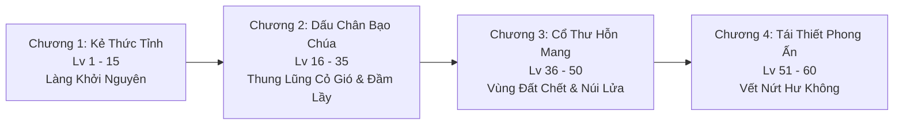
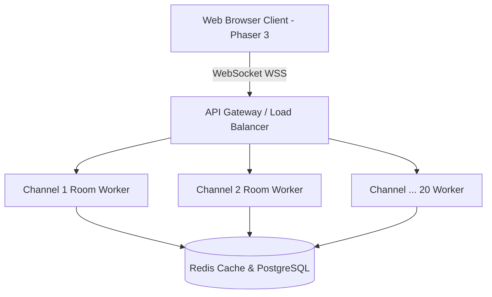

# BÁO CÁO PHÂN TÍCH THIẾT KẾ GAME & TƯ VẤN ĐỒ HỌA H5 ONLINE
**Dự án:** Astraea Online - Cổ Thư Hỗn Mang (The Shattered Grimoire)  
**Nền tảng mục tiêu:** Web Browser / H5 (Cross-platform: Mobile Web & PC Web)  
**Ngày lập báo cáo:** 21/10/2026  

---

## MỤC LỤC
1. [TỔNG QUAN DỰ ÁN](#1-tổng-quan-dự-án)
2. [PHẦN I: TỔNG HỢP CỐT TRUYỆN & TÍNH NĂNG CỐT LÕI (GDD)](#phần-i-tổng-hợp-cốt-truyện--tính-năng-cốt-lõi-gdd)
   - [2.1. Bối Cảnh & Cốt Truyện Thế Giới](#21-bối-cảnh--cốt-truyện-thế-giới)
   - [2.2. Tuyến Nhiệm Vụ Chính Tuyến (Cấp 1 - 60)](#22-tuyến-nhiệm-vụ-chính-tuyến-cấp-1---60)
   - [2.3. Hệ Thống 8 Trụ Cột Tính Năng Chi Tiết](#23-hệ-thống-8-trụ-cột-tính-năng-chi-tiết)
3. [PHẦN II: TƯ VẤN VÀ ĐÁNH GIÁ CÁC KIỂU ĐỒ HỌA CHO GAME WEB ONLINE](#phần-ii-tư-vấn-và-đánh-giá-các-kiểu-đồ-họa-cho-game-web-online)
   - [3.1. Phân Tích Chuyên Sâu Từng Phong Cách Đồ Họa](#31-phân-tích-chuyên-sâu-từng-phong-cách-đồ-họa)
   - [3.2. Bảng Ma Trận So Sánh Các Kiểu Đồ Họa](#32-bảng-ma-trận-so-sánh-các-kiểu-đồ-họa)
   - [3.3. Phân Tích Kỹ Thuật Làm VFX / FX (Kỹ Năng & Hào Quang Vũ Khí)](#33-phân-tích-kỹ-thuật-làm-vfx--fx-kỹ-năng--hào-quang-vũ-khí)
   - [3.4. Đánh Giá Pipeline Dùng AI Tạo Asset (Gemini / Generative AI)](#34-đánh-giá-pipeline-dùng-ai-tạo-asset-gemini--generative-ai)
4. [PHẦN III: ĐỀ XUẤT FRAMEWORK H5 & KIẾN TRÚC TRIỂN KHAI TEST ONLINE](#phần-iii-đề-xuất-framework-h5--kiến-trúc-triển-khai-test-online)
   - [4.1. Đề Xuất Framework H5 Tốt Nhất](#41-đề-xuất-framework-h5-tốt-nhất)
   - [4.2. Kiến Trúc Backend Multiplayer & Phân Khu (20 Channels)](#42-kiến-trúc-backend-multiplayer--phân-khu-20-channels)
   - [4.3. Phương Án Triển Khai Online Siêu Tốc Cho Mọi Người Test Ngay](#43-phương-án-triển-khai-online-siêu-tốc-cho-mọi-người-test-ngay)
5. [KẾT LUẬN & ĐỀ XUẤT CHỐT](#5-kết-luận--đề-xuất-chốt)

---

# 1. TỔNG QUAN DỰ ÁN
Dự án được định vị là một **Web Game MMORPG Cày Cuốc Cổ Điển (Hardcore Farming & Free Trade)** kết hợp cơ chế chiến đấu hiện đại, học hỏi tinh hoa từ các tựa game huyền thoại như:
- **Phong cách kinh tế & cày cuốc:** Teamobi (Hiệp Sĩ Online, Ninja School), Ngọc Rồng Online (săn Boss dã ngoại, tranh cướp rương).
- **Cơ chế kỹ năng:** Sách phép Grimoire độc lập phân nhánh, gán Affix ngẫu nhiên (Diablo/PoE style).
- **Trọng tâm trải nghiệm:** Chạy mượt mà trực tiếp trên trình duyệt Web (PC lẫn Safari/Chrome trên Smartphone) mà không cần cài đặt ứng dụng.

---

# PHẦN I: TỔNG HỢP CỐT TRUYỆN & TÍNH NĂNG CỐT LÕI (GDD)

## 2.1. Bối Cảnh & Cốt Truyện Thế Giới

### Biến cố Đại Sụp Đổ (The Great Shattering)
- **Đại lục Astraea** thuở sơ khai được nuôi dưỡng bởi nguồn sinh lực vô tận từ **Cổ Thụ Thần Vực** và toàn bộ tri thức ma pháp vận hành vũ trụ được ghi chép trong **Đại Cổ Thư Khởi Nguyên (The Genesis Grimoire)**.
- Năm **1042 Kỷ Nguyên Ánh Sáng**, một vết nứt không gian kỳ dị mang tên **Vết Nứt Hư Không (The Void Rift)** xé toạc bầu trời, giải phóng binh đoàn Hỗn Mang đe dọa nuốt chửng thế giới.
- Trong giờ phút sinh tử, Hội Đồng Tối Cao Pháp Sư buộc phải thi hành pháp thuật cấm: **kích nổ Đại Cổ Thư Khởi Nguyên** nhằm tạo nên một Đại Phong Ấn phong tỏa Vết Nứt Hư Không.
- Hậu quả: Vụ nổ xé rách Đại Cổ Thư thành **hàng triệu Tàn Trang Thần Bí (Grimoire Pages)** và các **Cổ Thư Biến Dị** bắn tung tóe khắp bốn phương tám hướng, khiến dòng chảy mana trên toàn đại lục bị biến chất và xáo trộn hoàn toàn.

### Dị Thường Quái Vật & Ma Thú Bạo Chúa
- Các sinh vật bản địa khi nuốt phải các mảnh tàn trang ma pháp rơi rớt đã bị đột biến gen, trở nên khát máu và hung bạo bất thường.
- Những quái vật nuốt trọn được cả một cuốn Cổ Thư hoàn chỉnh đã tiến hóa vượt bậc thành **Ma Thú Bạo Chúa (Field Boss / World Boss)**, chiếm cứ các cứ điểm hiểm trở như hẻm núi, đầm lầy độc và phế tích cổ.

### Người Thức Tỉnh (The Awakened Ones - Người Chơi)
- Người chơi hóa thân thành những cư dân của Astraea sinh ra dưới thời khắc mana biến động. Mỗi người ẩn chứa một **Ấn Ký Nguyên Tố Bẩm Sinh (Innate Element)**.
- **Sứ mệnh:** Bắt đầu từ một kẻ vô danh, cày cuốc tôi luyện thể chất, săn lùng các Ma Thú Bạo Chúa để thu hồi các cuốn Cổ Thư Thần Bí, từng bước giải mã phong ấn và bảo vệ đại lục.

---

## 2.2. Tuyến Nhiệm Vụ Chính Tuyến (Cấp 1 - 60)

- **Chương 1: Kẻ Thức Tỉnh (Cấp 1 - 15) - Làng Khởi Nguyên**
  - Làm quen cơ chế di chuyển, điều khiển, đánh quái sơ cấp (Ốc Sên, Nấm Độc, Heo Rừng).
  - Đạt cấp 10: Thực hiện nhiệm vụ bước ngoặt, tiến vào **Đền Thần Vực** để làm Lễ Thức Tỉnh, kích hoạt ngẫu nhiên 1 trong 6 Ấn Ký Nguyên Tố.
- **Chương 2: Dấu Chân Bạo Chúa (Cấp 16 - 35) - Thung Lũng Cỏ Gió & Đầm Lầy Tử Khí**
  - Tiếp cận cơ chế săn Boss dã ngoại (Tiểu Boss), học cách phối hợp 2 Ô Sách Phép (Sách Lam sơ cấp).
  - Làm quen hệ thống phân khu (Channels) và tổ đội diệt Boss.
- **Chương 3: Cổ Thư Hỗn Mang (Cấp 36 - 50) - Vùng Đất Chết & Núi Lửa Tro Tàn**
  - Bãi quái cấp cao, kích hoạt cơ chế PK dã ngoại tự do.
  - Cạnh tranh khốc liệt săn Boss Thế Giới (Hydra Độc, Chim Sấm, Golem Cổ Đại) để săn lùng **Sách Phép Tím (Epic)** và Đá Cường Hóa cao cấp.
- **Chương 4: Tái Thiết Phong Ấn (Cấp 51 - 60) - Vết Nứt Hư Không**
  - Chinh phục Boss Thần Thoại đoạt **Sách Phép Vàng (Mythic)**.
  - Bang Hội đại chiến: Tham gia Công Thành Chiếm Mỏ tài nguyên tại Vực Đá Quý.

---

## 2.3. Hệ Thống 8 Trụ Cột Tính Năng Chi Tiết

### 1. Hệ Thống Ấn Ký Nguyên Tố (Innate Element)
- **Cơ chế kích hoạt:** Đạt Cấp 10, người chơi kích hoạt Bệ Đá Thần Vực để server **Roll ngẫu nhiên 1 trong 6 hệ**:
  1. **Hỏa (Cháy):** 15% xác suất gây Bỏng (rút 1% HP tối đa mỗi giây trong 3s, tối đa 1 tầng).
  2. **Băng (Lạnh):** 15% xác suất làm Chậm (giảm 10% tốc chạy trong 1.5s).
  3. **Lôi (Điện):** 20% xác suất tăng 5% tốc đánh cơ bản trong 2s khi tung chiêu.
  4. **Độc (Ăn mòn):** 20% xác suất gây Vết Thương Độc (giảm 15% hồi máu nhận vào trong 3s).
  5. **Quang (Thánh khiết):** 15% xác suất kích hoạt Khiên Quang Học (giảm 5% sát thương nhận vào trong 2s).
  6. **Ám (Nguyền rủa):** 15% xác suất hồi lại 2% Mana tiêu hao của chiêu thức vừa xuất kích.
- **Cân bằng cốt lõi:** Các đòn đánh giữ 100% sát thương phẳng, không áp dụng cơ chế tương khắc trừ máu vô lý, đảm bảo tính công bằng trong PvP/PvE.
- **Thưởng Đồng Điệu (Resonance):** Nếu trang bị Sách Phép cùng hệ với Ấn Ký Bẩm Sinh:
  - Giảm 5% Mana tiêu hao.
  - Tăng 30% uy lực kỹ năng.
  - Đổi màu hiệu ứng hạt (VFX) sang màu đặc trưng của hệ đó.
- **Tính năng Đổi Hệ:** Đến NPC "Đạo Sĩ Tẩy Mệnh", tiêu tốn Tiền Vàng cày cuốc để Roll lại hệ ngẫu nhiên.

---

### 2. Hệ Thống Sách Phép & Cây Kỹ Năng Độc Quyền (Grimoire System)
- **Trang bị Sách Phép:**
  - Nhân vật có **2 Ô Sách: Sách Chính (Main Slot) và Sách Phụ (Sub Slot)**.
  - Trang bị sách nào sẽ mở khóa cây kỹ năng tương ứng của cuốn sách đó trên thanh phím nóng (Active Skills).
- **Đẳng cấp Sách (Tome Mastery - Cấp 1 đến 10):**
  - Khi đeo sách đánh quái, sách nhận 50% EXP quái hạ gục.
  - Mỗi cấp sách mang lại **1 Điểm Bí Thuật (TP)** để mở nhánh kỹ năng.
- **Cấu trúc Cây Kỹ Năng 4 Tầng:**
  - **Tầng 1 (Active Core - 1 TP):** Kỹ năng chủ động cơ bản của sách.
  - **Tầng 2 (Branching Choice - 3 TP):** Chọn 1 trong 2: **Nhánh A** (Tăng tốc / Xuyên thấu) **HOẶC** **Nhánh B** (Diện rộng / Bộc phá).
  - **Tầng 3 (Passive Perk - 2 TP):** Nội tại bổ trợ chỉ số khi cầm sách.
  - **Tầng 4 (Ultimate Mutation - 4 TP):** Chọn 1 trong 2 tuyệt kỹ thức tỉnh tối thượng.
- **Hệ thống Dòng Ngẫu Nhiên (RNG Affixes):**
  - Sách rơi từ Boss chia 4 phẩm chất: **Trắng (0 dòng) → Lam (1-2 dòng) → Tím (3 dòng) → Vàng (4 dòng)**.
  - Dòng ngẫu nhiên: Giảm hồi chiêu (3% - 10%), Tăng phạm vi chiêu (5% - 15%), Hút mana (1% - 3%), Tăng tốc độ bay của đạn ma pháp (10% - 25%).
- **Tẩy Điểm Sách:** Sử dụng "Bụi Ma Pháp" (nhặt từ quái thường) để reset điểm TP và chọn lại nhánh.

---

### 3. Farm Quái Thường (Grinding & Stat Allocation)
- **Hệ thống Điểm Tiềm Năng:** Mỗi cấp nhân vật nhận **5 Điểm Tiềm Năng (TN)** tự do phân bổ:
  - **STR (Sức mạnh):** +3 Sát thương vật lý, +2 Sức chứa hòm đồ, +0.2% Sát thương chí mạng.
  - **INT (Trí tuệ):** +3.5 Sát thương phép, +15 Mana, +0.5 Hồi mana/5s.
  - **DEX (Khéo léo):** +0.15% Tỷ lệ chí mạng, +0.1% Tốc đánh, +0.2% Tỉ lệ né tránh.
  - **VIT (Thể lực):** +25 Máu (HP), +1.5 Giáp, +0.8 Hồi máu/5s.
- **Drop List Quái Thường:**
  - Vàng (Gold), Trang bị Trắng/Lam thông thường (Vũ khí, Áo, Quần, Găng, Giày, Nhẫn).
  - Đá Cường Hóa (Cấp 1 - Cấp 3), Bụi Ma Pháp.
  - **Mảnh Tàn Trang:** Thu thập 50 mảnh đổi 1 Hòm Sách Ngẫu Nhiên cấp thấp tại NPC Làng.
- **Cơ Chế Treo Máy (Auto-Grind H5):**
  - Tự động tìm mục tiêu quanh bán kính 5m - 10m.
  - Tự dùng bình HP/MP theo % cài đặt trước.
  - **Cơ chế an toàn:** Tự động dừng khi hòm đồ đầy hoặc bị người chơi khác bật cờ đồ sát tấn công.

---

### 4. Săn Boss Dã Ngoại & Thế Giới (Boss Hunting Loop)
- **Hệ thống Phân Khu (20 Channels / Map):**
  - Mỗi bản đồ chia từ **Khu 1 đến Khu 20** giúp phân tán tải server và tạo cơ hội săn Boss cho nhiều nhóm người chơi.
  - Đổi khu tự do tại Trụ Dịch Chuyển (Cooldown: 10 giây).
- **Cảnh báo toàn Server:** Boss xuất hiện sẽ phát thông báo chữ đỏ: *"Ma Thú [Tên Boss] đã xuất hiện tại [Bản Đồ] - [Khu X]!"*.
- **Luật Rơi Đồ & Tranh Đoạt:**
  - **Top Damage:** Cá nhân/Tổ đội gây tổng sát thương lớn nhất được quyền ưu tiên nhặt Rương Boss chính.
  - **Last-Hit:** Người tung đòn kết liễu cuối cùng nhận riêng 1 "Hòm May Mắn".
  - **Khóa bảo vệ 30 giây:** Rương rơi xuống đất có thời gian bảo vệ 30s cho người có quyền. **Sau 30s, trở thành vô chủ, bất kỳ ai cũng có thể lao vào cướp nhặt đồ!**
- **Phần thưởng Boss:** Sách Phép Hoàn Chỉnh (Lam/Tím/Vàng), Đá Cường Hóa cấp 4-5, Bùa Hộ Mệnh, Bột May Mắn.

---

### 5. Cường Hóa Trang Bị (+1 đến +15)
- **Quy trình:** Đặt Trang bị + Đá Cường Hóa + Vàng tại Lò Rèn NPC.
- **Bảng Tỷ Lệ & Rủi Ro Cường Hóa:**

| Mốc Cường Hóa | Tỷ Lệ Thành Công | Hậu Quả Khi Thất Bại | Biện Pháp Bảo Vệ |
| :--- | :---: | :--- | :--- |
| **+1 đến +3** | 100% | Không có rủi ro | Không cần |
| **+4 đến +6** | 60% → 45% | Giảm 1 cấp (VD: xịt +5 về +4) | Bột May Mắn (+5% ~ +15% tỷ lệ) |
| **+7 đến +9** | 35% → 20% | Rớt thẳng về mốc an toàn (+4) | Dùng **Bùa Hộ Mệnh Thường** giữ nguyên cấp |
| **+10 đến +12** | 15% → 8% | Rớt về +4 (không bùa rớt về +0) | Dùng **Bùa Hộ Mệnh Cao Cấp** chống rớt cấp |
| **+13 đến +14** | 5% → 3% | Rớt về +0, **10% nguy cơ vỡ vụn** | Bùa Cao Cấp chống vỡ và chống rớt |
| **+15 (Thần Khí)** | **1.5%** | **Vỡ nát trang bị thành Bụi Ma Pháp** | Cần Bùa Thần Thánh + Bột May Mắn |

- **Hiệu Ứng Hào Quang Vũ Khí (Weapon Glow VFX):**
  - **+4 ~ +6:** Ánh sáng trắng mờ dịu nhẹ.
  - **+7 ~ +9:** Hào quang xanh lơ nhấp nháy liên tục.
  - **+10 ~ +12:** Hào quang vàng kim rực rỡ tỏa sáng quanh nhân vật.
  - **+13 ~ +14:** Hào quang đỏ rực kèm tia sét điện giật chớp nháy bao quanh thân vũ khí.
  - **+15 (Max):** Hào quang cầu vồng chuyển màu tím huyền ảo + Hiệu ứng bốc hơi năng lượng + Phát loa toàn server chúc mừng.

---

### 6. Kinh Tế & Giao Dịch Tự Do (Free Economy)
- **Quy tắc Vàng "Unbound":** Toàn bộ Sách Phép, Đá Cường Hóa và Trang Bị săn từ quái và Boss dã ngoại đều ở trạng thái **Không Khóa (Unbound)**. Không áp đặt khóa đồ ép buộc.
- **Mở Sạp Hàng Chợ Trời (Player Stalls):**
  - Người chơi tập trung tại Khu Chợ Trung Tâm Thành Phố, bấm "Dựng Sạp".
  - Đặt tên sạp (VD: *"Bán Sách Lôi Epic - Mua Đá Cấp 3"*).
  - Treo tối đa 10 vật phẩm định giá bằng Vàng hoặc Ngọc. Nhân vật tự động ngồi bán, người chơi khác lướt qua bấm vào mua trực tiếp.
- **Giao Dịch Trực Tiếp P2P (Face-to-Face Trade):**
  - Đứng cạnh người chơi khác → Chọn "Giao Dịch".
  - Cơ chế bảo mật 2 bước: Bước 1 "Khóa Đồ" (không cho phép sửa đổi) → Bước 2 "Xác Nhận Đổi".

---

### 7. Chiến Đấu & PK Thế Giới (Open-World PvP)
- **3 Chế Độ Cờ:**
  - **Cờ Trắng (Hòa Bình):** An toàn, không đánh được ai, không bị người cờ trắng đánh.
  - **Cờ Đỏ (Đồ Sát):** Tự do tấn công mọi người ngoài Vùng An Toàn. Kích hoạt mất 5s chờ, hủy cờ cần 30s rời giao tranh.
  - **Cờ Bang (Guild PK):** Tự động coi thành viên bang đối địch là mục tiêu thù địch.
- **Điểm Tội Ác (PK Points) & Trừng Phạt Tên Đỏ (Hắc Danh):**
  - Giết 1 người chơi cờ trắng = +1 Điểm PK (Tên đổi sang Đỏ).
  - **Hình phạt:** Tên Đỏ khi bị hạ gục sẽ **rớt 10% Vàng mang theo và tăng 50% nguy cơ rơi trang bị trên người ra đất**.
  - **Rửa tội:** Đánh 100 quái thường để giảm 1 điểm PK hoặc mua "Thư Sám Hối".
- **Khu Vực An Toàn (Safe Zone):** Làng, Thành Phố, Trụ Hồi Sinh tuyệt đối cấm PK.

---

### 8. Tổ Đội & Bang Hội Đại Chiến (Social & Guild War)
- **Tổ Đội (Party):** Tối đa 4 người/đội. Mỗi thành viên đứng cùng màn hình **buff thêm 10% EXP**. Hiển thị HP và tọa độ đồng đội trên Minimap.
- **Bang Hội:** Cần Lv 30 + 500.000 Vàng để thành lập. Tối đa 50 thành viên. Đóng góp nâng kỹ năng Bang (+5% HP, +5% Tốc chạy).
- **Công Thành Chiếm Mỏ (20:00 Thứ Bảy):**
  - Đại chiến tại Vực Đá Quý để tranh giành quyền khống chế Trụ Trung Tâm.
  - Bang giữ trụ cuối cùng sở hữu mỏ tài nguyên: toàn bộ thành viên nhận Đá Cường Hóa hàng ngày và **được hưởng 5% thuế giao dịch chợ trời của toàn server trong tuần**.

---

# PHẦN II: TƯ VẤN VÀ ĐÁNH GIÁ CÁC KIỂU ĐỒ HỌA CHO GAME WEB ONLINE

Để làm một Web Game Online chạy trên trình duyệt (HTML5/WebGL) cho phép hàng chục người cùng tương tác trên 1 màn hình, việc lựa chọn phong cách đồ họa là **yếu tố sống còn** quyết định độ mượt, dung lượng tải và chi phí sản xuất.

## 3.1. Phân Tích Chuyên Sâu Từng Phong Cách Đồ Họa

### 1. Đồ Họa Full 3D (WebGL / WebGPU)
- **Hình thức:** Dùng Model 3D (.gltf/.glb), Rigging xương (Skeletal Animation), Camera 3D tự do hoặc góc nhìn thứ 3 (như Roblox, The Strongest Battleground).
- **Ưu điểm:**
  - Góc nhìn tự do, xoay camera 360 độ cực kỳ hoành tráng.
  - Đổi trang bị/ngoại trang (Avatar paperdoll) rất dễ dàng: chỉ cần thay mesh/texture vũ khí, áo giáp trên cùng bộ xương.
  - Hiệu ứng ánh sáng động, đổ bóng thời gian thực ấn tượng.
- **Nhược điểm nghiêm trọng trên Web:**
  - **Siêu nặng (Tải chậm):** Dung lượng file 3D mesh + texture chất lượng cao rất lớn, người dùng vào web phải chờ tải cả trăm MB.
  - **Nghẽn hiệu năng (Lag giật):** Trên trình duyệt di động hoặc máy tính văn phòng không có card đồ họa rời, khi 20-30 người chơi cùng xuất hiện và thi triển skill 3D, số lượng Draw Calls và Polycount tăng đột biến gây tụt FPS xuống dưới 15-20 FPS.
  - **Nhận định:** Chỉ phù hợp với game đối kháng phòng hẹp 1v1 hoặc tối đa 4-8 người (như ghi chú trong file Excel của bạn: *"Khả thi với multiple 2 người và môi trường bé"*). **Hoàn toàn không phù hợp cho MMORPG cày cuốc đông người**.

---

### 2. Đồ Họa 2.5D Isometric (Pre-rendered Sprites)
Đây là phong cách kinh điển của **Diablo II, MU Online, Võ Lâm Truyền Kỳ 1, Kiếm Thế**. Nhân vật và quái vật được dựng từ mô hình 3D rồi render xuất ra thành chuỗi ảnh 2D (Sprite Sheet) theo các hướng cố định.

#### a. 2.5D Hệ 4 Hướng (Isometric 4-way: Đông Bắc, Tây Bắc, Đông Nam, Tây Nam)
- **Cách làm:** Mỗi hành động (Đứng yên - Idle, Đi bộ - Walk, Chém - Attack, Trúng đòn - Hit, Chết - Die) chỉ cần render ra 4 góc nhìn (hoặc render 2 hướng rồi lật gương - FlipX).
- **Ưu điểm:**
  - **Tối ưu dung lượng cực tốt:** Số lượng sprite sheet ít nhất. Tải game siêu nhanh (chỉ vài giây là vào game).
  - Tương thích 100% điện thoại cấu hình yếu, chạy 60 FPS mượt như nhung.
  - Chi phí và thời gian tạo animation bằng AI hoặc vẽ tay rất nhanh.
- **Nhược điểm:** Di chuyển hơi cứng nhắc khi đổi hướng (chỉ di chuyển theo 4 đường chéo).

#### b. 2.5D Hệ 8 Hướng (Isometric 8-way: N, NE, E, SE, S, SW, W, NW) - ⭐ **KHUYÊN DÙNG NHẤT**
- **Cách làm:** Render nhân vật di chuyển và xoay theo 8 hướng la bàn. Thực tế chỉ cần render **5 hướng** (E, SE, S, SW, W hoặc các góc đối diện) và lật gương (FlipX) để tạo ra đủ 8 hướng!
- **Ưu điểm:**
  - **Chuẩn mực của MMORPG hoài niệm:** Tái hiện hoàn hảo cảm giác di chuyển mượt mà của MU Online, Võ Lâm, Diablo.
  - **Hiệu năng Web cực đỉnh:** Trình duyệt chỉ cần bốc hình từ Sprite Sheet đã nạp vào VRAM rồi vẽ (Texture Atlas Draw), không tốn CPU tính toán khung xương 3D. Cho phép 50-100 nhân vật đứng cùng màn hình vẫn duy trì 60 FPS.
  - Dung lượng tải nén WebP/AVIF chỉ khoảng 5MB - 15MB cho toàn bộ asset khởi động.
- **Nhược điểm:** Muốn thay đổi ngoại trang áo giáp/vũ khí cần chuẩn hóa hệ thống phân lớp sprite (Layered Paperdoll) hoặc dùng kỹ thuật Palette Swap (đổi màu trang phục).

#### c. 2.5D Hệ 16 Hướng
- **Cách làm:** Render góc xoay cách nhau 22.5 độ.
- **Ưu điểm:** Nhân vật xoay tròn siêu mượt, chuyển hướng gần như không thấy khấc.
- **Nhược điểm chí mạng:**
  - **Bùng nổ bộ nhớ (Memory Explosion):** Số lượng frame ảnh tăng gấp đôi so với 8 hướng. Bộ nhớ RAM trình duyệt dễ bị tràn (Crash tab trên iOS Safari do vượt quá giới hạn 384MB RAM cho WebGL canvas).
  - Thời gian sinh asset và kiểm thử tăng gấp đôi nhưng trải nghiệm người chơi không khác biệt nhiều so với 8 hướng.

---

### 3. Đồ Họa 2D Top-Down / Side-Scroll (Teamobi Style)
- **Hình thức:** Phong cách như **Hiệp Sĩ Online, Ninja School Online, MapleStory**.
- **Ưu điểm:**
  - Nhẹ nhất trong tất cả các thể loại. Chi phí sản xuất thấp nhất.
  - Thao tác trên màn hình dọc điện thoại hoặc phím điều hướng cực kỳ thân thiện.
- **Nhược điểm:** Cảm giác chiến trường và săn Boss thế giới không hoành tráng và bao quát bằng góc nhìn 2.5D Isometric.

---

## 3.2. Bảng Ma Trận So Sánh Các Kiểu Đồ Họa

| Tiêu chí đánh giá | Full 3D WebGL | 2.5D - 4 Hướng | 2.5D - 8 Hướng (Đề xuất) | 2.5D - 16 Hướng | 2D Top-down / Side-scroll |
| :--- | :---: | :---: | :---: | :---: | :---: |
| **Độ mượt trên Web & Mobile** | ⚠️ Thấp (20-30 FPS) | ⭐⭐⭐ Cực mượt (60 FPS) | ⭐⭐⭐ Cực mượt (60 FPS) | ⚠️ Dễ giật do tràn RAM | ⭐⭐⭐ Cực mượt (60 FPS) |
| **Sức chứa người chơi (1 Màn hình)** | Kém (< 10 người) | Tốt (50 - 70 người) | **Xuất sắc (50 - 80 người)** | Trung bình (20 - 30 người) | Tốt (50 - 70 người) |
| **Dung lượng tải khởi đầu (Initial)** | Nặng (> 80MB) | Siêu nhẹ (~ 5MB) | **Lý tưởng (~ 12MB - 18MB)** | Khá nặng (~ 35MB) | Cực nhẹ (~ 5MB) |
| **Độ hoành tráng & Trải nghiệm MMORPG** | 9/10 | 6.5/10 | **9/10 (Chuẩn MU/Võ Lâm)** | 9.5/10 | 7/10 |
| **Khả năng làm VFX / Hào quang** | Ánh sáng 3D phức tạp | 2D Sprite/Particle | **Shader 2D + Particle cực đẹp** | Shader 2D + Particle | Sprite truyền thống |
| **Thời gian sản xuất Asset** | Rất lâu (Rigging, 3D) | Rất nhanh | **Cân bằng & Tối ưu nhất** | Rất chậm | Rất nhanh |

---

## 3.3. Phân Tích Kỹ Thuật Làm VFX / FX (Kỹ Năng & Hào Quang Vũ Khí)

Làm game online trên web, nếu làm VFX không đúng cách sẽ dẫn đến **Overdraw** (nhiều lớp hình trong suốt đè lên nhau làm GPU quá tải) gây giật lag toàn bộ trận săn Boss.

### 1. Phân Biệt 6 Hệ Nguyên Tố Qua Ngôn Ngữ Hình Ảnh (Visual Language):
- **Hỏa (Fire):** Tông màu Cam - Đỏ rực. Dùng hạt đốm lửa bốc lên (Rise particle) kết hợp vệt cháy xém trên mặt đất.
- **Băng (Frost):** Tông màu Xanh Băng - Trắng tuyết. Hiệu ứng vỡ vụn băng tinh thể (Shatter effect) và vòng tròn sương giá làm chậm chân.
- **Lôi (Lightning):** Tông màu Vàng chanh - Tím điện. Vẽ các đường zíc-zắc (Procedural mesh strip) phóng giật giữa các mục tiêu (Chain lightning).
- **Độc (Poison):** Tông màu Tím thẫm - Xanh lá chuối dạ quang. Bong bóng độc nổi lên và làn khói sương ăn mòn.
- **Quang (Holy):** Tông màu Vàng kim - Trắng rạng rỡ. Cột sáng thiên phạt giáng từ trên trời xuống, hào quang tròn lan tỏa.
- **Ám (Dark/Chaos):** Tông màu Đen - Tím hư không. Xoáy hắc ám hút vào tâm (Blackhole vortex), mắt quỷ rực sáng.

### 2. Kỹ Thuật Làm Hào Quang Vũ Khí (+4 đến +15):
- **Sai lầm phổ biến:** Vẽ tĩnh hào quang vào từng frame vũ khí (gây tốn dung lượng gấp 5 lần).
- **Giải pháp tối ưu trên H5:**
  - Tách riêng lớp vũ khí (Weapon Sprite).
  - Dùng **Custom Fragment Shader (GLSL)** chạy trực tiếp trên GPU:
    - **+4 ~ +6:** Shader tạo viền phát sáng mờ (Glow outline bloom).
    - **+7 ~ +9:** Shader sóng xung kích màu xanh quét dọc thân kiếm (Sine wave sweep).
    - **+10 ~ +12:** Shader ánh sáng vàng kim lấp lánh (Sparkle noise filter).
    - **+13 ~ +14:** Shader tia sét điện giật ngẫu nhiên (Voronoi lightning shader).
    - **+15:** Shader dải màu Gradient dịch chuyển cầu vồng (Rainbow spectrum shift) kết hợp hệ thống hạt phát tán hư không.
  - **Hiệu quả:** Không tốn 1 byte dung lượng ảnh nào mà hào quang cực kỳ sắc nét, chuyển động mượt 60 FPS!

---

## 3.4. Đánh Giá Pipeline Dùng AI Tạo Asset (Gemini / Generative AI)

Trong ghi chú của bạn có đề cập:
> *"F10: cách prompt : step1 cho AI học asset có sẵn thực hiện việc xem xét, đánh giá asset chi tiết, step2: kêu gemini web thực hiện việc gen ảnh nano banana theo khung chuẩn tỉ lệ để sau logic cắt ảnh dùng engine gom thành chuyển động"*

### Phân tích tính khả thi và thực tế:
1. **Điểm mạnh của AI hiện nay:**
   - Tạo ảnh Concept Art, thiết kế quái vật Ma Thú, icon sách phép, giao diện UI cực kỳ xuất sắc và nhanh gấp 10 lần họa sĩ.
2. **Khó khăn khi sinh Animation nhiều frame (Sprite Sheet):**
   - AI tạo ảnh (DALL-E, Midjourney, Gemini) thường gặp hiện tượng **thiếu nhất quán (Inconsistency)**: khung hình 1 mặt nhân vật một kiểu, khung hình 2 cầm vũ khí khác kiểu, khung hình 3 góc nghiêng bị lệch tỉ lệ.
3. **Pipeline chuẩn chỉnh để bạn làm bằng AI thành công 100%:**
   - **Bước 1 (Concept bằng AI):** Dùng Gemini/Midjourney tạo concept nhân vật/quái vật theo góc nhìn Isometric 45 độ chuẩn tỉ lệ.
   - **Bước 2 (Tạo Model 3D Proxy đơn giản):** Đưa ảnh 2D vào các công cụ AI chuyển 2D sang 3D (như Tripo3D, Meshy AI, CSM AI) để có mô hình 3D thô trong vòng 1 phút!
   - **Bước 3 (Gán Xương & Chuyển Động Tự Động):** Đưa model 3D vào **Mixamo** (hoàn toàn miễn phí của Adobe) để tự động gắn xương và chọn sẵn các chuyển động: Đứng chờ (Idle), Đi bộ (Walk), Chém (Slash), Chết (Death).
   - **Bước 4 (Render Sprite Sheet 8 Hướng tự động):** Dùng Blender (với script Isometric Camera) render tự động ra chuỗi ảnh PNG 8 hướng trong vòng 10 giây.
   - **Bước 5 (Đóng gói Texture Atlas):** Gom các frame thành 1 tấm sprite sheet duy nhất bằng TexturePacker.
   - 👉 **Kết quả:** Nhân vật giữ đúng 100% tỉ lệ, mượt mà chuẩn góc độ, không bao giờ bị méo hình!

---

# PHẦN III: ĐỀ XUẤT FRAMEWORK H5 & KIẾN TRÚC TRIỂN KHAI TEST ONLINE

## 4.1. Đề Xuất Framework H5 Tốt Nhất

Dựa trên yêu cầu: **Game Online Web H5, đồ họa 2.5D/2D, mượt mà, nhiều người chơi, triển khai nhanh**:

### 🥇 Lựa Chọn Số 1: PHASER 3 kết hợp TypeScript (ĐỀ XUẤT TỐI ƯU NHẤT)
- **Lý do lựa chọn:**
  - **Ông vua của Web Game 2D/2.5D:** Hỗ trợ cực tốt bản đồ dạng lưới ô (Isometric Tilemaps), Camera cuộn mượt mà, cơ chế va chạm (Arcade/Matter Physics), hệ thống hạt (Particle System).
  - **Cực nhẹ:** Bộ thư viện chỉ khoảng 1MB, tải cực nhanh trên mạng 3G/4G di động.
  - **Tương thích cao:** Tự động fallback giữa WebGL và Canvas 2D, chạy mượt trên mọi điện thoại iPhone cũ lẫn Android.
  - Tích hợp hoàn hảo với WebSocket (Colyseus/Socket.io) để đồng bộ nhân vật thời gian thực.

### 🥈 Lựa Chọn Số 2: COCOS CREATOR 3.x
- **Lý do:** Có giao diện Editor kéo thả trực quan như Unity, hỗ trợ cả 2D và 3D, xuất bản ra HTML5 rất tốt. Phù hợp nếu bạn thích phong cách kéo thả Component thay vì thuần code.

---

## 4.2. Kiến Trúc Backend Multiplayer & Phân Khu (20 Channels)

Để xử lý hệ thống **Phân khu (Khu 1 đến Khu 20)** và chống nghẽn mạng:

- **Công nghệ Backend đề xuất:** **Node.js** sử dụng framework **Colyseus** (Chuyên dụng cho multiplayer game rooms).
- **Cơ chế hoạt động:**
  - Mỗi bản đồ (Map) khởi tạo 20 Room riêng biệt tương ứng với Khu 1 -> Khu 20.
  - Người chơi khi đổi khu chỉ cần ngắt kết nối Room cũ và join vào Room mới trong cùng WebSocket connection.
  - Server gửi trạng thái đồng bộ (State Sync) ở tần số **20 ticks/giây** (giúp tiết kiệm băng thông và mượt mà tuyệt đối).
  - Khách (Client) sử dụng cơ chế nội suy (Client-side Interpolation) để nhân vật di chuyển 60 FPS dù server chỉ tick 20 lần/giây.

---

## 4.3. Phương Án Triển Khai Online Siêu Tốc Cho Mọi Người Test Ngay

Để bạn có thể đưa game lên mạng cho bạn bè hoặc cộng đồng vào test ngay lập tức bằng link web trên điện thoại:

1. **Frontend (Game Client H5):**
   - Build bộ code HTML/JS/Assets ra thư mục `dist/`.
   - Đẩy lên **Vercel** hoặc **Cloudflare Pages** (Miễn phí 100%, có sẵn SSL HTTPS, CDN toàn cầu tải trang trong 0.5 giây).
2. **Backend (WebSocket Multiplayer Server):**
   - Viết server Node.js + Colyseus.
   - Triển khai miễn phí lên **Render.com**, **Railway.app** hoặc **Fly.io** (Hỗ trợ WebSocket WSS bảo mật chuẩn HTTPS).
3. **Quy trình test thực tế:**
   - Gửi link `https://game-cua-ban.vercel.app` cho mọi người.
   - Mở trên Zalo, Messenger, Safari, Chrome đều chơi được ngay lập tức, không cần đăng ký rườm rà.

---

# 5. KẾT LUẬN & ĐỀ XUẤT CHỐT

1. **Về Phong Cách Đồ Họa:**
   - **CHỐT:** Chọn phong cách **2.5D Isometric 8 Hướng (Pre-rendered Sprites từ 3D proxy hoặc AI)**.
   - Đây là giải pháp **"Thiên thời - Địa lợi"**: Đạt điểm 10 về hiệu năng web (nhẹ, 60 FPS, không lag khi săn Boss 50 người), vừa mang lại cảm xúc cày cuốc kinh điển của thế hệ vàng MMORPG (MU Online, Kiếm Thế).
2. **Về Kỹ Thuật VFX:**
   - Kết hợp **Particle System** nhẹ cho hiệu ứng nguyên tố và **GLSL Custom Shader** cho Hào quang vũ khí (+4 đến +15) để tiết kiệm dung lượng tối đa.
3. **Về Công Nghệ Xây Dựng:**
   - **Frontend:** **Phaser 3 + TypeScript** (Tối ưu hóa dung lượng H5).
   - **Backend:** **Node.js + Colyseus** (Hỗ trợ sẵn cơ chế 20 Channel / Room và State Sync).
   - **Deploy:** Vercel (Client) + Render/Railway (Server).

---
*Tài liệu được biên soạn phục vụ công tác chuẩn hóa thiết kế và triển khai giai đoạn Prototype của dự án.*
